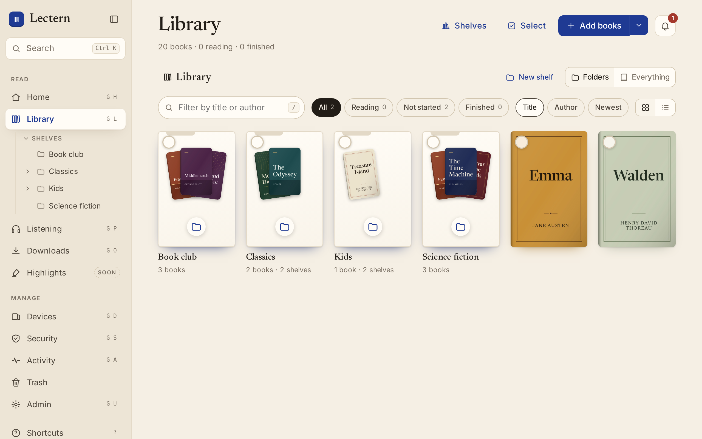
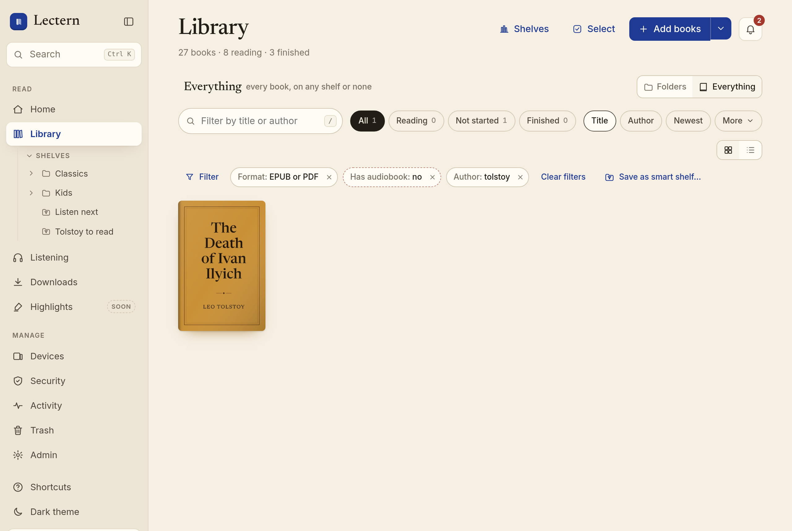
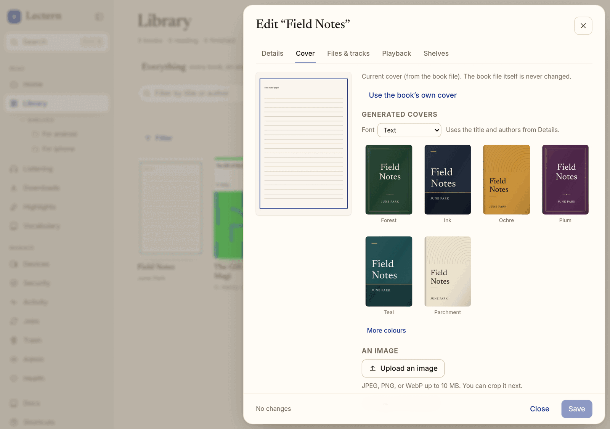
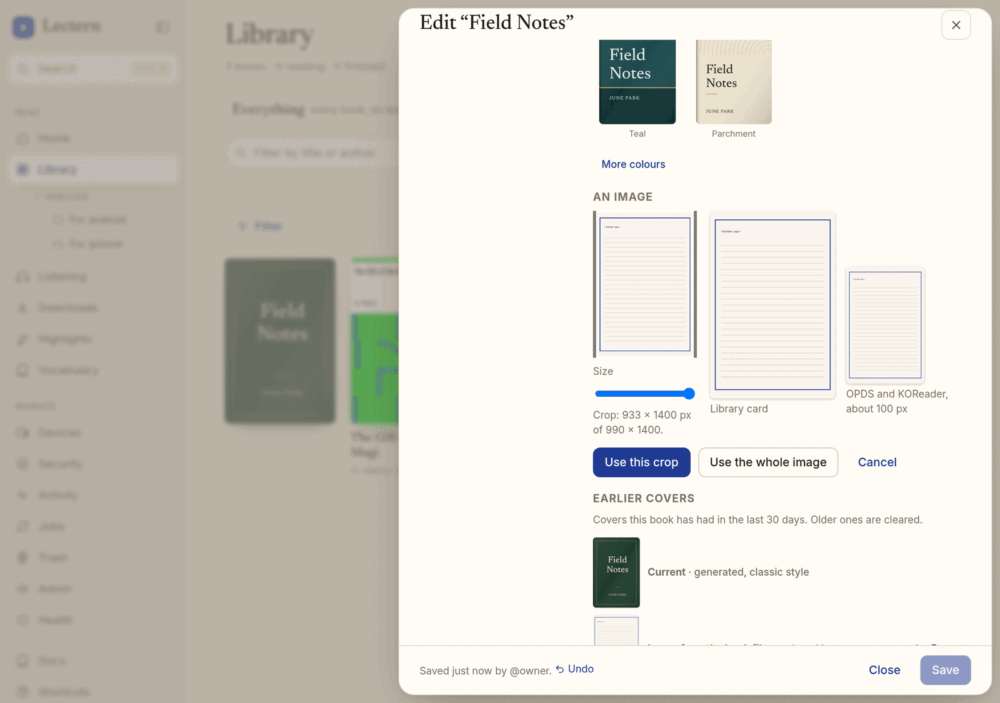
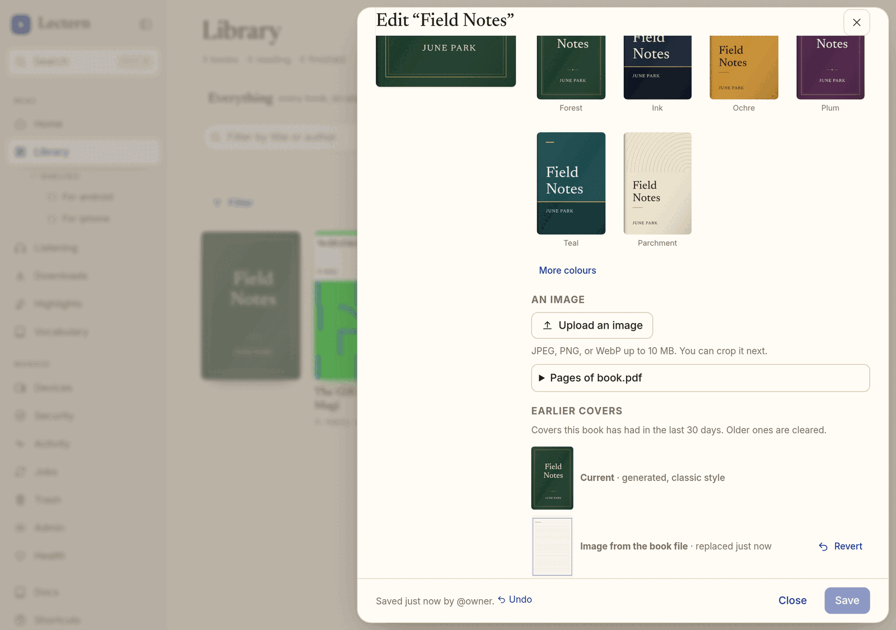
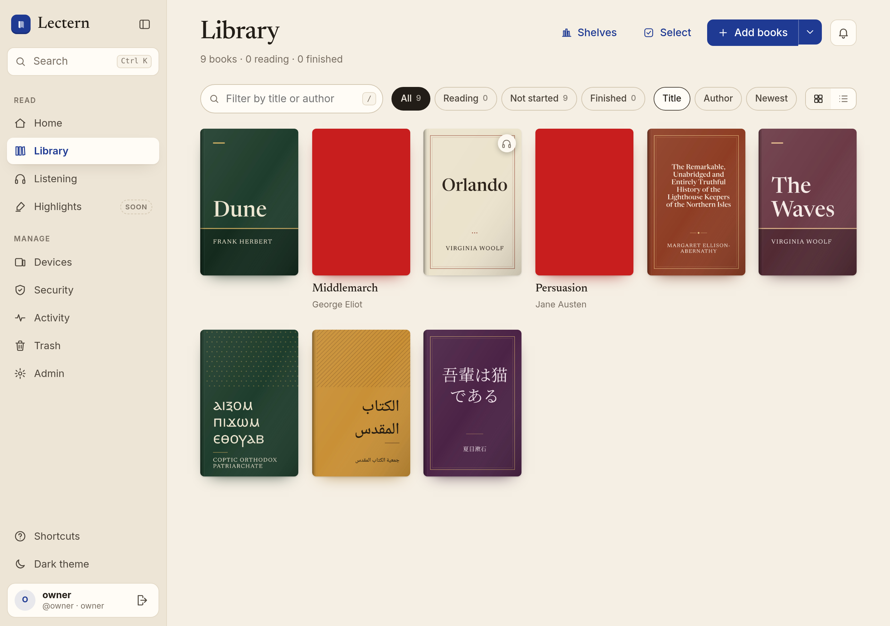
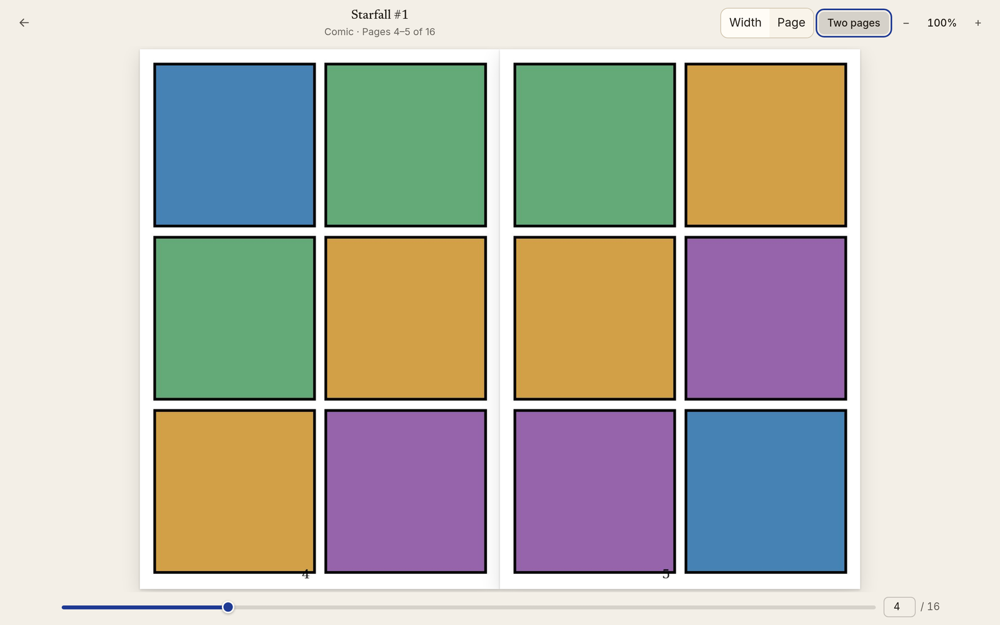
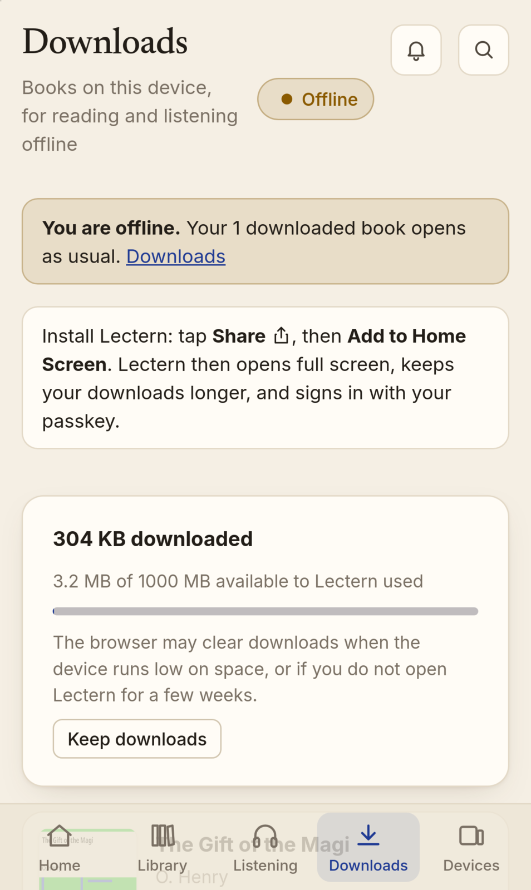

# Lectern

A self-hosted reading server that lets you store EPUBs, PDFs, Comics, audiobooks, and more. It has a web reader, an audiobook player, and extensions for KOReader for some e-readers.

## My Setup
I have this setup on a Raspberry Pi at home, running through Tailscale so it is not accessible by anything but my own devices! [`deploy/tailscale/`](deploy/tailscale/compose.yaml)

## Heads up!
This is entirely made with AI, and AI helped me with parts of the README too. Please expect this to be buggy, and use this at your own risk. I am not responsible for anything that happens :)

## Run

```sh
mkdir -p library/_inbox
LECTERN_BASE_URL=https://lectern.example docker compose up -d --build
docker compose logs lectern | grep -A3 "FIRST-RUN SETUP"
```
Open the printed setup link within 30 minutes to make the owner account. If setup is incomplete, restarting the server prints a new token. Ensure you have HTTP if using passkeys.

If running at home without a port (tailscale) [`deploy/tailscale/`](deploy/tailscale/compose.yaml):

```sh
mkdir -p library/_inbox data/lectern data/tailscale
cp .env.example .env && chmod 600 .env   # set LECTERN_BASE_URL and TS_AUTHKEY
docker compose --env-file .env -f deploy/tailscale/compose.yaml up -d --build
docker compose --env-file .env -f deploy/tailscale/compose.yaml logs lectern | grep -A3 "FIRST-RUN SETUP"
```

Starting from a blank Raspberry Pi? [`docs/pi-setup.md`](docs/pi-setup.md) guides you through flashing the pi all the way to setting up Lectern!!!

[`docs/deploy-tailscale.md`](docs/deploy-tailscale.md) also goes through the Tailscale setup.

eReaders can also sync over your home WiFi without Tailscale, optionally: [`docs/home-network.md`](docs/home-network.md)

## Make an audiobook

A book with no audiobook can be narrated into one with the **Make an audiobook** button on the platofrm. You can pick from open source engines (Pipr, Kokoro) or ElevenLabs optionally with an API KEY (untested! watch out!). See [`docs/tts.md`](docs/tts.md).

## Mac worker

A Mac with Apple Silicon can do the heavy work for a Raspberry Pi server: [`docs/mac-worker.md`](docs/mac-worker.md)

## KOReader plugin

**Devices → Add device** offers a per-device `lectern.koplugin.zip` for Kindle, Kobo, and
PocketBook. Copy the folder to `koreader/plugins` over USB; on first start it sets up progress
sync and the Lectern catalogue, then syncs automatically (pull on open, push on close, sleep,
and every 10 pages, queued while Wi‑Fi is off). Re-pair after a reset with a 6-digit code.
See [`docs/koreader-plugin.md`](docs/koreader-plugin.md), including Tailscale on a Kindle
(KUAL extension, kernel TUN mode).

## Backups

Nightly backups are opt-in, owner-only, and off by default: [docs/backups.md](docs/backups.md).

## Offline mode

You can guarantee Lectern runs completely offline with one switch, see: [docs/offline-mode.md](docs/offline-mode.md).

## Library

The Library is where all your books are stored! You can put your books in shelves (folders) that get their own address ('/app/library?shelf=1') and that syncs with everything. Shelves can be nested up to 8 times, and a book can be on multiple shelves, to help you sort your books however you like! 



### Filters and smart shelves

Filters help you sort books by specific attributes: [docs/filters.md](docs/filters.md).



### Auto-shelves

Auto-shelves is a shelf that fills itself based on specific attributes: See [docs/auto-shelves.md](docs/auto-shelves.md).

## Search inside books
Cmd/Control+K also searches inside your books- the index is in a separate file ('data/search.db') that stays up to date with updates. It is built to be fully capable on a Raspberry Pi! See: [`docs/search.md`](docs/search.md).

## Adding books

Members can add books from the website. Or copy them into `library/_inbox/`, which files them directly as before.


There are multiple methods you can use to add books:

- **Upload.** EPUB, PDF, CBZ comics, DRM-free MOBI/AZW3 (converted to EPUB), M4B/M4A, MP3, OGG/Opus, and FLAC go up through the resumable upload API in
  ≤ 50 MiB chunks, each with its own SHA-256, mainly because of Tailscale limits (You should be able to see a progress bar!)
- **Grouping.** You can put multiple files for each book (epub, audiobook, etc) in one book, to store all your different files for that book in one place!
- **Review before filing.** Uploads wait for your review, to confirm that they've been sorted correctly
- **Auto-file (optional, per person, off by default).** Security → *File certain matches
  automatically* files only certain matches (same ISBN, or exact title and author)


Rejected inbox files land in `library/_inbox/_rejected/`. Upload sessions expire after a day, unfiled ones after 7 days.

## Generated covers

A book with no cover art gets its own generated! There are 3 styles to use, I encourage you play around with them :)

The server draws the cover (SVG rasterised by resvg) and caches it as
`<work>/derived/cover-<key>.jpg`, so all devices have the same cover. There are also multiple fonts pre-installed if necessary: Coptic, Greek, Cyrillic, Arabic, Hebrew, and Devanagari use Noto fonts bundled in `src/lectern/fonts/`. Chinese, Japanese, and Korean use Noto Serif CJK (`fonts-noto-cjk`, in the Docker image).









## PDFs and comics

PDFs and CBZ Comics can be stored as epubs. Details: [`docs/pdf-comics.md`](docs/pdf-comics.md).

Lectern can read text pdfs, so those can be aligned, made into audio books, highlighted, etc. See: [`docs/pdf-read-along.md`](docs/pdf-read-along.md). 

A text PDF can also be converted into an epub, which gives you options for formatting: [`docs/pdf-epub.md`](docs/pdf-epub.md).

Scanned PDFs get your text recognised with Tesseract OCR: [`docs/ocr.md`](docs/ocr.md).

## Kindle books

DRM-free MOBI and AZW3 books are converted to EPUB when they arrive (in a resource-limited
child process) and filed as `book.epub` with their title, authors, ISBN, ASIN, language, and
cover. **DRM-protected books are refused. **Details: [`docs/kindle.md`](docs/kindle.md).



## Editing books

Editing a book allows you to edit title, sort title, authors, series/number, description, language, ISBN, publisher/date, tags/genres, narrators, cover, shellves, files/tracks, and audio playbackmode.


## Reading and listening in the browser

- **Reader** (`/app/reader/<id>`, **Read** on any book): Renders the EPUB
  [foliate-js](https://github.com/johnfactotum/foliate-js), in pages or as one scroll.
  Typography is saved to your account. The fonts include OpenDyslexic, Atkinson
  Hyperlegible, and Lexend, served by Lectern itself ([`frontend/fonts`](frontend/fonts/README.md)).
- **Listening** (`/app/listening`, `G` `P`): Saves chapters accross all tracks, adjustable speed remembered per book and synced accross your devices, skips, previous/next chapter (still buggy!), a sleep timer, lock-screen, headphone controls, mini-player for browsing while listening, and a lot more- play around with it :)
- **Data saver**: an optional ~64 kb/s copy (AAC by default, or Opus) made once with ffmpeg
  and cached under `<Author>/<Title>/derived/audio/`, for phones on a slow home uplink. A connected [worker](docs/mac-worker.md) makes it
  when there is one available, otherwise the server does, one file at a time with low priroity. Make it
  per book from the player or the book's editor (which also shows the space saved and
  deletes the copy), or set `LECTERN_AUDIO_LOW_AUTO=1` to make one after every audiobook
  import. Each account chooses when to use it (security)
- **One position per person per book**, shared by the reader, the player, and read-along.
  When another device moved on since this one last looked, Lectern asks
  ("iPhone 12, 6 min ago: 64% while listening. Continue here?") instead of jumping. KOReader keeps syncing through its own protocol and
  document hashes; its latest position is offered the same way.

## On your phone: install it, read and listen offline

Lectern installs as an app on iPhone (Safari **Share › Add to Home Screen**) and Android
(Chrome **Install app**), giving it its own icon and launch screen, full screen around the notch, and
passkey sign-in inside the app. You can also download books to keep them on the phone

Positions saved offline queue and sync when you reconnect! [`docs/offline.md`](docs/offline.md).



## Household

You can invite other users to your Lectern instance, making a one-time-use line for a member (can access whole library and upload books) or a reader (sees only shelves you share). Everyone's progress stays their own

## Security alerts and download limits

Lectern notifies you (the bell in the top bar) and the owner when your account signs in from a
browser it has not seen, when a new KOReader or OPDS device first connects, and when many books
are downloaded in a short time. Whole-file downloads (EPUBs, original audio, the reader's copy,
narrated EPUBs) count against an hourly cap per account and per OPDS device; over the cap the
download is refused with a clear message and a `download.blocked` audit event. The owner can set
per-user caps in the admin panel, and each person sets per-device caps under devices.


Streaming counts once per device and audiobook per hour after 8 MiB have actually been sent
(seeking and skipping chapters are free), and read-along text once per book per hour. Members and readers can lower their own
device caps; only the owner can raise them. Notifications are in-app only; email and webhook
delivery can be added as a `lectern.notify` sink (see `docs/contracts.md`) without changing
the callers.

## KOReader

Open **Devices → Add device** (or press `N`). You can download the custom extension for KOReader that will sync between your ereader and Lectern automatically! (Tested on my Kindle Paperwhite 11th gen, unsure about other devices)

### Send to device

**Send to device** on a book (or **Select** several in the Library) queues it for one
e-reader. For more details see: [`docs/device-queues.md`](docs/device-queues.md).

## Read-along

When a work has an EPUB, its audiobook, and a finished text–audio alignment, its **Formats**
list (the expanded card on Home, or the book sheet in the Library) offers:

- Read-along in the browser
- Narrated Epub 3 with audio overlays

Few apps play Media Overlays: Thorium Reader does; BookFusion and Colibrio are reported to;
**KOReader, Kobo/Kindle e-readers, and Apple Books (reflowable books) do not** and show the
narrated EPUB as an ordinary book. Details, the state machine, the EPUB 2 → 3 upgrade, and
validation with epubcheck are in [`docs/read-aloud.md`](docs/read-aloud.md).

## Audiobooks and alignment

Once you put an audiobook's files next to it's epub file (`library/<Author>/<Title>/`, subfolders work too), Lectern fines them and queues an alignment, which transcribes the audio and matches to the text sentence by sentence. After that, you can have one position synced between KOReader, the website read-along, and listening.

Transcription is CPU-heavy (about 3× realtime on two x86 cores with the default `small`
model). Audio is decoded as a stream and transcribed in five-minute windows, so memory does
not grow with the length of a file: a 10-hour single-file audiobook needs no more than a
chapter. The server runs each alignment in a separate, lower-priority process with a memory
cap, so running out of memory or a crash fails that job (with the log kept) and never takes
the server down. The default image does not transcribe; either build with
`--build-arg LECTERN_EXTRAS=align` (`"align tts"` adds Piper as well), or keep the server
small (`LECTERN_ALIGN_LOCAL_WORKER=0`) and run `lectern worker --server
https://lectern.example` on a laptop or GPU box with an owner-issued worker key. 

More info: [`docs/alignment.md`](docs/alignment.md).

## AI apps (MCP)

AI apps on your tailnet, such as Claude Desktop and Claude Code, can add books, search and
organize the library, send books to an e-reader, start alignment, and fix metadata through
the MCP endpoint at `/mcp` (Streamable HTTP). Details in [`docs/mcp.md`](docs/mcp.md).


## Configuration

| Variable | Default | Purpose |
| --- | --- | --- |
| `LECTERN_BASE_URL` | `http://localhost:8080` | Public origin; passkey RP ID derives from it |
| `LECTERN_DATA_DIR` | `/data` | SQLite database and generated signing key |
| `LECTERN_LIBRARY_DIR` | `/library` | Book storage |
| `LECTERN_INBOX_DIR` | `<library>/_inbox` | Watched folder |
| `LECTERN_INSECURE_HTTP` | `0` | Drop the Secure cookie flag (development only) |
| `LECTERN_SECRET_KEY` | generated | Signing key; persisted under the data dir if unset |
| `LECTERN_SESSION_TTL_SECONDS` | 30 days | Browser session lifetime |
| `LECTERN_OFFLINE_MAX_AGE_SECONDS` | 14 days | How long the installed app keeps downloads without reaching the server ([offline.md](docs/offline.md#signing-out)) |
| `LECTERN_LOGIN_MAX_FAILURES` | 5 | Failures per account before lockout |
| `LECTERN_LOGIN_LOCKOUT_SECONDS` | 900 | Lockout window |
| `LECTERN_RATE_LIMIT_PER_MINUTE` | 60 | Per-IP limit on OPDS/sync auth attempts |
| `LECTERN_UPLOAD_MAX_BYTES` | 4 GiB | Largest file a resumable upload may declare |
| `LECTERN_UPLOAD_DIRECT_MAX_BYTES` | 200 MiB | Largest EPUB on the one-request `POST /api/books/upload` |
| `LECTERN_UPLOAD_QUOTA_BYTES` | 16 GiB | Total declared size of one user's unfinished uploads |
| `LECTERN_UPLOAD_MAX_ACTIVE` | 5 | Unfinished upload sessions per user |
| `LECTERN_UPLOAD_SESSION_TTL_SECONDS` | 1 day | Unfinished uploads expire and are swept after this |
| `LECTERN_DOWNLOAD_CAP_PER_HOUR` | 120 | Whole-file downloads per account per hour (0 = no cap); per-user override in Admin |
| `LECTERN_DOWNLOAD_DEVICE_CAP_PER_HOUR` | 60 | Downloads per OPDS device per hour (0 = no cap); per-device override in Devices |
| `LECTERN_DOWNLOAD_BURST_COUNT` / `_WINDOW_SECONDS` | 20 / 600 | This many downloads within the window alerts the user and the owner |
| `LECTERN_STREAM_METER_BYTES` | 8388608 | Bytes of one audiobook actually sent to a device in an hour before it counts as a download |
| `LECTERN_FFMPEG_PATH` / `LECTERN_FFPROBE_PATH` | `ffmpeg` / `ffprobe` | Audio metadata, data-saver copies, sleep-timer rewind (installed in the Docker image) |
| `LECTERN_AUDIO_LOW_CODEC` | `aac` | Data-saver codec: `aac` (plays everywhere, iOS included) or `opus` |
| `LECTERN_AUDIO_LOW_BITRATE_KBPS` | 64 | Data-saver bitrate |
| `LECTERN_AUDIO_LOW_AUTO` | false | Make a data-saver copy after every audiobook import |
| `LECTERN_TRANSCODE_MEMORY_LIMIT_MB` | 1024 | Address-space cap for the server's own data-saver ffmpeg (0 = none); it also runs on one thread at `nice` 19 |
| `LECTERN_MCP_REQUESTS_PER_MINUTE` | 240 | MCP requests per minute per AI key (upload chunks included) |
| `LECTERN_MCP_BURST_COUNT` / `_WINDOW_SECONDS` | 200 / 600 | This many AI tool calls by one key within the window alerts the user and the owner (0 = off) |
| `LECTERN_WORKER_REQUESTS_PER_MINUTE` | 1200 | Requests per minute per valid worker key (failed worker logins use the per-IP limit) |
| `LECTERN_ALIGN_MODEL` | `small` | faster-whisper model for alignment ([more settings](docs/alignment.md#transcription)) |
| `LECTERN_ALIGN_LOCAL_WORKER` | `1` | Align in the server when faster-whisper is installed; `0` leaves jobs to `lectern worker` |
| `LECTERN_ALIGN_WINDOW_SECONDS` / `_OVERLAP_SECONDS` | 300 / 15 | Audio transcribed at a time, and shared by neighbouring windows; memory grows with the window, not the book |
| `LECTERN_ALIGN_MEMORY_LIMIT_MB` | 75 % of RAM or the container limit | Resident-memory cap of the alignment process (the job fails above it); `0` = none of our own |
| `LECTERN_BACKGROUND_JOBS` | `1` | Audio rescans, lease sweeps, and the local worker |
| `LECTERN_TRUSTED_PROXIES` | empty | Comma-separated IPs/CIDRs of reverse proxies whose `X-Forwarded-For` is believed (`127.0.0.1` for `tailscale serve`); empty trusts nobody |
| `LECTERN_TRUST_CF_CONNECTING_IP` | false | Also believe `CF-Connecting-IP` from a trusted proxy. Only for Cloudflare Tunnel, with `LECTERN_TRUSTED_PROXIES` limited to the `cloudflared` connector; any other proxy passes the header through from the client |

## Security model

Please see [docs/security-model.md](docs/security-model.md).

## What Lectern does not do

- No DRM remova
- No book searching from the internet

The data model and API contracts for audiobooks, text–audio alignment, shelves, invites, and
external alignment workers are in [`docs/contracts.md`](docs/contracts.md) if your agent needs to see it. Read-along never
fetches anything either, all the data is from your library.

## Development

```sh
uv sync --extra dev
uv run pytest                     # set EPUBCHECK_JAR to also run epubcheck (docs/read-aloud.md)
LECTERN_DATA_DIR=./data LECTERN_LIBRARY_DIR=./library LECTERN_INSECURE_HTTP=1 uv run lectern
```

### Web app

The UI is a React + Vite single-page app in `frontend/`, built into `src/lectern/static/app`
(git-ignored; the Docker image builds it) and served at `/app` behind the session cookie. It
talks only to the authenticated JSON API under `/api`; every write sends the per-session
`X-CSRF-Token` header. Setup and login stay server-rendered.

```sh
npm --prefix frontend ci
npm --prefix frontend run build      # one-off build that FastAPI serves at /app

# Live reload: run the backend as above on :8080, then
npm --prefix frontend run dev        # http://localhost:5173/app/
```

`npm run dev` proxies `/api`, `/login`, `/logout`, `/setup`, `/library`, and `/static` to
`http://127.0.0.1:8080` and keeps the browser's `Host`. With `LECTERN_INSECURE_HTTP=1`, as in
the command above, cookies and the CSRF/same-origin checks behave as in production. Sign in at
`http://localhost:5173/login`.

Phone tests (iPhone on WebKit, Android on Chromium, offline included): `npm --prefix frontend
run e2e` after a build; see [`docs/offline.md#tests`](docs/offline.md#tests).

Keyboard: `⌘/Ctrl K` search, `/` filter, `N` add device, `G` then `H`/`L`/`O`/`D`/`S`/`A`,
`T` theme, `[` sidebar, `Esc` close, `?` all shortcuts. Screenshots: `docs/screenshots/`.

End-to-end tests (Playwright, Chromium) start a freshly seeded server on `:8090`
(`frontend/e2e/serve.sh`: 360 books, owner `owner` / `e2e correct horse battery`) against
the built app:

```sh
npm --prefix frontend run build
npx --prefix frontend playwright install chromium   # once
(cd frontend && npx playwright test)
```
