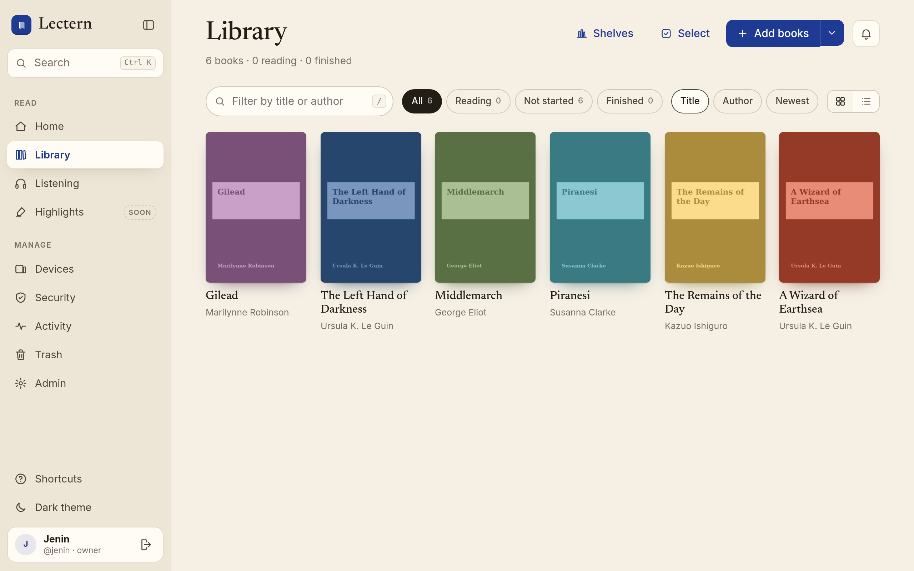
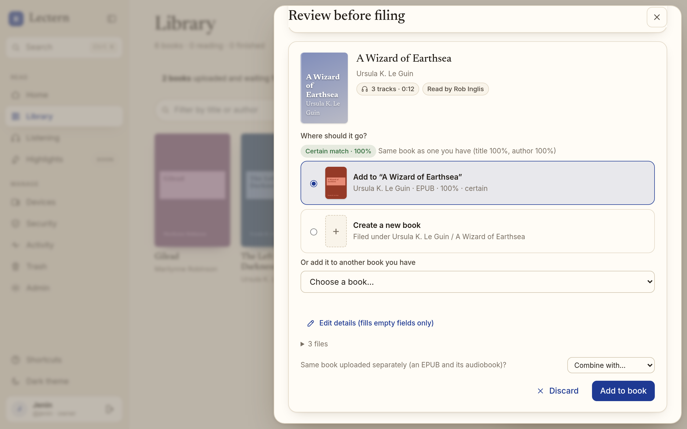
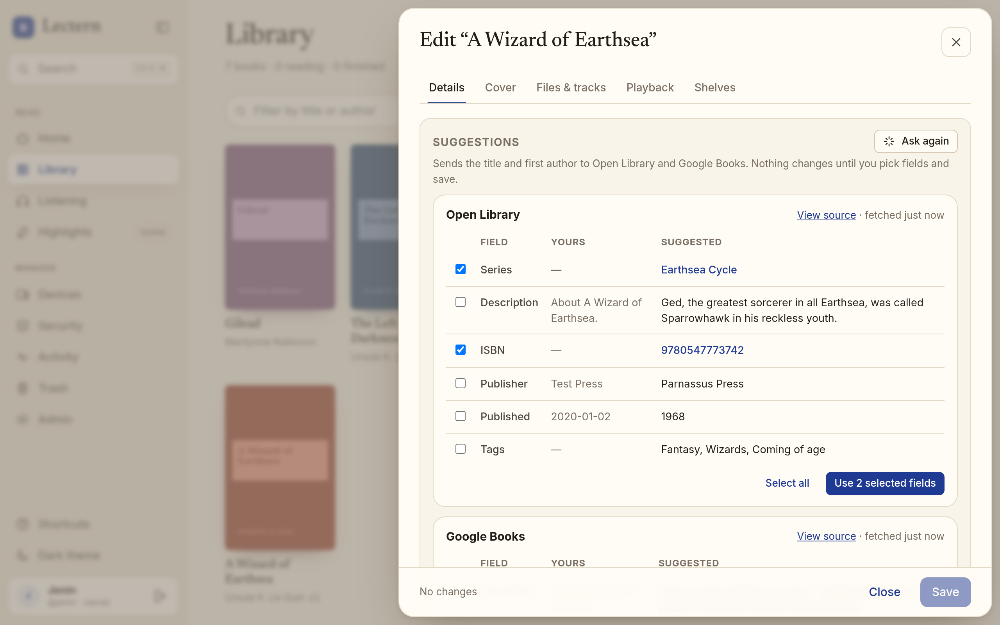
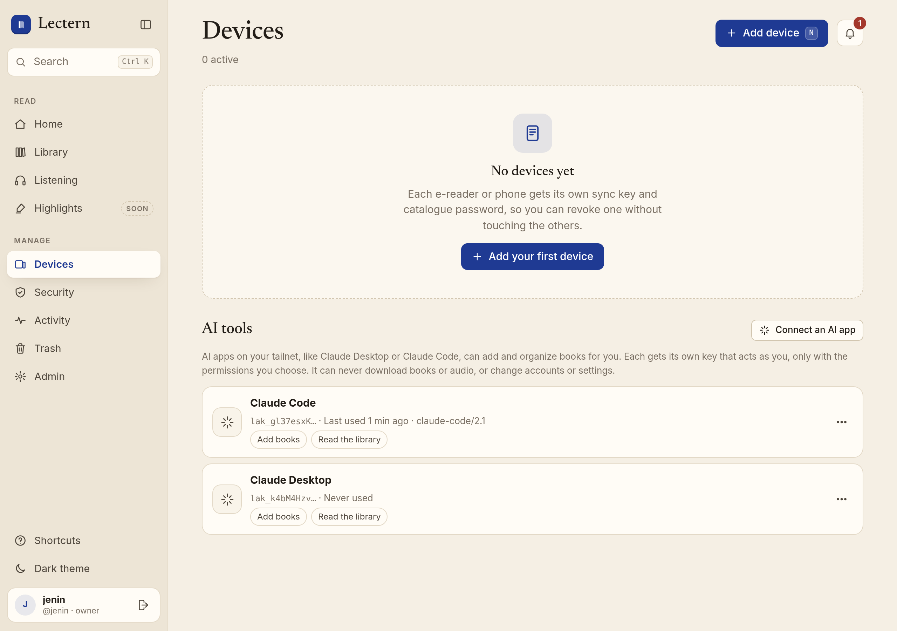

# Lectern

Self-hosted reading server for one household: a library of works (EPUBs and their
audiobooks), a web reader and audiobook player, an authenticated OPDS catalogue with a
per-device "send to device" queue, KOReader progress sync between devices, household
accounts with shared shelves, text–audio alignment of audiobooks, and read-along for books
with an aligned audiobook.

## Run

```sh
mkdir -p library/_inbox
LECTERN_BASE_URL=https://lectern.example docker compose up -d --build
docker compose logs lectern | grep -A3 "FIRST-RUN SETUP"
```

Open the printed `/setup?token=…` link within 30 minutes to create the owner account.
Registration closes permanently after that. Restarting the server mints a new token
only while setup is incomplete.

Put a TLS-terminating reverse proxy in front of port 8080. Passkeys require HTTPS and a
stable hostname; until then, password + TOTP sign-in works. For local plain-http testing
set `LECTERN_INSECURE_HTTP=1` and `LECTERN_BASE_URL=http://localhost:8080`.

Running at home without opening a port, for example on a Raspberry Pi? The repository ships
a ready-to-use Lectern + Tailscale setup in [`deploy/tailscale/`](deploy/tailscale/compose.yaml);
you only fill in `.env` and never edit tracked files, so `git pull` stays conflict-free:

```sh
mkdir -p library/_inbox data/lectern data/tailscale
cp .env.example .env && chmod 600 .env   # set LECTERN_BASE_URL and TS_AUTHKEY
docker compose --env-file .env -f deploy/tailscale/compose.yaml up -d --build
docker compose --env-file .env -f deploy/tailscale/compose.yaml logs lectern | grep -A3 "FIRST-RUN SETUP"
```

[`docs/deploy-tailscale.md`](docs/deploy-tailscale.md) walks through it: `tailscale serve`
gives you a trusted HTTPS address on your private tailnet (so passkeys work), nothing is
published on the LAN or the Internet, and it covers Raspberry Pi 4 specifics, cloning a
private repository with a read-only deploy key, upgrades, backups, and Kindle/Kobo with
KOReader. With any other reverse proxy in front, set
`LECTERN_TRUSTED_PROXIES` to its address so rate limits and the audit log see your readers'
IPs instead of the proxy's. Lectern's own sign-in is always required, private network or not.

## Adding books

Owners and members add books from the web app: **Add books** in the Library (its menu also has
**Choose a folder** for one multi-track audiobook), **B** or "Add books or audiobooks" in the
Cmd/Ctrl+K palette, or drop files or whole folders anywhere on the page. Or copy them into
`library/_inbox/`, which files them directly as before.



- **Upload.** EPUB, M4B/M4A, MP3, OGG/Opus, and FLAC go up through the resumable upload API in
  ≤ 50 MiB chunks, each with its own SHA-256. The tray shows live progress per file with pause,
  resume, cancel, and retry, grouped by book. Wrong formats, files over the server limit, and
  exact duplicates are reported in plain words before anything is filed.
- **Grouping.** Each EPUB and M4B is its own book. Audio tracks in one folder are one
  audiobook (with that folder's EPUB, if it has exactly one); `CD 1`/`Disc 2` subfolders are
  merged. Loose MP3s dropped together are one audiobook. You can combine or split during review.
- **Review before filing.** Uploads wait in **Review before filing** with what Lectern detected:
  title, authors, series and number, cover, language, ISBN, narrators, and a proposed match to
  a book you already have, with its confidence and reason. Accept it, edit any field, pick
  another book, or file it as a new one. Joining an existing book only fills its empty fields;
  adding audio to a book that already has an audiobook needs an explicit "add as more tracks".
- **Auto-file (optional, per person, off by default).** Security → *File certain matches
  automatically* files only certain matches (same ISBN, or exact title and author); anything
  else still waits for review.
- **Filing** reads metadata the same way for uploads and the inbox (OPF incl. Calibre/EPUB 3
  series and `nrt` narrators; audio tags incl. narrator and series), stores
  `library/<Author>/<Title>/book.epub`, `cover.jpg`, `audio/D01-T001 <name>.<ext>`, and a
  `book.json` sidecar with the work's metadata.



Rejected inbox files land in `library/_inbox/_rejected/`. Upload sessions expire after a day;
unfiled reviews after 7 days. Limits: `LECTERN_UPLOAD_MAX_BYTES` per file,
`LECTERN_UPLOAD_QUOTA_BYTES` in flight per user.

## Editing books

**Edit** on a book (or "Edit …" in Cmd/Ctrl+K) opens the full editor: title and sort title;
several authors with sort names; series and number; description; language; ISBN; publisher and
date; tags and genres; narrators; cover (upload, the EPUB's own, or none); shelves; files and
tracks (primary EPUB, remove a format, reorder and rename tracks, chapter titles); and playback
(default mode, read-along on or off, re-run alignment with a chosen model, regenerate the
read-aloud EPUB).

- **One save, one undo.** Save sends one versioned change. The toast and the save bar offer
  **Undo** for that save while nobody has saved since. Closing with unsaved edits asks first.
- **Concurrent edits.** If someone else saved meanwhile, nothing is overwritten: you choose
  "use their version" or "keep my edits on top".
- **Files stay untouched.** The original EPUB is never rewritten. Changing author or title moves
  the folder atomically to `<Author>/<Title>` (with a ` (2)` suffix on collisions, and a
  verified copy when it crosses filesystems); renaming tracks renames files. Bytes, SHA-256,
  and KOReader document ids are unchanged, so device sync keeps working. Text or audio changes
  re-queue alignment with the same model.
- **Bulk edit.** **Select** in the Library sets author or series, adds or removes tags and
  shelves, or trashes many books at once, with one Undo for the batch.
- **Trash.** Trashed books and removed files are hidden at once and stay restorable from
  **Trash** for 30 days; a background job then deletes them. Only the owner can delete early.
- **Metadata suggestions (optional, off by default).** The owner can enable them in Admin.
  The editor then asks Open Library and Google Books (no key) for the ISBN, or the title and
  first author, and shows suggestions side by side with their source. You apply them field by
  field; nothing is written until you save.

Readers never see add, edit, or trash controls, and the API refuses them (`403`).



## Reading and listening in the browser

- **Reader** (`/app/reader/<id>`, **Read** on any book): the EPUB rendered with
  [foliate-js](https://github.com/johnfactotum/foliate-js), in pages or as one scroll.
  Typography (font, size, line spacing, margins, line length, justification) and themes
  (light, warm, warm dark, or follow the app) are kept per browser. `←`/`→` turn pages.
- **Listening** (`/app/listening`, `G` `P`): chapters across all tracks, 0.8–3× speed,
  ±15/30 s skips, a sleep timer (minutes or end of chapter) that fades out and rewinds to the
  start of the last sentence heard, lock-screen and headphone controls (Media Session), and a
  mini-player that keeps playing while you browse (above the tab bar on phones). Audio streams
  with HTTP range requests; originals stay downloadable.
- **Data saver**: an optional ~64 kb/s copy (AAC by default, or Opus) made once with ffmpeg
  and cached under `<Author>/<Title>/derived/audio/`, for phones on a slow home uplink.
  Originals are never touched. Make it per book from the player, or set
  `LECTERN_AUDIO_LOW_AUTO=1` to make one after every audiobook import.
- **One position per person per book**, shared by the reader, the player, and read-along.
  When another device moved on since this one last looked, Lectern asks
  ("Pixel 8, 12 min ago: 64% while listening. Continue here?") instead of jumping. Until a
  book's audio is aligned, conversions between text and audio positions are proportional
  estimates and are labelled as such. KOReader keeps syncing through its own protocol and
  document hashes; its latest position is offered the same way.

## Household

The owner invites people from **Admin → Household invites**: an expiring, one-use link for a
*member* (sees the whole library and can upload) or a *reader* (sees only the shelves shared
with them). The invitee picks their own username and password. Shelves (**Library → Shelves**)
group books; their owner shares them with readers, view-only or with permission to add books.
Everyone's progress is their own.

## Security alerts and download limits

Lectern notifies you (the bell in the top bar) and the owner when your account signs in from a
browser it has not seen, when a new KOReader or OPDS device first connects, and when many books
are downloaded in a short time. Whole-file downloads (EPUBs, original audio, the reader's copy,
narrated EPUBs) count against an hourly cap per account and per OPDS device; over the cap the
download is refused with a clear message and a `download.blocked` audit event. The owner sets
per-user caps under **Admin**, and each person sets per-device caps under **Devices**.
Streaming counts once per device and audiobook per hour after 8 MiB have actually been sent
(seeking and skipping chapters are free), and read-along text once per book per hour. Members and readers can lower their own
device caps; only the owner can raise them. Notifications are in-app only; email and webhook
delivery can be added as a `lectern.notify` sink (see `docs/contracts.md`) without changing
the callers.

## KOReader

Open **Devices → Add device** (or press `N`). Each device gets a KOReader sync key and an OPDS
app password together. Both are shown once and revoked together. The sheet shows the exact
values to enter, then waits and confirms the device's first sync live.

- Progress sync: Tools → Progress sync → Custom sync server → `https://lectern.example/`,
  then **Login** (not Register) with your Lectern username and the sync key.
- Catalogue: OPDS catalog → add `https://lectern.example/opds` with your username and
  the app password. Its first page is made for e-ink: **Continue reading**, **Up next**
  (unstarted books on your shelves), and **Queued for this device**, then the whole library.

### Send to device

**Send to device** on a book (or **Select** several in the Library) queues it for one
e-reader. It shows up first in that device's catalogue and leaves the queue when that device
has downloaded the whole EPUB; another device, a browser download, a range request, or a
conditional `304` never counts. Everyone sends to their own devices; the owner can send to
anyone's, but only books that person can see. Queues are on **Devices → Open queue**. Details,
delivery rules, and the API: [`docs/device-queues.md`](docs/device-queues.md).

## Read-along

When a work has an EPUB, its audiobook, and a finished text–audio alignment, its **Formats**
list (the expanded card on Home, or the book sheet in the Library) offers:

- **Read-along** in the browser: the sentence being spoken is highlighted; click a sentence to
  play from it; the page follows the narration until you scroll away. Separate speeds for
  reading along and for listening only; keyboard (`Space`, `←`/`→`, `<`/`>`, `F`) and
  screen-reader support; your position is saved.
- **Narrated EPUB**: the book with EPUB 3 Media Overlays and the audio inside, built on request
  and cached at `<Author>/<Title>/derived/read-aloud.epub`. Download requires sign-in like any
  other download. The plain `book.epub` is never changed, so KOReader sync is unaffected.

Few apps play Media Overlays: Thorium Reader does; BookFusion and Colibrio are reported to;
**KOReader, Kobo/Kindle e-readers, and Apple Books (reflowable books) do not** and show the
narrated EPUB as an ordinary book. Details, the state machine, the EPUB 2 → 3 upgrade, and
validation with epubcheck are in [`docs/read-aloud.md`](docs/read-aloud.md).

## Audiobooks and alignment

Put an audiobook's files next to its `book.epub` (`library/<Author>/<Title>/`, subfolders
allowed). Lectern finds them within a minute and queues an alignment, which transcribes the
audio with faster-whisper and matches it to the text sentence by sentence. After that, one
position follows you between KOReader, the web read-along, and listening: KOReader's sync
jumps to the sentence you were listening to, and audio resumes where KOReader stopped.

Transcription is CPU-heavy (about 3× realtime on two x86 cores with the default `small`
model). Audio is decoded as a stream and transcribed in five-minute windows, so memory does
not grow with the length of a file: a 10-hour single-file audiobook needs no more than a
chapter. The server runs each alignment in a separate, lower-priority process with a memory
cap, so running out of memory or a crash fails that job (with the log kept) and never takes
the server down. The default image does not transcribe; either build with
`--build-arg LECTERN_EXTRAS=align`, or keep the server small (`LECTERN_ALIGN_LOCAL_WORKER=0`)
and run `lectern worker --server https://lectern.example` on a laptop or GPU box with an
owner-issued worker key. Setup, settings, memory and benchmark numbers, failure handling, and
how matching handles intros and missing or abridged chapters are in
[`docs/alignment.md`](docs/alignment.md).

## AI apps (MCP)

AI apps on your tailnet, such as Claude Desktop and Claude Code, can add books, search and
organize the library, send books to an e-reader, start alignment, and fix metadata through
the MCP endpoint at `/mcp` (Streamable HTTP). **Devices → AI tools → Connect an AI app** creates
a key and shows the exact configuration for each app, then confirms the first connection.
Each key acts as you, limited to the scopes you choose (`upload` by default, `read`,
`organize`). It is accepted nowhere but `/mcp`, so it can never download books or audio or
manage accounts, keys, or settings. Every call is rate limited and audited. A key's first use
and bursts of calls raise alerts. Keep it private: no Funnel, no public exposure. Details in
[`docs/mcp.md`](docs/mcp.md).



## Configuration

| Variable | Default | Purpose |
| --- | --- | --- |
| `LECTERN_BASE_URL` | `http://localhost:8080` | Public origin; passkey RP ID derives from it |
| `LECTERN_DATA_DIR` | `/data` | SQLite database and generated signing key |
| `LECTERN_LIBRARY_DIR` | `/library` | Book storage |
| `LECTERN_INBOX_DIR` | `<library>/_inbox` | Watched folder |
| `LECTERN_INSECURE_HTTP` | `0` | Drop the Secure cookie flag (development only) |
| `LECTERN_SECRET_KEY` | generated | Signing key; persisted under the data dir if unset |
| `LECTERN_SESSION_TTL_SECONDS` | 30 days | Browser session lifetime |
| `LECTERN_LOGIN_MAX_FAILURES` | 5 | Failures per account before lockout |
| `LECTERN_LOGIN_LOCKOUT_SECONDS` | 900 | Lockout window |
| `LECTERN_RATE_LIMIT_PER_MINUTE` | 60 | Per-IP limit on OPDS/sync auth attempts |
| `LECTERN_UPLOAD_MAX_BYTES` | 4 GiB | Largest file a resumable upload may declare |
| `LECTERN_UPLOAD_DIRECT_MAX_BYTES` | 200 MiB | Largest EPUB on the one-request `POST /api/books/upload` |
| `LECTERN_UPLOAD_QUOTA_BYTES` | 16 GiB | Total declared size of one user's unfinished uploads |
| `LECTERN_UPLOAD_MAX_ACTIVE` | 5 | Unfinished upload sessions per user |
| `LECTERN_UPLOAD_SESSION_TTL_SECONDS` | 1 day | Unfinished uploads expire and are swept after this |
| `LECTERN_DOWNLOAD_CAP_PER_HOUR` | 120 | Whole-file downloads per account per hour (0 = no cap); per-user override in Admin |
| `LECTERN_DOWNLOAD_DEVICE_CAP_PER_HOUR` | 60 | Downloads per OPDS device per hour (0 = no cap); per-device override in Devices |
| `LECTERN_DOWNLOAD_BURST_COUNT` / `_WINDOW_SECONDS` | 20 / 600 | This many downloads within the window alerts the user and the owner |
| `LECTERN_STREAM_METER_BYTES` | 8388608 | Bytes of one audiobook actually sent to a device in an hour before it counts as a download |
| `LECTERN_FFMPEG_PATH` / `LECTERN_FFPROBE_PATH` | `ffmpeg` / `ffprobe` | Audio metadata, data-saver copies, sleep-timer rewind (installed in the Docker image) |
| `LECTERN_AUDIO_LOW_CODEC` | `aac` | Data-saver codec: `aac` (plays everywhere, iOS included) or `opus` |
| `LECTERN_AUDIO_LOW_BITRATE_KBPS` | 64 | Data-saver bitrate |
| `LECTERN_AUDIO_LOW_AUTO` | false | Make a data-saver copy after every audiobook import |
| `LECTERN_MCP_REQUESTS_PER_MINUTE` | 240 | MCP requests per minute per AI key (upload chunks included) |
| `LECTERN_MCP_BURST_COUNT` / `_WINDOW_SECONDS` | 200 / 600 | This many AI tool calls by one key within the window alerts the user and the owner (0 = off) |
| `LECTERN_WORKER_REQUESTS_PER_MINUTE` | 1200 | Requests per minute per valid worker key (failed worker logins use the per-IP limit) |
| `LECTERN_ALIGN_MODEL` | `small` | faster-whisper model for alignment ([more settings](docs/alignment.md#transcription)) |
| `LECTERN_ALIGN_LOCAL_WORKER` | `1` | Align in the server when faster-whisper is installed; `0` leaves jobs to `lectern worker` |
| `LECTERN_ALIGN_WINDOW_SECONDS` / `_OVERLAP_SECONDS` | 300 / 15 | Audio transcribed at a time, and shared by neighbouring windows; memory grows with the window, not the book |
| `LECTERN_ALIGN_MEMORY_LIMIT_MB` | 75 % of RAM or the container limit | Resident-memory cap of the alignment process (the job fails above it); `0` = none of our own |
| `LECTERN_BACKGROUND_JOBS` | `1` | Audio rescans, lease sweeps, and the local worker |
| `LECTERN_TRUSTED_PROXIES` | empty | Comma-separated IPs/CIDRs of reverse proxies whose `X-Forwarded-For` is believed (`127.0.0.1` for `tailscale serve`); empty trusts nobody |
| `LECTERN_TRUST_CF_CONNECTING_IP` | false | Also believe `CF-Connecting-IP` from a trusted proxy. Only for Cloudflare Tunnel, with `LECTERN_TRUSTED_PROXIES` limited to the `cloudflared` connector; any other proxy passes the header through from the client |

## Security model

- Every route except `/healthz`, `/login`, and `/setup` requires authentication. The
  exception is `/app/assets/*`: content-hashed JS, CSS, and fonts built from `frontend/`,
  with no data or configuration in them. The app shell at `/app` and every `/api` route
  require a session.
- Owner password: argon2id. TOTP optional. Passkeys preferred.
- Sessions, sync keys, app passwords, and the setup token are 256-bit random secrets;
  only their SHA-256 digests are stored.
- Cookies are `HttpOnly; Secure; SameSite=Lax`; state-changing browser requests need a
  per-session CSRF token and a same-origin `Origin`/`Sec-Fetch-Site`.
- Roles: owner (user admin, invites, audit log, worker keys), member (whole library,
  uploads, can request alignments), reader (only shelves shared with them; everything else
  answers 404, OPDS and KOReader progress projection included).
- Alerts for new sign-ins, new devices, and download bursts; hourly download caps per account
  and per device (see above).
- AI apps authenticate at `/mcp` with a per-user `lak_…` key (stored hashed, revocable,
  scoped to `upload`/`read`/`organize`) that acts only with its user's permissions and opens
  nothing else; no MCP tool returns book files or audio ([docs/mcp.md](docs/mcp.md)).
- External alignment workers authenticate with an owner-issued `lw_…` key (stored hashed,
  revocable) that opens only `/api/worker/*`, and only the inputs of jobs they hold a lease on.
- Per-IP rate limits, per-account lockout, and an audit log of logins, credential
  changes, and downloads (narrated EPUBs included). The client IP is the socket peer unless that peer is listed in
  `LECTERN_TRUSTED_PROXIES`; only then is `X-Forwarded-For` honoured, read right to left so a
  client-supplied entry is never believed. `CF-Connecting-IP` is ignored unless
  `LECTERN_TRUST_CF_CONNECTING_IP` is on (details in `docs/contracts.md`).
- `POST /users/create` (KOReader's Register button) always returns 403; keys come from
  the web UI.
- Non-goals: anonymous access, and the two below.

## What Lectern does not do

- **No DRM removal or circumvention.** Lectern only reads EPUBs and audio files you already own
  and can open. It contains no code to strip, bypass, or work around any copy protection.
- **No book searching or downloading integrations.** There is no catalogue search, no
  connection to any download site, store, or torrent/IRC/Usenet source, and no fetching of
  books or audiobooks from the Internet. Content enters the library only through your own
  uploads and the inbox folder. Optional metadata suggestions only fetch descriptive
  fields (title, authors, description, ISBN, …) from Open Library and Google Books when the
  owner enables them; they never search for, link to, or download book files. (The test suite contains one documented public-domain fixture
  from Project Gutenberg and LibriVox; see `tests/fixtures/magi/PROVENANCE.md`.)

The data model and API contracts for audiobooks, text–audio alignment, shelves, invites, and
external alignment workers are in [`docs/contracts.md`](docs/contracts.md). Read-along never
fetches anything either: it works only from audio and alignments already in your library.

## Development

```sh
uv sync --extra dev
uv run pytest                     # set EPUBCHECK_JAR to also run epubcheck (docs/read-aloud.md)
LECTERN_DATA_DIR=./data LECTERN_LIBRARY_DIR=./library LECTERN_INSECURE_HTTP=1 uv run lectern
```

### Web app

The UI is a React + Vite single-page app in `frontend/`, built into `src/lectern/static/app`
(git-ignored; the Docker image builds it) and served at `/app` behind the session cookie. It
talks only to the authenticated JSON API under `/api`; every write sends the per-session
`X-CSRF-Token` header. Setup and login stay server-rendered.

```sh
npm --prefix frontend ci
npm --prefix frontend run build      # one-off build that FastAPI serves at /app

# Live reload: run the backend as above on :8080, then
npm --prefix frontend run dev        # http://localhost:5173/app/
```

`npm run dev` proxies `/api`, `/login`, `/logout`, `/setup`, `/library`, and `/static` to
`http://127.0.0.1:8080` and keeps the browser's `Host`. With `LECTERN_INSECURE_HTTP=1`, as in
the command above, cookies and the CSRF/same-origin checks behave as in production. Sign in at
`http://localhost:5173/login`.

Keyboard: `⌘/Ctrl K` search, `/` filter, `N` add device, `G` then `H`/`L`/`D`/`S`/`A`,
`T` theme, `[` sidebar, `Esc` close, `?` all shortcuts. Screenshots: `docs/screenshots/`.
