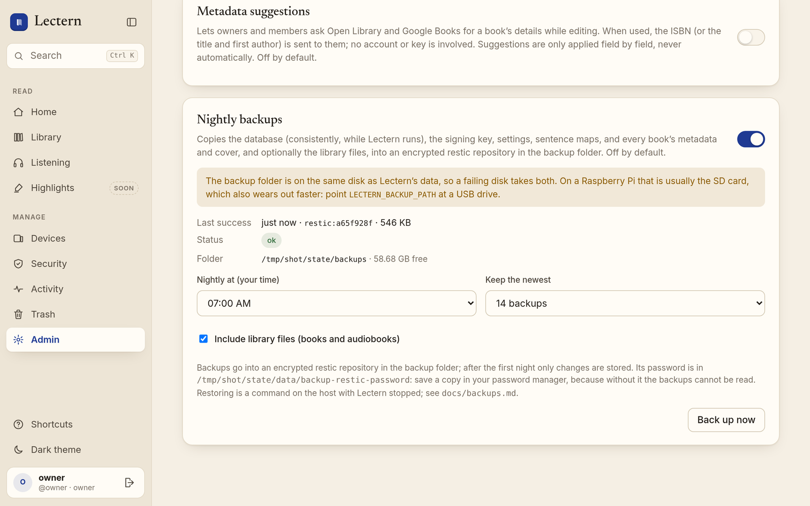
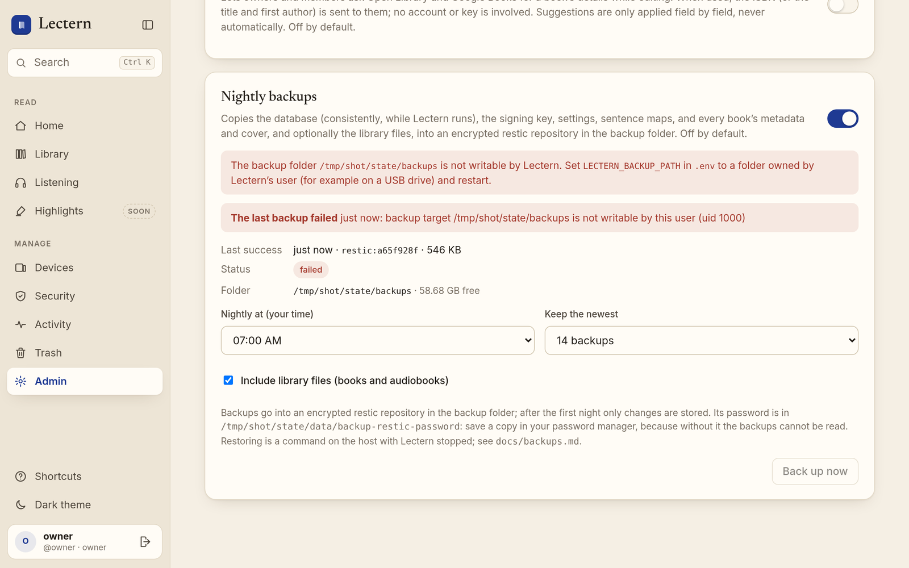

# Backups and restore

Lectern can back itself up every night. **Backups are off by default.** The owner turns them
on under **Admin → Nightly backups** and chooses the time, how many to keep, and whether
library files are included. Where they go is deployment configuration
(`LECTERN_BACKUP_PATH` in `.env`), not a web setting, so nobody can redirect your backups
from a browser.



## What a backup contains

Every backup is a snapshot in an encrypted, deduplicated [restic](https://restic.net)
repository at `<backup folder>/restic`. restic ships in the Docker image. After the first
night only changes are stored, which suits a large audiobook library.

| Part | Always | Notes |
| --- | --- | --- |
| Database (`lectern.db`) | yes | SQLite's **online backup API**: a consistent copy while Lectern keeps running, WAL included. No stop, no torn file. Checked with `PRAGMA integrity_check` before it is kept. Copied together with the parts below under the library lock, so an edit cannot land between them. |
| Secrets | yes | the signing key (`secret_key`) and the repository password |
| Config | yes | the `LECTERN_*` settings the server ran with (`config/lectern.env`) and a JSON summary without the signing key |
| Sentence maps and Undo cover backups | yes | `data/align/` (hours of transcription to redo) and `data/revisions/` |
| Cover and book metadata | yes | each book's `book.json` and cover art |
| Library files | optional | EPUBs, PDFs, comics, audiobooks. `_inbox/` and the regenerable `derived/` folders are left out. Read after the lock is released, so a long backup never blocks adding books; a book filed meanwhile is in the next one. |

Not included: uploads in progress, scratch space, logs, downloaded models, the Tailscale node
state (back that up as root; see [the Tailscale guide](deploy-tailscale.md#backups-and-restore)),
and your host `.env` (keep it in your password manager; `config/lectern.env` helps rebuild it).
`config/lectern.env` holds every `LECTERN_*` value, secrets included (the e-mail-in password,
the push alert URL and token of [Health and alerts](health.md)); the JSON summary masks them.

**Symlinks are never followed or backed up**, in the library or the data folder. Each one is
logged and skipped; one that points outside the backed-up folders is logged as a warning and
named in the backup status (`last_skipped_links_outside`), because whatever it points at is
not in your backups. Copy the real file in instead.

**The repository password** is created on first use in
`data/lectern/backup-restic-password` (or `LECTERN_BACKUP_RESTIC_PASSWORD_FILE`). **Copy it
to your password manager now**: without it the backups are unreadable. A copy inside the
backups does not help, because they are encrypted with it.

Retention is `restic forget --keep-last N --prune` after every backup. A file restic cannot
read (wrong permissions, say) is left out of that snapshot; the backup still counts and is
pruned like the others, and the Admin card names the file so you can fix it.

## Setting it up on a Raspberry Pi with a USB drive

1. Plug in the drive and mount it at a fixed place, e.g. `/media/usb` (add it to `/etc/fstab`
   with `nofail` so the Pi still boots without it).
2. Create the folder, owned by Lectern's user:

   ```sh
   sudo install -d -o "$(id -u)" -g "$(id -g)" -m 700 /media/usb/lectern-backups
   ```

3. In `~/lectern/.env`: `LECTERN_BACKUP_PATH=/media/usb/lectern-backups`, then
   `lectern-compose up -d`.
4. **Admin → Nightly backups**: turn it on, pick a time, press **Back up now** once and check
   that *Last success* fills in. Then save the repository password (above).

Without `LECTERN_BACKUP_PATH`, backups go to `backups/` in the checkout (git-ignored).
Compose creates the folder if it is missing; if it was created as root, `chown` it to
`LECTERN_UID:LECTERN_GID`. The Admin card says when the folder is missing, not writable, or
on the same disk as Lectern's data.

The snapshot is staged in `<backup folder>/.staging/` (never in the data directory, so the
card or disk Lectern runs from only sees reads) and removed after each run. A run that was
killed part-way leaves it behind; the next run removes it before it starts.

## SD-card wear

SD cards wear out with writes and fail without warning, often taking everything on them.
On a Pi booting from an SD card:

- **Do not back up to the SD card.** A backup on the same card dies with it, and nightly
  writes shorten its life. Use a USB drive or SSD (Lectern warns when the backup folder is on
  the same disk as its data).
- Prefer keeping `data/` and `library/` on a USB SSD too (`LECTERN_DATA_PATH`,
  `LECTERN_LIBRARY_PATH`); SQLite writes on every sync and page turn.
- restic writes only what changed, so including library files costs little after the first
  night.
- A backup reads the library in full; reads do not wear flash.
- Keep a second copy off the Pi (another machine on the tailnet, cloud storage, a drive you
  rotate). One USB drive next to the Pi protects against a dead SD card, not against a fire or
  a power surge.

## Status and alerts

The Admin card shows the last success (time, snapshot, size), whether one is running, free
space, files that could not be read, and the last error.



When a backup fails, every owner gets a warning notification (at most once a day), and
earlier snapshots stay as they were. If a backup is already running (say you started one
from the command line during the nightly run), the second one is skipped, not counted as a
failure. A server that was off at backup time catches up once when it starts.

From the host you can also run one by hand or list the snapshots:

```sh
lectern-compose exec lectern lectern backup
lectern-compose exec lectern lectern backup --list
```

## Restore

`lectern restore [SNAPSHOT]` restores a snapshot (the newest by default) into the data
directory and library. It:

- **refuses while Lectern is running** on that data directory;
- verifies the database copy and refuses a backup made by a newer Lectern (update first);
- treats the backup's contents as untrusted: it **refuses** a snapshot that contains any
  symlink (Lectern never backs one up), a manifest that points outside the backup, and any
  library file that would be written outside the library (for example through a book folder
  that is now a link to elsewhere);
- **checks free space first** and refuses, changing nothing, when a volume cannot take the
  restore: every restored file is first copied next to its destination, and replaced library
  files kept in `pre-restore-*/library/` are a second copy on the data volume when the library
  lives on another one (a Pi with the library on USB and data on the SD card). The message
  names the folder, what it needs, and what is free;
- copies everything next to its destination first, then swaps it in. Replaced data files
  always go to `data/lectern/pre-restore-<time>/`; replaced library files go to its `library/`
  folder, unless you skip that copy (below). Library files are never otherwise deleted;
- **rolls back** if anything fails part-way (a full disk, an I/O error): the server is left
  exactly as it was, including folders the restore had created, and the error says so;
- **can be finished or undone after a crash** or power loss part-way through (below).

**Skipping the pre-restore copy.** `--no-pre-restore-copy` (or
`LECTERN_RESTORE_KEEP_REPLACED=0` in the server's environment) keeps each replaced library
file next to itself during the swap, as a rename, and deletes it once the restore succeeded.
Use it when the data volume is small and you have the backup anyway. The database, signing
key, and sentence maps are always kept in `pre-restore-*/`.

### If a restore is interrupted

Before it stages a single file, the restore writes its plan to
`data/lectern/restore-journal.json` (flushed to disk), and removes it once everything is in
place. If a crash, power loss, or `kill -9` stops it part-way, the journal stays, and:

- **Lectern refuses to start** (the log says why), and a new `lectern restore` refuses too;
- `lectern restore --resume` **finishes** the restore: it swaps in the rest of the staged
  copies, then tidies up as a finished restore would;
- `lectern restore --undo` **puts everything back** exactly as it was before the restore,
  byte for byte: the originals come back from `pre-restore-<time>/` (or from
  `.<name>.replaced-restore-<time>` with `--no-pre-restore-copy`), and the staged copies, the
  folders the restore created, and its scratch copy of the backup are removed.

Run either with Lectern stopped, the same way as the restore (below). Both are safe to run
again if they are interrupted themselves. A restore stopped while it was still copying files
had changed nothing; `--undo` clears what it left. One stopped after every file was already
swapped in, while it was tidying up, can only be resumed.

Neither the journal nor the files are trusted blindly: `--undo` and `--resume` refuse a
journal that names anything outside the data directory and the library. Each step's progress
is read from the files themselves (a rename survives a power cut whole), and a replaced
library file kept on another volume (a Pi with the library on USB) is copied there in full
and flushed before the original is deleted.

The server migrates the schema on its next start. With the Tailscale compose file
(`lectern-compose` is the alias from the guide):

```sh
cd ~/lectern
lectern-compose stop lectern
lectern-compose run --rm --no-deps lectern lectern backup --list
lectern-compose run --rm --no-deps lectern lectern restore            # the newest
lectern-compose run --rm --no-deps lectern lectern restore 1a2b3c4d   # or a given one
lectern-compose run --rm --no-deps lectern lectern restore --resume   # after a crash: finish
lectern-compose run --rm --no-deps lectern lectern restore --undo     # or put it all back
lectern-compose start lectern
```

`run --rm --no-deps` starts a one-off container with the same user and mounts as the server;
it joins the still-running Tailscale container's network but serves nothing. Options:

- `--no-library`: restore the data side only (database, secrets, maps); leave library files.
- `--restic-password-file PATH`: on a fresh machine, the repository password you saved. Put it
  in the backup folder or data folder first so the container can read it.

After a restore, compare `data/lectern/restored-lectern.env` with your `.env`. Once you are
happy, delete `data/lectern/pre-restore-*`.

**On a new Pi:** clone, write `.env` (same `LECTERN_BASE_URL`, so passkeys keep working),
create `data/lectern` and `library`, mount the USB drive, put the saved password in
`data/lectern/backup-restic-password` (mode 600), run the restore above, then
`lectern-compose up -d --build`. Restore the Tailscale node state as the guide describes, or
remove the old machine and use a fresh auth key.

The restore path is tested in CI: `tests/test_backups.py` backs up a running server (with and
without library files), changes and deletes things, runs `lectern restore`, and signs in to
the restored server. It also covers a crafted manifest, symlinks in the library and in a
snapshot, paths that escape the library, the free-space check, unreadable files, a busy
target, a restore that fails half-way, and one killed with `kill -9` half-way through the
swap (with the library on the same and on another volume), then undone byte for byte or
resumed.

## Schema upgrades at startup

When a new Lectern version brings database changes, the server upgrades the schema as it
starts. Before it does, it takes a snapshot of the database, and if the upgrade fails it puts
the snapshot back and refuses to start. On a normal restart (nothing to upgrade) nothing is
copied.

- **Where:** `data/lectern/premigration-snapshots/` (folder mode 700, files mode 600), named
  `<UTC time>-<from revision>-to-<to revision>-<random>.db`, for example
  `20261101T120000123456Z-0043_reading_stats-to-0044_listening_queue-1a2b3c4d.db`. A
  snapshot is a complete SQLite database made with SQLite's online backup API (consistent even with a WAL), checked, and flushed to disk
  before the upgrade starts. Nothing in the data directory is ever served over the web.
- **Free space first:** the volume needs room for the snapshot and, for a restore, a second
  copy next to the database (the database and its WAL, twice), plus a margin. Without it
  Lectern **refuses to start and changes nothing**; the log names the folder, what it needs,
  and what is free. A snapshot that cannot be written refuses the same way: the database is
  never upgraded without one.
- **Retention:** the newest 5 snapshots are kept (the one just taken always counts, even if
  the clock was wrong); older ones are deleted only after an upgrade succeeded, never after a
  failure.
- **If the upgrade fails:** Lectern closes every database connection, checks the snapshot,
  copies it next to the database, flushes it, removes the failed database's `-wal` and `-shm`
  files, renames the copy into place, and checks the result (`PRAGMA integrity_check` and the
  revision). It then exits with an error naming the revisions and the snapshot, and writes
  `premigration-snapshots/failed-upgrade.json`. While that file is there, later starts of the
  same version refuse straight away instead of retrying the same upgrade (so a restart loop
  cannot fill the disk); a version with different migrations tries again. Fix the cause, then
  delete the file to retry, or go back to the previous Lectern version.
- **If the restore fails too** (say, the disk died), the error says so, the database may be
  half-upgraded, and the snapshot is kept. With Lectern stopped, copy the snapshot over
  `data/lectern/lectern.db`, delete `lectern.db-wal` and `lectern.db-shm`, and start the
  previous version; or restore a nightly backup (above).
- Two servers starting on the same data directory take turns (`premigration.lock`); the
  second finds the schema already upgraded and copies nothing.

Errors and logs name revisions, paths, and the kind of failure only: never a setting, a key,
or the database's contents.

Settings (in `.env`; empty = the default):

| Variable | Default | Meaning |
| --- | --- | --- |
| `LECTERN_PREMIGRATION_SNAPSHOT_KEEP` | `5` | Snapshots kept (at least 1). |
| `LECTERN_PREMIGRATION_FREE_MARGIN_MB` | `64` | Free space, in MiB, required on top of the copies. |
| `LECTERN_PREMIGRATION_SNAPSHOT` | `1` | `0` upgrades **without** a snapshot. |

`LECTERN_PREMIGRATION_SNAPSHOT=0` is a deliberate escape hatch for a disk too full for a
snapshot when you have a recent backup; the log warns on every upgrade it lets through. Set it
back afterwards.

## Restore drill

A backup is only known to be good once it has been restored. The optional restore drill
does that on a schedule, without touching anything live: in the hours right after a nightly
backup, every `LECTERN_RESTORE_DRILL_DAYS` days (off by default; `7` for weekly), it restores
the latest snapshot into a scratch folder on the backup volume (`<backup folder>/.drill`, not
the SD card), checks it, and deletes it.

It checks, in order, and stops at the first failure:

1. **Repository**: `restic check`, reading the next 1/N of the stored data on each run
   (`LECTERN_RESTORE_DRILL_READ_DATA_PARTS`, default 20), so N drills read all of it.
2. **Latest snapshot**: one Lectern backup, and nothing a backup never contains (symlinks,
   paths outside the tree), as `lectern restore` requires.
3. **Free space**: room on the backup volume for what it restores, plus a reserve.
4. **Restore**: `restic restore --verify` of the manifest, database, signing key, settings,
   and a sample (`LECTERN_RESTORE_DRILL_SAMPLE` per kind, default 20) of `book.json` and
   covers, sentence maps and cover backups, and, when the backup includes them, library files
   (at most 512 MiB of them: large files are sampled, never restored wholesale).
5. **Manifest, secrets, and config**: the format is known, the secrets it lists and the
   settings are there, and it records as many `book.json` and cover files as the snapshot has.
6. **Database**: it opens read-only, `PRAGMA integrity_check` is `ok`, its schema revision is
   the manifest's and known to this Lectern, it has users, and nearly every book has its
   `book.json` in the snapshot.
7. **Sampled files**: the sizes the snapshot records, `book.json` that parses, and library
   files with the SHA-256 the database recorded when they were added.

The result (passed or failed, the failing check and why, the snapshot and its age, how long
it took) is on the [Health](health.md) page and in Admin → Nightly backups. A failed drill
turns Health red and alerts the owners like any Health check, in the app and through push
alerts if they are set up.

What it never does: write to the data directory, the library, the live database (other than
its own result), or the restic repository (it reads it with `--no-lock`); take
`data/lectern.lock` the way a restore does (the server keeps running); or run during a
backup or restore: then it is skipped, not failed, and tried again half an hour later. It
runs restic at idle I/O and lowest CPU priority and stops after
`LECTERN_RESTORE_DRILL_TIMEOUT_MINUTES` (default 120). The scratch folder holds a plaintext
copy of the database and secrets, so it is removed after every drill, passed or failed; one
left by a server killed mid-drill is removed within a minute of the next start.
