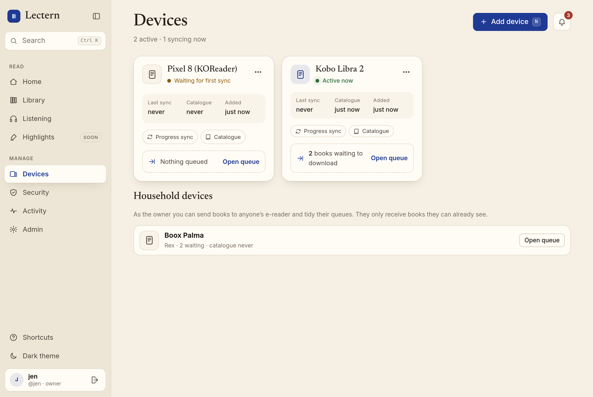
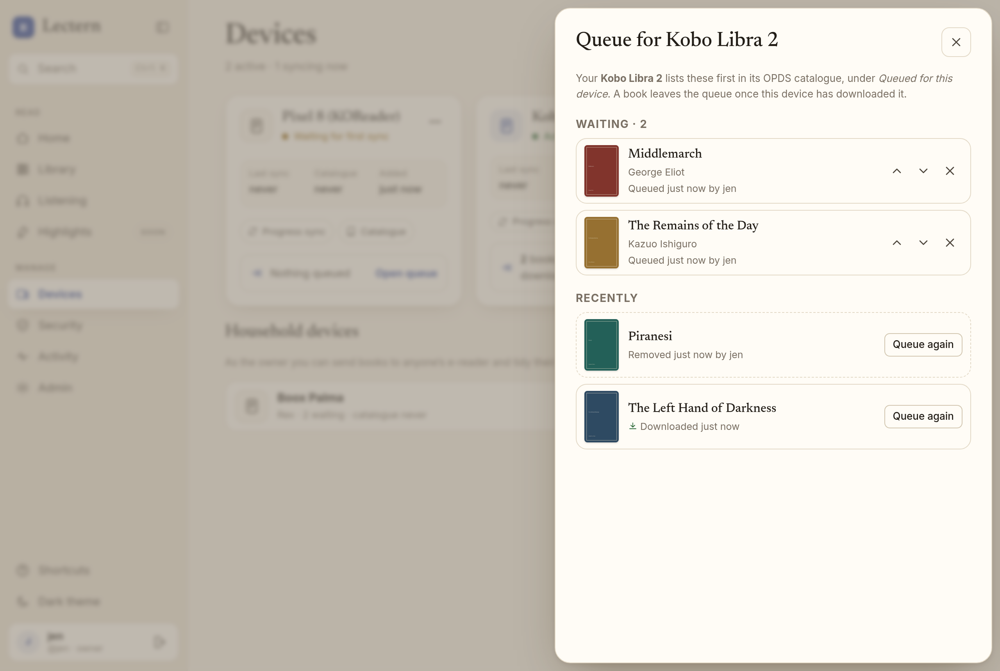
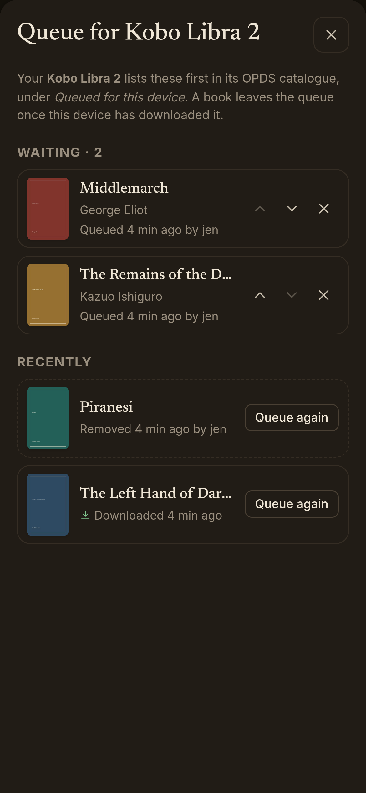
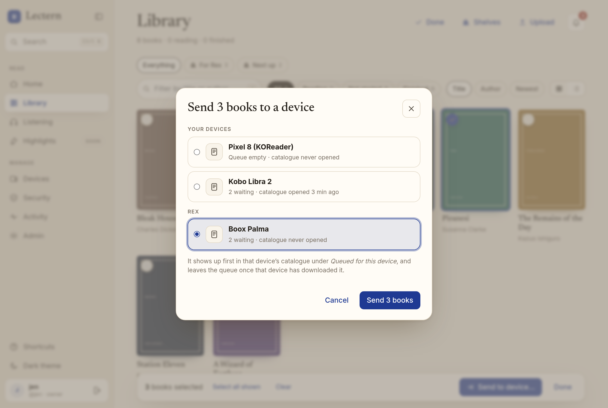
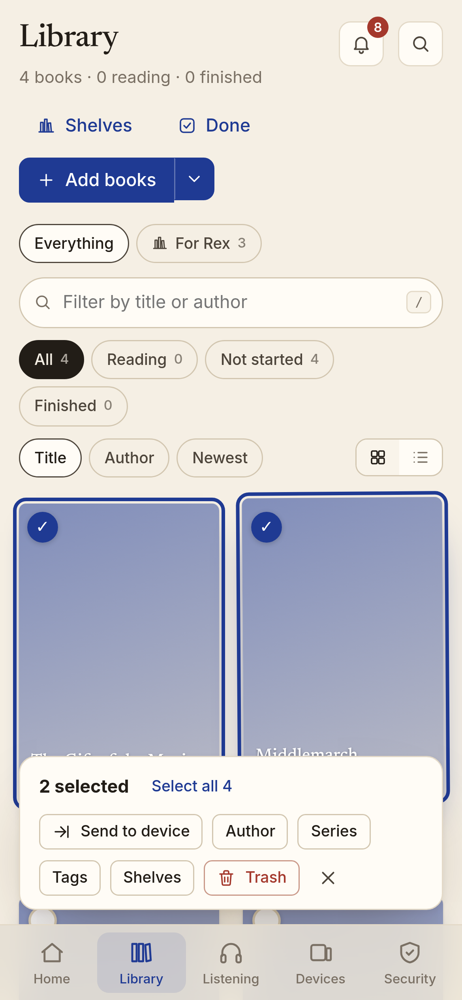
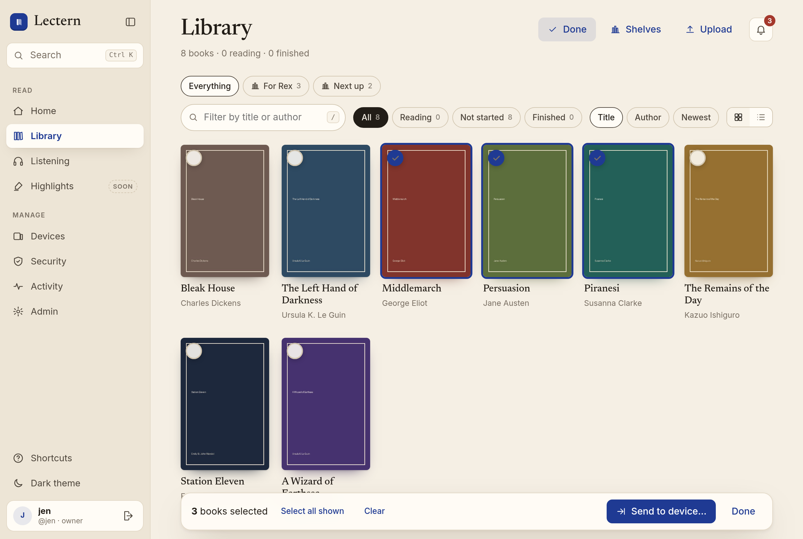

# Sending books to a device

"Send to device" puts a book at the top of one e-reader's OPDS catalogue, under **Queued for
this device**. The e-reader downloads it from there like any catalogue book, and the queue
forgets it once that device has the whole EPUB. Nothing is pushed: e-ink devices only ever
pull, so the queue is just a personal shelf for one catalogue password.

## Using it

- **One book:** open it in the Library and choose **Send to device**. The dialog lists the
  devices you can send to, which ones already have the book waiting, and remembers your last
  choice.
- **Several books:** select them in the Library (click a book's circle, then the others;
  `⌘/Ctrl` or `Shift` + click, `⌘/Ctrl A` for the whole view; on a phone, press and hold), then **Send** in the selection bar (the same bar as bulk edit; readers see only **Send to device**). The
  toast says what happened to each book: sent, already waiting, not shared with that person,
  or without an EPUB.
- **The queue:** on **Devices**, each device with a catalogue password shows how many books
  are waiting; **Open queue** lists them in catalogue order. Move them up or down, remove one,
  or queue a delivered or removed book again from **Recently**.
- **On the e-reader:** open the Lectern catalogue. The root lists, in this order:
  1. **Continue reading**: what you are reading or listening to, most recent first;
  2. **Up next**: books on your shelves you have not started;
  3. **Queued for this device**: what was sent to *this* device;
  4. **Shelves**: your top-level shelves; a shelf with sub-shelves opens on "Books on …"
     and its sub-shelves, a shelf without opens straight on its books. Owners and members also
     get **Not on a shelf**. Shelves shared with a reader show at their top level, and shelves
     above them stay private.
  5. **All books** and **Recently added**, as before.

  Each entry says how many books it holds ("2 books sent to Kobo Libra 2"), so a slow e-ink
  screen shows what is new without opening anything.

| Desktop | Phone (dark) |
| --- | --- |
|  |  |
|  |  |
|  | |

## Following a shelf

A device can follow one shelf so it stays stocked without sending books one by one. On
**Devices**, open the device's **⋯ → Shelf sync…**:

- **Follow a shelf**: any shelf you see, including nested shelves and smart shelves
  ([filters.md](filters.md)). A manual shelf brings its own books and those on every shelf
  inside it (as the `shelf:` filter does); a smart shelf brings whatever its filter matches.
  Only books with a book file (EPUB, PDF, CBZ) that the device's user can see are queued.
- **Remove books that leave the shelf** (clean-up, off by default): a followed book that leaves
  the shelf (taken off it, no longer matched by the rule, unshared, or trashed) is taken off
  the queue, and the KOReader plugin deletes the copy it downloaded. Catalogue-only devices
  just see it leave **Queued for this device**.
- **Download queued books automatically** (off by default): the KOReader plugin downloads the
  device's queued books by itself on its quiet automatic sync, whether they were sent by hand
  or queued by the followed shelf.

The device's card shows **Follows …** and **Auto-download** when they are on.

**When it happens.** Nothing is pushed. The queue is brought in line with the shelf whenever
the device reads it: the catalogue's root and **Queued for this device** feeds, the plugin's
status check, and **Open queue** in the web app, and once when the setting is saved. So a book
put on the shelf, or a smart shelf's changed rule, takes effect at the device's next sync.

**A batch at a time.** At most 25 followed books wait at once; as the device downloads them,
the next ones in the shelf's order (title, or the smart shelf's own sort) are queued. A large
shelf trickles onto the e-reader instead of arriving in one go.

**What the shelf never touches.**

- A book sent by hand is never cleaned up, even when it is not on the shelf, or was already
  waiting because of the shelf when it was sent.
- A book a person took off the queue (**Remove** in **Open queue**) is not queued again by the
  shelf; **Queue again** from **Recently** brings it back.
- A followed book that left the shelf (clean-up) and comes back is queued again.
- Clean-up off: books that leave the shelf stay queued and on the device.
- Unfollowing, or deleting the followed shelf, stops the follow and changes nothing else.
- A smart shelf whose rule this version cannot read queues and removes nothing.

### In the KOReader plugin

With **Sync automatically** on, the plugin checks the device's queue quietly (no messages, no
Wi‑Fi prompt) about 10 s after KOReader starts, 5 s after Wi‑Fi comes back, 8 s after waking,
and every 15 minutes while KOReader runs, at most once a minute. **Sync now** checks at once.
Each check:

1. deletes the copies it downloaded of books that left the followed shelf (clean-up on), and
2. with **Download queued books automatically** on, downloads up to 3 queued books it has no
   copy of yet into KOReader's download folder, one after the other, as **Books sent to this
   device** does by hand. Downloads pause the screen for a moment, so automatic checks
   leave them while a book is open; the next check in the file browser, or **Sync now**,
   downloads them. A refused download (offline, or `429` when the device's hourly
   download limit is reached) stops the batch until the next check.

The plugin keeps a list of the files it downloaded (`downloads` in `settings/lectern.lua`).
Clean-up deletes only those, and only while unchanged: a file the reader replaced or changed
(for example annotations written into a PDF) is the reader's and is kept, as is the book open
in the reader (deleted at a later check, once closed). KOReader's sidecar folder (`.sdr`, with
highlights and notes) is never touched, and nothing else in the folder ever is.

Setting it: `POST /api/devices/app-passwords/{app_password_id}/shelf-sync`
`{"shelf_id": 12 | null, "cleanup": bool, "auto_download": bool}` (own devices only, like the
download limit; `404 shelf_not_found` for a shelf you cannot see, `409 device_revoked`).
`GET /api/devices` reports `follow_shelf_id`, `follow_cleanup`, and `auto_download` on each
app password. The audit log records `device.shelf_sync` and, when a sync changed the queue,
`queue.follow` ("device Kindle: 3 queued, 1 removed").

## Who can send what to whom

A queue belongs to one OPDS **app password** (one device), not to a person: your Kobo and
your phone have separate queues, and nobody else's catalogue ever shows yours.

| | Own devices | Other people's devices |
| --- | --- | --- |
| Owner | send, reorder, remove | send, reorder, remove (household administration) |
| Member | send, reorder, remove | invisible (404) |
| Reader | send, reorder, remove | invisible (404) |

- A book can be sent only if the sender can see it **and** the device's user can see it. The
  owner cannot put a book on a reader's e-reader that is not on a shelf shared with that
  reader (`not_visible_to_device`).
- Visibility is checked again whenever a queue is read. Unsharing a shelf hides its books from
  the reader's queue (feed and web) and its downloads answer 404, as everywhere else; sharing
  it again brings them back.
- A revoked device's catalogue closes (401) and nothing more can be sent to it; its queue can
  still be viewed and tidied.
- Only works with a book file (EPUB, PDF, or CBZ comic) can be queued (`no_ebook`); an
  audiobook alone cannot. The feed offers every book file of the work with its own media type
  (`application/epub+zip`, `application/pdf`, `application/vnd.comicbook+zip`), and the item
  is delivered when the device has received any one of them in full.

## Delivery: when a queued book counts as downloaded

An item becomes **delivered** when *that exact device* (the app password that signed the
request) has been sent **every byte of a book file (EPUB, PDF, or CBZ) of that work in one response**:

| Request from the queued device | Delivers? |
| --- | --- |
| `GET /opds/files/{id}/download` (or `/library/files/{id}/download` with the same Basic credentials), `200`, body fully sent | **yes** |
| `Range: bytes=0-` answered `206` with the whole file | **yes** |
| any other range (`bytes=0-99`, `bytes=100-`, `bytes=-500`), even if the pieces add up to the file | no |
| `If-None-Match` with the file's ETag (its SHA-256): `304`, not counted against the caps either | no |
| `HEAD` (`405`), `416`, `404` (not visible), `429` (download cap), or a transfer the client abandons | no |
| the same book downloaded by another device, the web app, or another person | no |

"Sent" means the server handed the last block to the connection (the response body generator
resumed after it), the same point at which streaming bytes are metered. The update is one
`UPDATE … WHERE status = 'pending'`, so concurrent downloads deliver and audit once. A delivered
book stays downloadable from **All books**; **Queue again** puts it back at the end.

Downloads keep their caps and audit rows: every whole-file `GET` counts against the hourly
caps as before, including ranges; only a `304` is now free, since it transfers nothing.

## Ordering and idempotency

- Queues are first in, first out. **Queue again** moves a book to the end; reordering
  rewrites positions for the whole visible queue at once and is refused (`409
  queue_changed`) if the queue changed since the client loaded it.
- There is one row per device and work (`uq_device_queue_device_work`). Sending a book that is
  already waiting changes nothing (`already_queued`); sending a delivered or removed one makes
  the same row pending again (`requeued`). The insert is `INSERT … ON CONFLICT DO UPDATE …
  WHERE status <> 'pending'`, so two people sending the same book at once leave one item.
- The audit log records `queue.add`, `queue.remove`, and `queue.delivered` (Activity shows
  them).

## What "Continue reading" and "Up next" mean

Both are computed from data Lectern already keeps (`lectern.reading_lists`), only for works the
person can see:

- **Continue reading** is exactly the web app's Continue list (`GET /api/continue`): works with
  a KOReader progress record for any of their EPUBs, or a canonical position from the web
  reader, read-along, or audio player, most recent activity first (newest 50). Finished books
  stay until newer activity pushes them down, as on Home.
- **Up next** is the books on the person's shelves (their own shelves by name, then shelves
  shared with them by name; each in shelf order) that are in neither source of Continue, so
  starting a book moves it from Up next to Continue. Someone without shelves has nothing up
  next.

## API

All under the session cookie; writes need the CSRF token and a same-origin request.

| Route | |
| --- | --- |
| `GET /api/device-queues[?work_id=]` | devices you may send to (`own` first; the owner also gets everyone's), each with `pending`, and `queued` for `work_id` |
| `GET /api/device-queues/{app_password_id}` | `pending` (catalogue order) and `history` (latest 50 delivered or removed) |
| `POST /api/device-queues/{app_password_id}/items` `{"work_ids": [...]}` (≤ 200), or `{"selection": …}` ([contracts](contracts.md#selections--get-apilibrarycount-selection-on-bulk-requests)) | per-work `status`: `queued`, `requeued`, `already_queued`, `not_found`, `not_visible_to_device`, `no_ebook` |
| `DELETE /api/device-queues/{app_password_id}/items/{item_id}` | `{"removed": true}`; `false` if it was not pending |
| `POST /api/device-queues/{app_password_id}/order` `{"item_ids": [...]}` | exactly the visible pending items; `409 queue_changed` otherwise |

OPDS (HTTP Basic with the device's app password; the per-IP Basic rate limit applies):

| Route | |
| --- | --- |
| `GET /opds` | navigation feed: Continue reading, Up next, Queued for this device, Shelves, All books, Recently added |
| `GET /opds/shelves`, `/opds/shelves/{id}` | navigation feeds: top-level shelves; one shelf's books entry and sub-shelves (`up` leads to the visible parent). Hidden shelves are 404 |
| `GET /opds/shelves/{id}/books`, `/opds/shelves/none` | acquisition feeds: a shelf's own books in shelf order; books on no shelf |
| `GET /opds/continue`, `/opds/up-next`, `/opds/queue` | acquisition feeds, 50 per page with `next`/`previous` links and OpenSearch counts; entries are identical to `/opds/all` (same `urn:lectern:work:<id>` ids and acquisition links) |

## Storage

`device_queue_items` (migration `0008`): `app_password_id`, `user_id` (the device's owner),
`work_id`, `status` (`pending`/`delivered`/`removed`), `position`, `queued_by`, `queued_at`,
`delivered_at`, `delivered_file_id`, `removed_at`, `removed_by`, `updated_at`, and `followed`
(migration `0019`: queued by the followed shelf; with `removed_by` empty, removed because it
left the shelf). Deleting a device's app password, a user, or a work deletes their items.

`device_follows` (migration `0019`): `app_password_id` (primary key), `shelf_id`, `cleanup`,
`created_at`; deleting the shelf or the app password deletes the follow.
`app_passwords.auto_download` (migration `0019`, default off).
