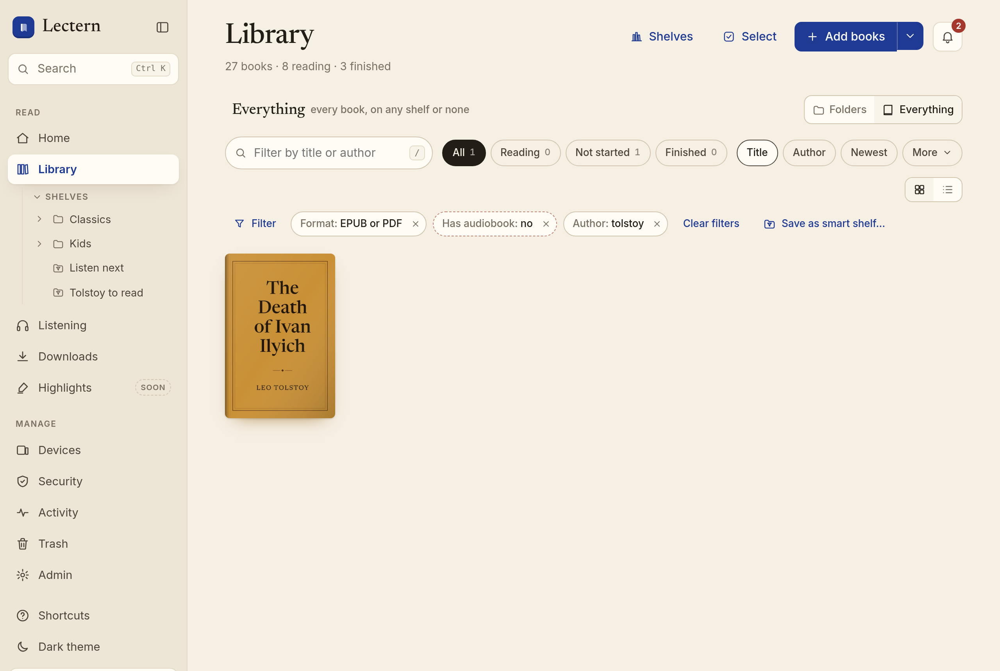
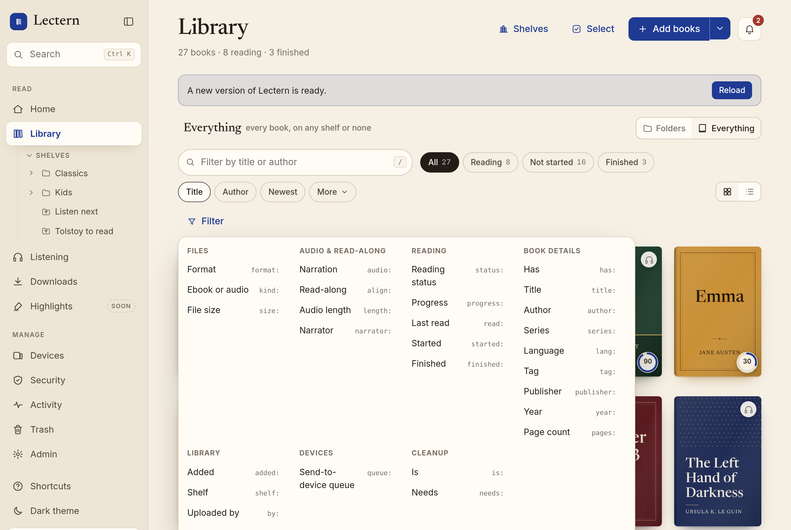
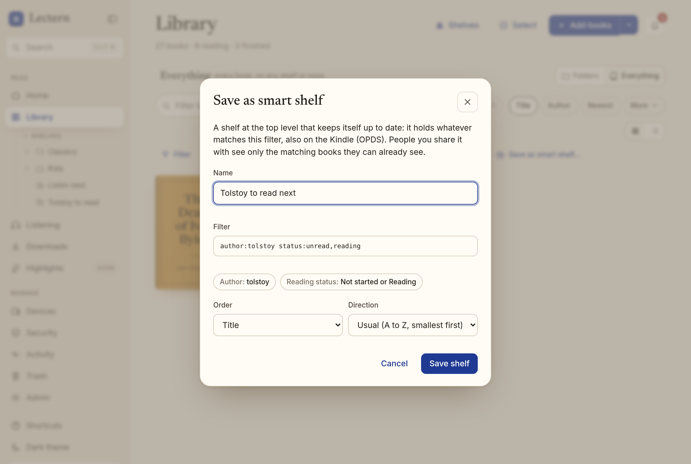
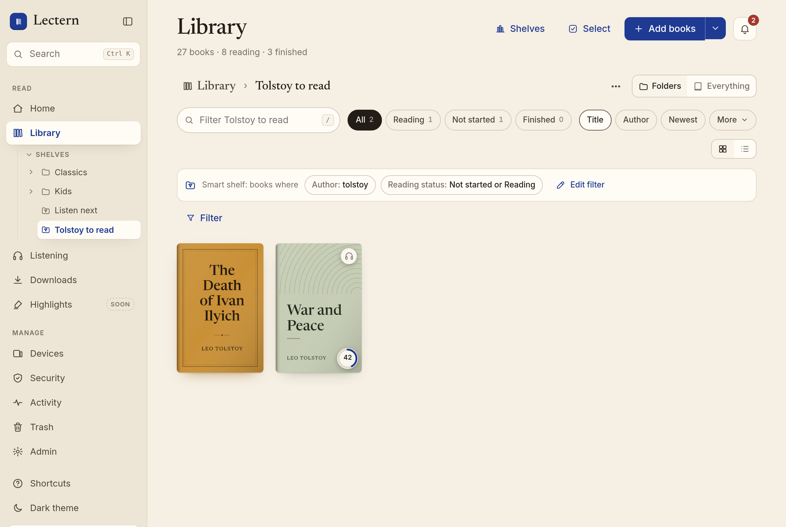

# Library filters and smart shelves

One filter syntax works in the Library's search box, in Cmd/Ctrl+K, in smart shelves (and so on
the Kindle, over OPDS), and in the MCP `search_library` tool. The server does the filtering
(`lectern.filters`). Every filter is ANDed with what the person may see, so a filter never shows
a book, shelf, name, or count they could not already see.

## In the Library

- **Filter** (next to the search box) opens the field menu. Pick a field, choose or type its
  values, and choose **is** or **is not**. The filter shows as a chip, such as
  *Format: EPUB or PDF*. Click a chip to edit it, or × to remove it.
- **Chips AND together; values in one chip OR together.** *Format: EPUB or PDF* and
  *Has: Audiobook* (negated) finds EPUBs and PDFs without an audiobook.
- **Typing works too.** `format:epub ` becomes a chip as soon as you type the space after it,
  and Enter turns everything left in the box into chips. Backspace in an empty box takes the
  last chip back into the box so you can edit it. A value a field cannot take is explained
  under the box (*Year: “abc” is not a whole number.*); nothing is silently dropped.
- **Cmd/Ctrl+K** shows typed filter syntax as a **Filter** result that opens Everything with
  those chips.
- **The filter lives in the URL** (`/app/library?view=everything&f=format:epub%20-has:audio`),
  so Back, reloads, and bookmarks keep it.
- **Folders, Everything, and shelves.** In Everything a filter searches every book. In a shelf it
  searches that shelf and every shelf inside it. In the Folders root it searches every book, as
  Everything does.
- **Multi-select** works on filtered results: Cmd/Ctrl+A selects everything the filter matches,
  and bulk actions apply to exactly that set.
- **Sort by any filterable field** with **More** next to Title / Author / Newest, and reverse
  the order there.





## Syntax

```text
format:epub,pdf -has:audio author:"Tolstoy" year:1850..1900 progress:<50% war
```

- `key:value` is a clause. `key:a,b` matches either value. A leading `-` negates it: "is not"
  matches everything the clause does not, **including books with no value for the field**
  (`-series:discworld` includes books with no series).
- Numbers, sizes, lengths, percentages, and dates take `<`, `<=`, `>`, `>=`, or a range `a..b`
  (either end may be left open: `year:..1900`).
- Dates are `2026`, `2026-03`, or `2026-03-15` (UTC), or ages: `30d`, `2w`, `6m`, `1y`
  (`added:<30d` means added in the last 30 days).
- Anything else is a free word, matched against title, author, series, and ISBN. `-word`
  excludes it. A `key:` Lectern does not know is a free word too, so `Re:Zero` still finds
  itself.
- Accents and case never matter. Quote a value that has spaces, commas, or quotes
  (`shelf:"Kids/Picture books"`, `\"` inside quotes).
- Limits: 1,000 characters, 24 clauses, 20 values per clause, 12 free words.

## Fields

| Group | Field | Values |
| --- | --- | --- |
| Files | `format` | `epub`, `pdf`, `cbz` (`comic`), `audiobook` (`audio`) |
| | `kind` | `ebook` (ebook only), `audio` (audio only), `both` |
| | `size` | total of the book's files and audio: `100MB`, `1.5GB` (a bare number is MB) |
| Audio & read-along | `audio` | `narrated` (a real narrator), `generated` (Lectern made it) |
| | `align` | `aligned`, `running` (queued or in progress), `failed`, `none` (has audio, not aligned) |
| | `length` | audio length: `10h`, `1h30m` (a bare number is hours) |
| | `narrator` | part of a narrator's name |
| Reading | `status` | `unread`, `reading`, `finished` (yours) |
| | `progress` | your progress: `<50%`, `25%..75%` |
| | `read` | when you last read it |
| | `started`, `finished` | when you started or finished it: any read, with your corrected dates ([reviews.md](reviews.md)) |
| | `rating` | your own rating, ½ to 5 stars: `5`, `>=4`, `3..4.5`; `-rating:>0` is unrated |
| Book details | `title`, `author`, `series`, `publisher` | part of it |
| | `lang` | a language code: `lang:en` also matches `en-GB` |
| | `tag` | a whole tag |
| | `year` | publication year: `1850..1900` |
| | `pages` | page count of a PDF or comic (EPUBs have no fixed pages) |
| | `has` | `audio`, `cover` (cover art; `-has:cover` is books showing a generated cover), `author`, `series`, `isbn`, `tags`, `description` |
| Library | `added` | when it was added |
| | `shelf` | a shelf by path (`Kids/Picture books`) or name, with every shelf inside it; `none` (on none of your shelves), `any` |
| | `by` | who uploaded it (owners and members only) |
| Devices | `queue` | waiting in one of your devices' Send to device queues: a device name, or `any` |
| | `is` | `offline` (downloaded on this phone or browser), `duplicate` (see below) |
| Cleanup | `needs` | `ocr`: a scanned PDF with no text layer and no finished OCR |

`has:author` is false for "Unknown Author". `is:duplicate` is a book with the same title and
author as another book you can see (accents, case, and spacing ignored) unless someone marked
the pair as different books, or one the importer or the hourly duplicate scan flagged as a
possible duplicate that nobody has decided on yet. Only books you can see are compared.

`is:offline` is known only to the device: the web app sends the ids it holds, so the filter
means "on this device". Elsewhere (smart shelves on OPDS, MCP) it matches nothing.

The field menu and the MCP tool description come from `lectern.filters.describe()`.
`GET /api/library/fields` serves it, and `tests/fixtures/filter_fields.json` pins it for the web
app's copy (`frontend/src/lib/filters.ts`).

## Smart shelves

**Save as smart shelf…** (under the chips) saves the current filter as a top-level shelf with
the smart-shelf icon. It holds whatever matches the filter right now, in the order you chose. It
is never filled by hand: dragging or adding books to it is refused (`409 smart_shelf`). Open it
and **Edit filter** on its banner (for people who manage it) changes the filter, order, or
direction. Its **⋯** menu renames, shares, or deletes it like any shelf.

- **Everyone sees their own matches.** A smart shelf shared with someone shows them only the
  matching books they can already see. Their own reading state answers `status:` and
  `progress:`. Sharing a smart shelf never exposes a book.
- **Only the shelf's managers see the rule.** Other people get the shelf's name and books, and
  `smart: true`, but not its filter, so a rule that names a hidden shelf or a person cannot
  leak.
- **A rule outlives what it names.** A shelf, device, or person in a saved rule that no longer
  exists, or that this viewer cannot see, matches nothing for them instead of failing.
  `shelf:` naming another smart shelf means that shelf's matches, one level deep: inside a
  smart shelf's rule, a smart shelf matches nothing, so rules cannot loop.
- **OPDS (Kindle).** A smart shelf is a leaf under **Shelves** whose feed lists its matches for
  the device's person, live and in the shelf's order.
- **MCP.** `list_shelves` marks smart shelves (`smart: true`, and `filter` for people who manage
  them). `search_library` with `shelf:"<path>"` lists one.





## Reading status: every reader counts now

**Behavior change.** The Library's reading-status chips (*Reading*, *Not started*,
*Finished*) and the `status:` / `progress:` filters now use a person's latest position from
**any** source: KOReader, the page viewer, the web reader, and the audio player. Before, only
KOReader and page-viewer progress counted, so a book read in the browser or listened to stayed
*Not started*.

The new `reading_states` table holds one row per person and work. It records the latest
`fraction` (the position written last wins, as the Library always showed the most recently
synced file; a KOReader sync counts with KOReader's own percentage, not the web position it is
projected onto), `last_read_at`, `started_at` (first above 0 %), and `finished_at` (first at
98.5 % or more). A `before_flush` hook (`lectern.reading_state`) keeps it current on every
progress write, in the same transaction. Migration `0018_library_filters` backfills it from the
progress that already exists. With no history to go on, it uses the earliest position as the
start.

## API

- `GET /api/library?f=&sort=&order=asc|desc&shelf=&subtree=&unshelved=&offline=`: `f` is a
  filter. A filter that cannot run is `422 {detail, message, field}`. `sort` is any field in the
  **More** menu (`title`, `author`, `added`, `series`, `year`, `size`, `length`, `pages`,
  `progress`, `read`, `started`, `finished`, `rating`, `lang`, `publisher`); books without a value sort
  last. `subtree` with `shelf` includes the shelf's sub-shelves; a smart `shelf` is its matches.
  `offline` is the comma-separated ids for `is:offline`. Each work carries
  `reading: {fraction, status, last_read_at, started_at, finished_at}`.
- `GET /api/library/count` and bulk `selection.filter` take the same `f`, `subtree`, and
  `offline` (`offline_ids` in a selection).
- `GET /api/library/facets?field=author|series|tag|narrator|lang|publisher|by`: the values among
  the books the caller sees, most common first, for the editor's suggestions. `by` is `403` for
  readers.
- `POST /api/shelves {name, filter, sort?, order?}` creates a smart shelf; `PATCH` with
  `filter`/`sort`/`order` changes its rule (`409 not_smart` on a manual shelf). The rule is
  checked as if typed by the caller now: `422` for a value they cannot use.

## Performance and indexes

Filters compile to one SQL query with `EXISTS` subqueries and indexed look-ups. Migration
`0018_library_filters` adds indexes on `works.created_at`, `language`, `publisher`, and
`published`, and on `imports(work_id, status)`. `reading_states` is keyed by
`(user_id, work_id)`. Accent-insensitive matching uses the SQL function `lectern_fold`
(registered on every connection), the same folding as the web app's search.

On 10,000 works, with each query returning up to the Library's 2,000-row cap:

| Filter | Owner | Reader (one shared shelf) |
| --- | --- | --- |
| none | 36 ms | 15 ms |
| `format:epub` | 30 ms | 10 ms |
| `-format:pdf year:1850..1900` | 18 ms | 6 ms |
| `author:"author 1" status:reading` | 39 ms | 6 ms |
| `progress:<50% lang:fr tag:sf` | 44 ms | 6 ms |
| `pages:>500 size:<10MB` | 20 ms | 5 ms |
| `is:duplicate` | 30 ms | 6 ms |

These are SQL times in the orb, not including JSON encoding. `is:duplicate` compares titles in
Python over the books the person can see.

## Tests

- `tests/fixtures/filters.json`: parser cases that the Python and TypeScript parsers must both
  agree on.
- `tests/test_filters.py`: every field; negation with missing values; reader leaks (hidden
  shelves answer like missing ones, `by:` is refused, counts and facets cover visible books
  only); smart shelves over the API, OPDS, and MCP; reading-state upkeep; the migration's
  backfill and downgrade.
- `frontend/src/lib/__tests__/filters.test.ts`: the web app's parser, chips, and labels.
- `frontend/e2e/filters.spec.ts`: chips from the menu and from typing, URL state, editing and
  negating, and saving a smart shelf.
