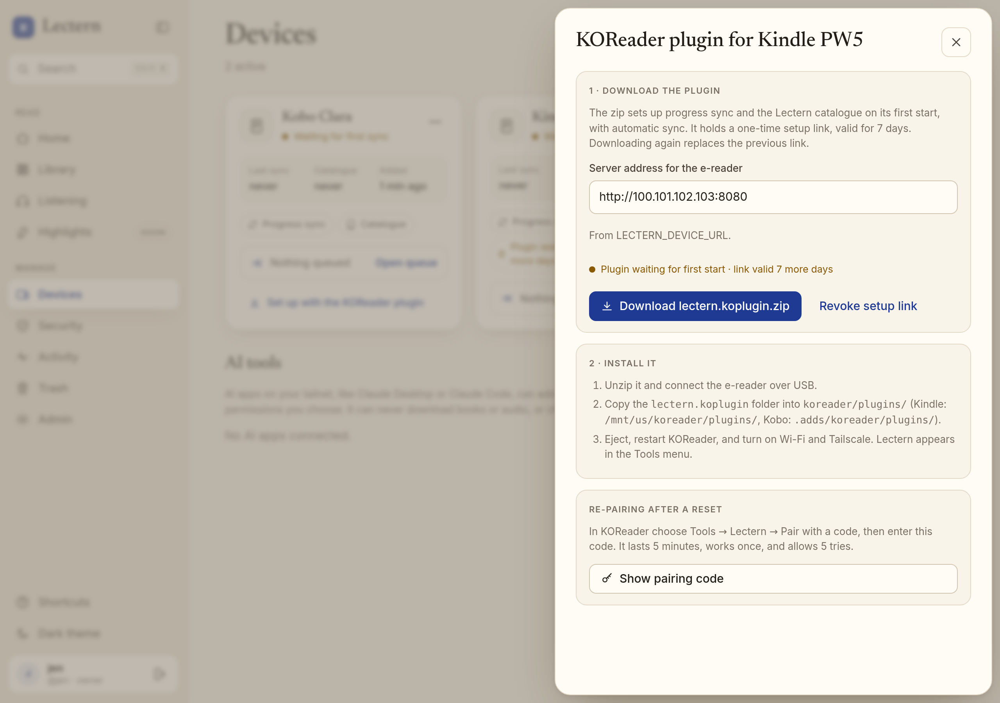

# The Lectern plugin for KOReader

`lectern.koplugin` connects a Kindle, Kobo, or PocketBook running KOReader to Lectern
without typing passwords on an e-ink keyboard. You download one zip per device from the web
app and copy it over USB. On its first start the plugin sets up KOReader's progress sync and
the Lectern catalogue by itself, and from then on it syncs your position without you
pressing Push.

## Install

1. In Lectern open **Devices → Add device**, name it (for example *Kindle PW5*), and choose
   **Create credentials**. Under **Kindle or Kobo with KOReader?** check the **server address
   for the e-reader** and choose **Download lectern.koplugin.zip**. For an existing device
   use **⋯ → KOReader plugin…** on its card.
2. Unzip it. You get one folder, `lectern.koplugin`.
3. Connect the e-reader over USB and copy **the whole folder** into KOReader's plugin folder:

   | Device | Folder |
   | --- | --- |
   | Kindle (jailbroken) | `/mnt/us/koreader/plugins/` (on the USB drive: `koreader/plugins/`) |
   | Kobo | `.adds/koreader/plugins/` |
   | PocketBook | `applications/koreader/plugins/` |

4. Eject, start (or restart) KOReader, and turn on Wi‑Fi and Tailscale (see
   [Tailscale on the e-reader](#tailscale-on-the-e-reader)).

On the first start with a connection the plugin shows *Lectern is set up*. If Wi‑Fi is off
it waits silently and finishes when Wi‑Fi comes up. Everything lives under **Tools →
Lectern** in KOReader's menu.

The zip contains the plugin's Lua files, `lectern_device.lua` (server address, username,
device name; not secret), and `lectern_bootstrap.txt` (the one-time setup secret).

## What the first start does

1. Sends the setup secret to `POST /koplugin/bootstrap` on the address in the zip.
2. Lectern checks it (unused, not revoked, not older than 7 days, device not revoked), marks
   it used in one conditional `UPDATE`, and returns this device's long-lived credentials: the
   KOReader sync key (as the `userkey` KOReader sends) and a new catalogue (OPDS) password.
   Both of the device's earlier credentials are replaced, so values shown in the web app before
   stop working.
3. The plugin writes KOReader's settings:
   - **Progress sync** (kosync): custom server `http://<ip>:8080/`, username, userkey,
     automatic sync on, push every N pages, *Sync to a newer state: Auto*.
   - **OPDS catalog**: an entry *Lectern* at `http://<ip>:8080/opds` with your username and the
     catalogue password, at the top of the list. Your other catalogues stay.
4. Deletes `lectern_bootstrap.txt` from the plugin folder.

If the answer never reaches the e-reader (Wi‑Fi dropped, a slow server hit the plugin's
timeout), the plugin keeps the secret and tries again: for **15 minutes after its first use**
the same secret can be exchanged again, and each exchange rotates the credentials again, so
only the last one to arrive works. The window does not grow with retries, and a new zip, a
pairing code, or revoking the device ends it at once. A refused secret (used more than 15
minutes ago, expired, revoked) is deleted, and the plugin tells you to pair with a code
instead. Without a reachable server at first start (Tailscale still connecting) setup retries
quietly after 30 s, 1, 2, 5, and then every 15 minutes while Wi‑Fi stays on, and 3 s after
Wi‑Fi comes back.

## Automatic sync

KOReader's own progress sync does the work; the plugin turns it on and makes it quiet:

- **Pull on open:** opening a book fetches the newest position; a position further ahead from
  another device (or the web reader or audiobook player) is applied without asking. Change it
  under **When another device is further ahead → Ask first**.
- **Push on close and on sleep:** closing a book or suspending the device sends the position.
- **Push every N pages:** default **10 page turns**. That is a few minutes of reading on an
  e-reader: close enough that a crash or a dead battery loses little, rare enough not to keep
  the radio busy. KOReader waits until you stop turning pages for 10 seconds before pushing,
  so skimming does not cause a burst. Set 0 to turn it off, or anything up to 200.
- **Wi‑Fi off: queue, don't nag.** Without a connection, automatic pushes go to a small outbox
  (newest position per book, at most 50 books) instead of KOReader's *Turn on Wi‑Fi?* prompt,
  and automatic pulls are skipped. When Wi‑Fi comes back the plugin waits 3 seconds for
  Tailscale and sends the outbox, oldest first. If Wi‑Fi is up but Lectern is not reachable
  (Tailscale still connecting, server down), it retries quietly after 30 s, 1, 2, 5, and then
  every 15 minutes while the network stays up. Nothing is shown unless you asked for it. A
  position is dropped only if Lectern answers that it is invalid (400/422); any other answer,
  such as a 404 from a wrong address, keeps the outbox.
  **When Wi‑Fi is off → Turn Wi‑Fi on to sync** restores KOReader's behaviour of switching
  Wi‑Fi on for each sync (and sets *Action when Wi‑Fi is off* to *turn on*).
- **Sync automatically** turns all of the above off; KOReader's Push and Pull still work.

## The Lectern menu (Tools → Lectern)

| Item | |
| --- | --- |
| *status line* | Connected, Offline/Retrying with how many positions wait, Not reachable, or *Device revoked or replaced: pair again*. Tap for details: server, account, device, last push, books waiting. |
| **Sync now** | Sends the current position and the outbox, pulls, and says what happened. |
| **Books sent to this device** | The device's Send to device queue. Tap a book to download it into KOReader's download folder (as `Title - Author (2).epub` if that name is taken; nothing is replaced); a complete download marks it delivered in Lectern, as with the catalogue. |
| **Sync automatically**, **Also push every N pages**, **When another device is further ahead**, **When Wi‑Fi is off** | The settings above. |
| **Pair with a code…** | See below. |

## Pairing with a code (re-pairing after a reset)

When KOReader was reset, the plugin folder was copied without the secret, or the setup link
expired: in Lectern open the device's **KOReader plugin…** sheet and choose **Show pairing
code**. In KOReader choose **Tools → Lectern → Pair with a code…**. Server and username are
filled in from the plugin (`lectern_device.lua` or the last pairing); enter the 6 digits.

- A code lasts **5 minutes** and works **once**.
- It allows **5 attempts**: each wrong 6-digit code entered for your username uses one; the
  fifth wrong attempt destroys the code. The fifth attempt can still be the right one.
  Malformed input (not 6 digits) can never match, so it costs no attempt.
- Showing a new code ends your previous one: one live code per person.
- Rate limits: 10 pair or setup requests per minute per address; 10 **wrong guesses at a live
  code** per 15 minutes per username, whatever the address (junk input, unknown names, and
  requests while no code is shown do not count, so nobody can lock you out without racing a
  code you are about to use; a successful pairing clears it); and 10 new codes per minute per
  person. Over a limit Lectern answers `429` and KOReader says to wait. Refusals are audited,
  at most once a minute per address and username.
- Pairing replaces the device's credentials, like the first start, and makes any unused setup
  link of the device useless.

## Security

- **Per-device.** Each device has its own sync key and catalogue password. **Devices → ⋯ →
  Revoke device** stops the plugin's credentials, any unused setup link, and any live code at
  once; the plugin then shows *Device revoked or replaced*.
- **One-time setup secret.** 256 random bits, stored only as SHA-256, valid 7 days, single use,
  revocable on its own (**Revoke setup link**) or by downloading a new zip. Lectern lists its
  state on the device card (*waiting for first start*, *set up*, *expired*, *revoked*), never
  the secret.
- **Zip only for the device's own user.** `POST /api/devices/{id}/koplugin` needs your session
  and CSRF token and answers 404 for anyone else's device, the owner role included, because the
  zip hands out that device's credentials. The same holds for pairing codes. The response is
  `Cache-Control: no-store`.
- **No secrets in logs.** Lectern logs and audits actions, device names, addresses, and
  reasons, never a secret, code, or credential. The plugin passes every log line through a
  filter that masks its stored credentials and anything shaped like a setup secret.
- **Audit events** (Activity): `koplugin.download` (with the address in the zip),
  `koplugin.bootstrap`, `koplugin.bootstrap_failed` (`used`, `expired`, `revoked`,
  `unknown`, `device_revoked`), `koplugin.pairing_code`, `koplugin.paired`,
  `koplugin.bootstrap` with `retry`, `koplugin.pair_failed` (`wrong_code`, `burned`,
`no_code`, `malformed`, `unknown_user`, `rate_limited_address`, `rate_limited_user`), and `koplugin.revoke`, next to
  the existing `device.create`, `device.revoke`, and `device.first_use`.
- **Activity:** plugin events show to the device's own user and to the owner. Unlike other
  rows they are not matched by target name, so a device labelled like another person does
  not show them its addresses.
- **Plain HTTP inside the tailnet**: see [docs/deploy-tailscale.md](deploy-tailscale.md#kindle-and-kobo-with-koreader)
  for why `http://100.x.y.z:8080` is the right address and why it is still private.

## Server address

The zip carries `http://<Lectern's Tailscale IP>:8080`. E-readers cannot use the
`https://lectern.<tailnet>.ts.net` name: Tailscale on the e-reader runs with MagicDNS off, and
KOReader's HTTPS client cannot go through a proxy. Lectern finds its own Tailscale address
(the source address of a route to Tailscale's `100.100.100.100`, which in the
[sidecar setup](deploy-tailscale.md) is the `tailscale0` interface) and pre-fills it; you can
edit it before downloading; the sheet warns when a plain `http://` address is outside
Tailscale's `100.64.0.0/10`, since the e-reader would then send its credentials unencrypted. If detection fails or is wrong, set `LECTERN_DEVICE_URL` (for
example `http://100.101.102.103:8080`) in `.env`. The plugin remembers the address, so pairing
later does not ask for it again.

## Tailscale on the e-reader

The e-reader must be on your tailnet. Two ways, both covered in more detail in
[deploy-tailscale.md](deploy-tailscale.md#kindle-and-kobo-with-koreader):

**Kindle: the KUAL extension in kernel TUN mode** ([mitanshu7/tailscale_kual](https://github.com/mitanshu7/tailscale_kual)).
On a jailbroken Kindle with KUAL:

1. Download the repository and put a fresh auth key from **Settings → Keys** alone in
   `tailscale/bin/auth.key`. Edit `tailscale/bin/up.args` (default `--ssh`) and remove
   `--ssh` unless you want Tailscale SSH *into* the Kindle.
2. Copy the **`tailscale`** folder (not `tailscale_kual`) into `extensions/` on the Kindle's
   USB drive, eject, and in KUAL tap **Install / Update Binaries** (downloads `tailscale` and
   `tailscaled` over Wi‑Fi).
3. In KUAL open **Start Tailscaled → Kernel TUN**, wait a few seconds, then tap **Start
   Tailscale**. Kernel TUN gives the whole Kindle a tailnet route, so both the catalogue *and*
   progress sync reach `http://100.x.y.z:8080` with no proxy. In *Standard (userspace)* or
   *Proxy Mode* KOReader's progress sync cannot reach the tailnet (its sync client ignores the
   HTTP proxy), so the plugin's pushes would wait in its outbox; use those modes only if your
   firmware has no TUN module (the README warns Kernel TUN is "not available on all Kindle
   firmware versions" and fails silently). Leave KOReader's HTTP proxy empty in Kernel TUN mode.
4. In the Tailscale admin console, **Machines → ⋯ → Disable key expiry** for the Kindle.
5. Start Tailscale before KOReader's first start with the plugin, or just leave it: the plugin
   retries once Wi‑Fi and the tailnet are up.

**Kindle, Kobo, PocketBook: the KOReader Tailscale plugin**
([victoria-riley-barnett/koreader-tailscale](https://github.com/victoria-riley-barnett/koreader-tailscale)).
It runs inside KOReader and uses kernel TUN automatically when the device has `/dev/net/tun`;
do not enable *Force userspace mode*, for the same reason as above.

## Plugin and API reference

| Route | Auth | |
| --- | --- | --- |
| `GET /api/devices/koplugin` | session | `{server_url, source: config\|tailscale\|none, port}` |
| `POST /api/devices/{id}/koplugin` `{server_url?}` | session + CSRF, own device | the zip; mints a new secret |
| `POST /api/devices/{id}/koplugin/revoke` | session + CSRF, own device | revoke the unused secret and live code |
| `POST /api/devices/{id}/pairing-code` | session + CSRF, own device | `{code, expires_at, attempts: 5, username}` |
| `POST /koplugin/bootstrap` `{secret}` | the secret | credentials, or `410 setup_secret_invalid` |
| `POST /koplugin/pair` `{username, code}` | the code | credentials, or `401 invalid_code` |
| `GET /koplugin/status` | HTTP Basic (catalogue password) | device, last sync, queue (first 50, EPUB first) |

`GET /api/devices` adds `koplugin` (the device has both credentials) and `plugin` (state of the
newest setup secret) to each device. Storage: `device_bootstraps` and `device_pairing_codes`
(migration `0011`).

The plugin's KOReader-independent logic is `lectern_core.lua`; `tests/test_koplugin.py` runs
the real plugin files under LuaJIT, against a live Lectern, with small stand-ins for
KOReader's modules (`tests/koplugin/harness.lua`). It has not been tested on a physical
e-reader by us.
