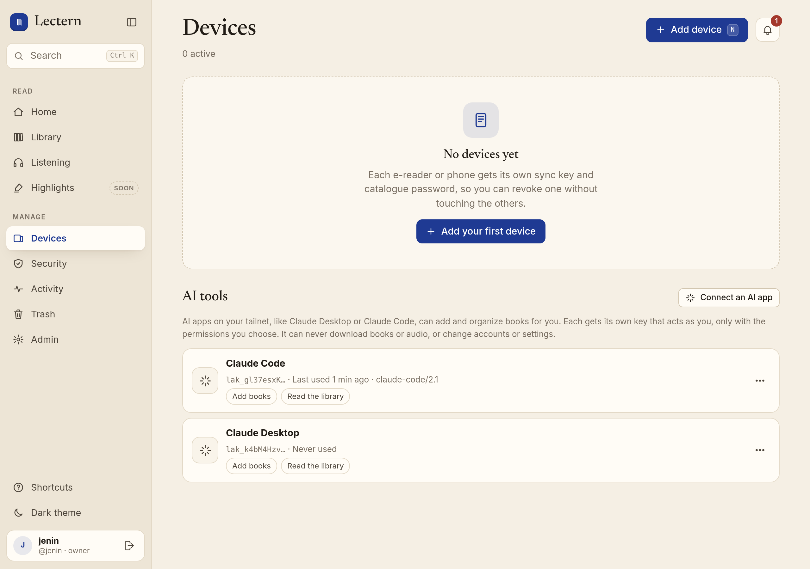
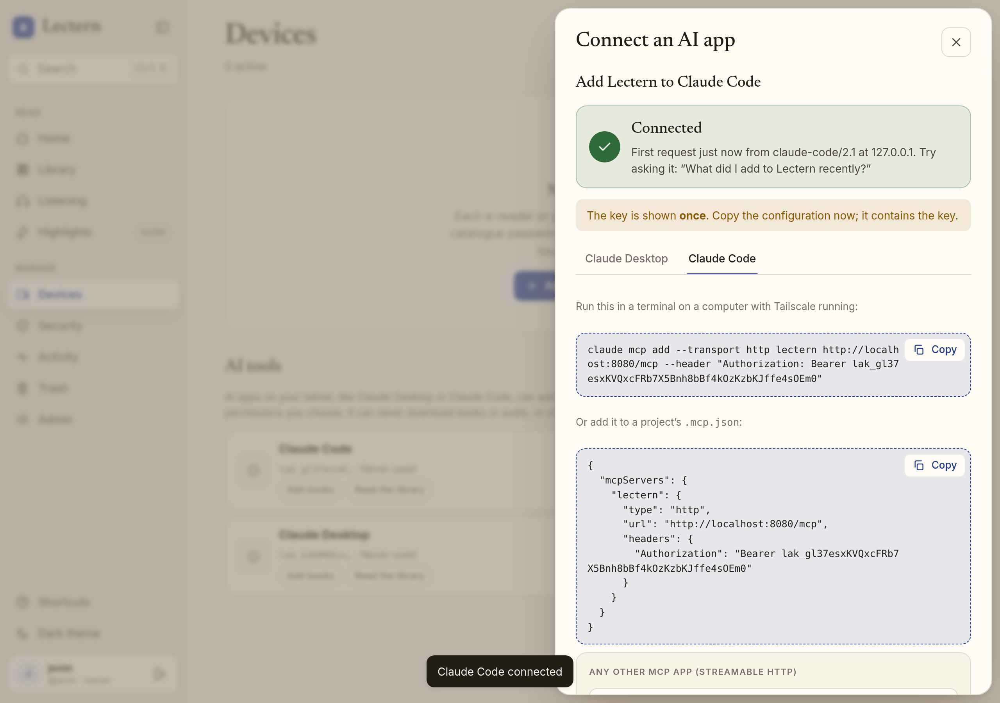

# AI access (MCP)

AI apps can manage your library through Lectern's [Model Context Protocol](https://modelcontextprotocol.io)
endpoint, `/mcp`. Examples are Claude Desktop and Claude Code, or any other MCP client that
speaks Streamable HTTP. An AI app can add books (upload, review, and, with the `file` scope, file them), search the library,
put books on shelves, send them to an e-reader, start alignment, and fix metadata. It acts as
one person and only within the permissions that person gave its key.



## Private by design

`/mcp` is served on the same address as the rest of Lectern. Behind `tailscale serve` (see
[deploy-tailscale.md](deploy-tailscale.md)) that is `https://lectern.<tailnet>.ts.net/mcp`,
reachable only from devices on your tailnet. Nothing about AI access needs to be public:

- **Do not use Tailscale Funnel** or otherwise publish Lectern on the Internet for this.
  Cloud-hosted AI connectors that call in from the Internet are not supported; use an app
  that runs on a computer in your tailnet (Claude Desktop, Claude Code).
- There is no OAuth server. Each app gets a key that you create and revoke yourself.
- The MCP SDK's DNS-rebinding protection only accepts the host from `LECTERN_BASE_URL`
  (and loopback), so set it to the address your AI app uses.

## Connect an app

1. Open **Devices → AI tools → Connect an AI app**.
2. Choose the app, name the key, and pick what it may do (below). Create the key.
3. Copy the configuration shown. It contains the key, which is shown **once**:
   - **Claude Desktop** (Settings → Developer → Edit Config, `claude_desktop_config.json`).
     Claude Desktop starts local servers from its config, so it reaches Lectern through the
     `mcp-remote` bridge (needs Node.js):

     ```json
     {
       "mcpServers": {
         "lectern": {
           "command": "npx",
           "args": ["-y", "mcp-remote", "https://lectern.<tailnet>.ts.net/mcp",
                    "--header", "Authorization:${LECTERN_AUTH}"],
           "env": { "LECTERN_AUTH": "Bearer lak_…" }
         }
       }
     }
     ```

   - **Claude Code**:

     ```sh
     claude mcp add --transport http lectern https://lectern.<tailnet>.ts.net/mcp \
       --header "Authorization: Bearer lak_…"
     ```

     or the same server in a project's `.mcp.json`
     (`{"type": "http", "url": …, "headers": {"Authorization": "Bearer lak_…"}}`).
   - **Anything else**: Streamable HTTP at the URL above, with the header
     `Authorization: Bearer lak_…`.
4. Restart or reload the app. The sheet changes to **Connected** when its first request
   arrives, and shows the app's name and address.



## Keys and scopes

| Scope | Lets the app | Tools |
| --- | --- | --- |
| `upload` (default) | add books to Review before filing; owners and members only | `upload_book`, `list_pending_imports`, `cancel_import` |
| `file` (default): “Can file books (confirm imports)” | file reviewed imports **this key uploaded** into the library; owners and members only | `confirm_import`, and auto-filing a certain match from `upload_book` |
| `read` | search, book details, alignment status, your progress, your shelves | `search_library`, `get_book`, `list_recent`, `list_shelves` |
| `organize` | shelves, send to device, alignment, metadata, PDF → EPUB | `add_to_shelf`, `remove_from_shelf`, `create_shelf`, `move_shelf`, `send_to_device`, `list_device_queue`, `start_alignment`, `job_status`, `edit_metadata`, `analyse_pdf_conversion`, `convert_pdf_to_epub` |

- A key belongs to one person and acts **as them**: the same role and visibility checks as
  the web app. Readers only see books on shelves shared with them and cannot add books, so a
  reader's key cannot hold `upload` or `file` (it defaults to `read`).
- `file` is on by default for new keys; untick it and the app's uploads wait in **Review
  before filing** for you. Without `file`, `upload_book` never files a book, even with your
  “file certain matches automatically” preference on. Keys created before `file` existed kept
  their ability to file: every key that had `upload` was given `file` too (migration `0013`).
  A key files only imports it opened itself with `upload_book`. Uploads you started in the web
  app, or that another key uploaded, are yours to file in the review sheet, even if the key
  has `file` and knows the import id. Likewise a key adds files (`import_id`, or resuming an
  `upload_id`) only to imports it opened.
- **API callers**: a script that creates keys with explicit `{"scopes": ["upload"]}` now gets
  a key that uploads but cannot file. Add `"file"` to keep the old behaviour. Editing metadata and alignment
  need an owner or member, as in the web app.
- Keys are shown once and stored as SHA-256 hashes (prefix `lak_`, 256 bits of randomness).
  Devices lists each key with its first characters, its scopes, and when, from where, and by
  which app it was last used. Revoking takes effect on the next request.
- **Editing a key.** Devices → AI tools → a key's **Edit** changes its scopes. The key is not
  shown again and not rotated, so the app keeps working. Every tool call reads the key's scopes
  from the database (nothing caches them), so the change applies to the app's next request. An
  upload in progress is checked again for `upload` just before its last chunk is finalized,
  and for `file` inside the filing transaction, after the book's rows are written and just
  before they commit, so a `file` removed at any moment before then stops the filing. Only
  the person who owns a key can edit it, not even the household owner.
- **Removing scopes** applies immediately and is always allowed, even for a person who was
  demoted to reader and whose key still holds `upload` or `file` from before.
- **Step-up.** Anything that gives an AI app more access needs a fresh confirmation in the
  same request: your password, or a passkey (with its PIN or biometric) against a single-use
  challenge. That covers adding scopes to a key, creating a key with more than the default
  scopes, and **registering a passkey** (otherwise someone holding only your signed-in
  session could add a passkey of their own and confirm with it). A session alone (a stolen
  cookie, an unlocked browser) is therefore not enough. Activity shows `ai_key.scopes_change`
  with the scopes before and after and how it was confirmed, and `ai_key.step_up_failed` /
  `passkey.step_up_failed` for wrong confirmations (rate limited like sign-in).
- If the server is busy writing (an AI app filing a book holds SQLite's write lock), an edit
  answers `503 busy` with `Retry-After` and changes nothing (also for a wrong step-up); try
  again. A filing refused at the last moment leaves the library exactly as it was, including
  `book.json`.
- A key is accepted **only** at `/mcp`. It cannot open `/api`, `/library`, or `/opds`, so it
  cannot download book files, audio, covers, or read-aloud EPUBs. No tool returns file
  contents or download links. No tool manages users, invites, keys, or server settings.

## Tools

Book ids are numbers (`search_library` returns them). Devices are given by name or id.
Shelves are nested folders, given by id, by **path** from your top level
(`Kids/Picture books`, case-insensitive), or by a name only one of your shelves has; an
ambiguous or unknown shelf is an error that lists your shelves with their paths and ids.
Errors come back as tool errors the AI app can read, for example
`not_found (not found, or not visible to this person)` or
`forbidden: needs file scope. This AI key does not have it; its owner can add it in Lectern
under Devices → AI tools → Edit.`

- `upload_book`: put a book or audiobook file (`.epub`, `.pdf`, `.cbz`, `.mobi`, `.azw3`,
  `.mp3`, `.m4b`/`.m4a`, `.ogg`/`.opus`, `.flac`) into **Review before filing**. CBR is not
  supported; convert it to CBZ ([pdf-comics.md](pdf-comics.md)). MOBI and AZW3 are converted to
  EPUB; DRM-protected ones are refused with `drm_protected` ([kindle.md](kindle.md)). The file's first bytes must match its extension. Files up to 2 MiB go in one call as base64. Larger
  files are sent in 2 MiB chunks: the first call gives `total_size` and the whole file's
  `sha256` and returns an `upload_id`; each later call gives `upload_id`, `offset`, and the
  chunk. A call with only `upload_id` reports how far the upload got (resume). This is the
  same resumable upload session as the web app's, with the same size limits, quota, checksum,
  and format checks. When the file is complete, the result has the detected metadata and the
  proposed match (join an existing book, with its confidence and reason, or a new book).
  Several files of one book (an EPUB, PDF, or CBZ and its tracks) share an `import_id`; pass `finish=false`
  until the last one.
- `list_pending_imports`: your uploads waiting for review.
- `confirm_import` (scope `file`): file one: `accept` the proposal, `new`, or `join` a `work_id`, optionally
  with metadata corrections. Joining only fills the book's empty fields, and adding audio to a
  book that already has an audiobook needs `add_audio_tracks`. Same as the review sheet.
- `cancel_import`: discard it and its files.
- `search_library` takes the Library's filter syntax ([filters.md](filters.md)), such as
  `format:epub -has:audio author:"Tolstoy" year:1850..1900 progress:<50%`, and a `sort`; it
  returns the filter it ran in canonical form as `filter`. A value it cannot take is an
  `invalid_filter` error with the reason.
- `list_recent` (`added`, or what you `read` most recently), `get_book`
  (metadata, formats, audiobook length, alignment status and job, shelves, your progress).
  Formats are labelled `EPUB`, `PDF`, `CBZ`, or `audiobook`.
- `list_shelves`: every shelf you see, with its path, parent, books directly on it,
  sub-shelves, and your permission (`owner`, `edit`, `view`). A shelf shared with you appears
  at your top level; shelves above it that are not shared with you are never named. A smart
  shelf has `smart: true` (and its `filter`, for people who manage it); its books are its
  filter's matches, so `search_library` with `shelf:"<path>"` lists them and nothing is
  added to it by hand.
- `add_to_shelf`, `remove_from_shelf`: shelves you may edit, with the shelf rules of the web
  app (for example, a reader with an edit grant cannot widen another reader's library). A book
  can be on several shelves; adding never takes it off another.
- `create_shelf`: `path` such as `Kids/Picture books` makes the missing shelves along it
  (top-level shelves need an owner or member; inside a shelf, edit permission there; at most 8
  deep; names cannot contain `/`).
- `move_shelf`: move a shelf with everything in it into another shelf (`to`: id or path) or to
  the top level (`to: ""`). Needs the right to manage it; never into itself or below itself.
- `send_to_device`, `list_device_queue`: the per-device queues from
  [device-queues.md](device-queues.md). Your own e-readers; the owner can also send to
  household devices, but only books that device's person can see.
- `start_alignment`, `job_status`: queue text–audio alignment for a book with an EPUB and an
  audiobook and follow its progress and ETA ([alignment.md](alignment.md)). PDF and CBZ have
  no text, so a book without an EPUB cannot be aligned.
- `analyse_pdf_conversion`, `convert_pdf_to_epub`: convert a text PDF to an EPUB edition in
  two steps (docs/pdf-epub.md): the first analyses the PDF and returns the detected rules
  with their evidence (and the converted text of chosen pages); the second converts with the
  rules the person approved. Follow either job with `job_status`.
- `edit_metadata`: change fields with the editor's validation (lengths, language tag, dates,
  and no control characters). `expected_version` from `get_book` refuses the edit if the book
  changed since. Each edit is a revision you can undo in the web editor.

## Limits, audit, and alerts

- **Rate limits.** `LECTERN_MCP_REQUESTS_PER_MINUTE` (default 240) per key, counting every
  MCP message, including upload chunks; over it the server answers `429`. Failed keys count
  per address against `LECTERN_RATE_LIMIT_PER_MINUTE`, and an address over that limit is
  refused before any key lookup, so keys cannot be guessed.
- **Audit.** Every tool call writes an `mcp.call` row to Activity: the tool, the key, and the
  outcome (`ok`, `denied (needs file scope)`, or the error). The tools also write the same rows
  as the web app (`upload.complete`, `import.file`, `queue.add`, `work.edit`, …). Creating,
  editing, revoking, and first use of a key are `ai_key.create`, `ai_key.scopes_change`,
  `ai_key.revoke`, `ai_key.first_use`.
- **Alerts.** A key's first request notifies its person ("Claude Desktop connected"). More
  than `LECTERN_MCP_BURST_COUNT` tool calls (default 200) within
  `LECTERN_MCP_BURST_WINDOW_SECONDS` (default 600) notify the person and the owners, at most
  once an hour per key (`ai_key.burst`; `0` turns it off).

## Implementation notes

`lectern/mcp_server.py` mounts the official MCP Python SDK (`mcp` 2.x, `MCPServer`) in
stateless Streamable HTTP mode with JSON responses. Lectern authenticates and rate limits the
request before the SDK sees it. Each tool reloads its key (so a revoke or scope change between
messages takes effect), checks the scope, then calls the same functions as the web app's routes:
`routes/api/uploads.py` and `routes/api/imports.py`, `device_queue`, `routes/api/shelves.py`,
`routes/api/align.py`, and `routes/api/editor.py`. Tests: `tests/test_mcp.py`, including an end
to end run of the SDK's own client against a live server.
