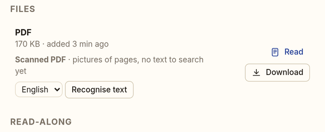
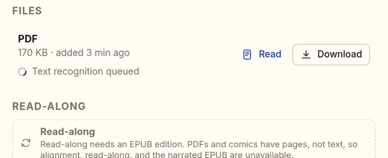
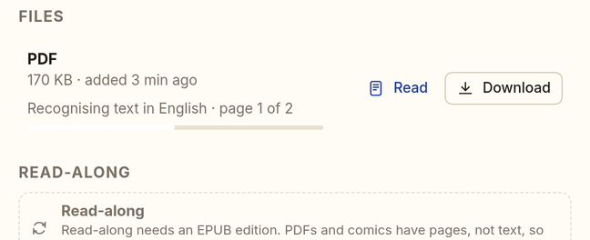
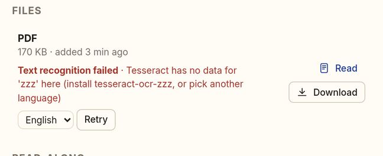
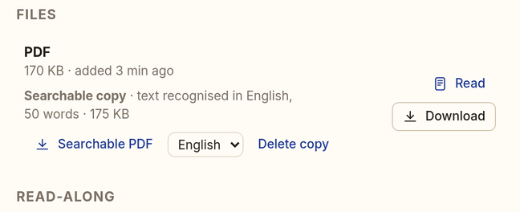

# Text recognition (OCR) for scanned PDFs

A scanned PDF is pictures of pages: nothing in it can be searched, selected, read aloud, or
aligned. Lectern finds scans, recognises their text with
[Tesseract](https://github.com/tesseract-ocr/tesseract) as a background job, and keeps a
**searchable copy**: the same pages with an invisible text layer, so any PDF viewer can search,
select, and copy the text. The original file is never changed. Issue #17, phase 1.

| Scan, not recognised yet | Queued | Recognising | Failed (Retry) | Done |
|---|---|---|---|---|
|  |  |  |  |  |

## Which PDFs

The library sweep (Housekeeping, at startup and every `LECTERN_TRACK_RESCAN_SECONDS`) reads every
new PDF once in the sandboxed PDF child (the ingest limits and parser slots of
[pdf-comics.md](pdf-comics.md#parser-safety)): page sizes, `/Rotate`, page labels, the outline,
and how many characters each page's text layer has. **A PDF where fewer than half the pages have
40 or more characters is a scan**, the same rule the PDF text reader uses. The result is cached
by the file's SHA-256 (`<data>/ocr/scan/`), so a PDF is looked at once.

- A **text PDF** (born digital) is never recognised: the work says nothing, and asking for it is
  `409 has_text`.
- A **scan** gets one OCR job automatically (`LECTERN_OCR_AUTO=0` turns that off), when something
  can run it. A scan whose OCR failed, or whose copy was deleted, is left alone until someone
  asks again.

## Running it

OCR is a job like alignment and narration (kind `ocr`, capability `ocr`): queued, leased,
heartbeated with progress (`page 12 of 300`), retried with backoff (3 attempts), cancellable. It
never blocks filing: a PDF is in the library before anyone looks at its pages.

- **On the server** when Tesseract is installed (`LECTERN_OCR_LOCAL_RUNNER`, on by default). The
  Docker image includes Tesseract with English; for other languages add their data packages
  (`tesseract-ocr-fra`, `-deu`, …) to the image or install them on the host.
- **On a worker** (`lectern worker --capabilities ocr`, or the Mac worker when `tesseract` is on its
  PATH): it downloads the PDF, recognises the pages, and uploads them; the server builds the
  searchable PDF itself, so a worker never supplies a PDF. While an `ocr` worker is online, the
  server leaves new jobs to it for `LECTERN_LOCAL_DEFER_SECONDS`, then takes them.
- **Neither**: the work says *"No text recognition here: install Tesseract on the server (the
  Lectern image has it), or connect a worker that has it"*, and nothing is queued (`409
  no_engine` on request). A credential that has ever advertised `ocr` counts, so jobs wait for it.

### One page at a time (Raspberry Pi)

Every page is rendered and recognised in its own child process (`python -I -m lectern.ocr.child`)
with hard limits: `LECTERN_OCR_MEMORY_LIMIT_MB` of address space (1536 by default, Tesseract
included), 10 minutes of CPU, a 15-minute wall clock, no core dumps, `nice` 10. Pages are rendered
in grayscale at `LECTERN_OCR_DPI` (300) and at most 40 megapixels, and Tesseract uses
`LECTERN_OCR_THREADS` (1). Memory stays flat whatever the length of the book. A page that hits a
limit is tried once more at half the resolution, then left without text and counted
(*"2 pages could not be read"*); the rest of the book still gets its text. A timeout kills the
child and its Tesseract together. The server parses recognised pages in its own memory, so a
stored batch is at most 16 MiB and a book keeps at most 1.5 million words and 8 million
characters (the PDF text reader's caps; beyond them the document says `truncated`). Only one
searchable PDF is assembled at a time.

Recognised pages are stored in batches of 10 (`pages-00010.json`, the job's artifacts), so a
retry, a restart, or a worker taking over resumes at the first missing batch.

### Failures

A failure is shown on the work with its reason and a **Retry** button (owners, members):

| Reason | What happens |
|---|---|
| a language without Tesseract data (`Tesseract has no data for 'deu' here`) | on the server: fails at once. On a worker: retried with backoff (the server or another worker may have it), then failed. Pick another language or install its data |
| Tesseract missing on a worker | the worker hands the job back and stops offering `ocr` for a while |
| an unreadable or password-protected PDF | fails at once |
| anything else (a crash, a full disk) | retried with backoff, then failed |
| the server restarts mid-run | requeued at the next start (counts as an attempt), resumed from the stored batches |
| the PDF changes or its work is trashed mid-run | fails with that reason (Retry recognises the new file) |
| a worker disappears | its lease expires and the usual sweep requeues the job |

No state stays "running": every lease either heartbeats, expires, or is handed back.

## Language

The work's language metadata (from the EPUB, PDF XMP, or the editor) picks Tesseract's language:
`en`/`en-GB` → `eng`, `fr`/`fre` → `fra`, `zh-Hant` → `chi_tra`, and so on; unknown → English.
The card's language menu (the languages installed on the server) overrides it for one run;
choosing another language on a finished copy offers **Recognise again**. Up to three languages
can be combined (`eng+fra`).

## What is kept

Next to the work, under `derived/` (regenerable, not backed up, deleted with **Delete copy**):

- `ocr-<sha256 prefix>.pdf`: the searchable copy. Each word is drawn in text render mode 3
  (invisible) in a glyphless font whose `ToUnicode` map is the text itself, stretched to its box
  on the page image, in the page's own user space (rotated pages and offset crop boxes included).
  Download it from the card (*Searchable PDF*); it counts as a download.
- `ocr-<sha256 prefix>.json`: the recognised words, for the read-along pipeline below.

Both are removed when their PDF leaves the work.

## Read-along on scans (with the PDF text work)

The words file has exactly the shape of the PDF text reader's pages (`lectern.pdftext.extract`,
[pdf-read-along.md](pdf-read-along.md)): per page `{index, w, h, x0, y0,
rotation, label, chars, map_errors, words: [[text, x0, y0, x1, y1, size, flags]]}`, boxes in PDF
user space (points, origin bottom left, before `/Rotate`), flags 1 = line-end hyphen and 2 =
line break, plus the outline as `toc`. Each word's box spans its line, as PDFium's loose boxes
do. So the same layout step (running heads and page numbers, columns, dehyphenation, Unicode)
can build the same canonical text document from it, with `status: "ready"`, and sentences,
positions, alignment, narration, and the read-along overlay then work on scans unchanged.

Still to do (a small hookup, not part of this change): store a scan's
text from this file; mark the document as `ready` from the recognised text rather than by the
text-layer rule (a sparse scan, such as a picture book, would otherwise stay `needs_ocr`); and
record the OCR engine and language in the document, so a new recognition is a new text and an
older alignment goes stale.

## Not yet

- **A reflowed EPUB from the recognised text** (issue #17, phase 2) is a follow-up.
- Handwriting, tables and maths, comics, and editing recognised text are out of scope.

## API

- `GET /api/files/{id}/ocr`: `{status: "checking" | "not_needed" | "unreadable" | "needs_ocr" |
  "unavailable" | "queued" | "running" | "failed" | "done", pages, pages_with_text, language,
  default_language, languages, engine, worker, job, progress, message, error, result: {pages,
  pages_with_words, pages_failed, words, chars, language, engine}, download_url, size}`.
- `POST /api/files/{id}/ocr` `{"language"?}` (owners, members): start, retry, or redo in another
  language (`409 has_text | no_engine | another_pdf_running`, `422 invalid_language`).
- `DELETE /api/files/{id}/ocr` (owners, members): stop a running job and delete the copy.
- `GET /api/files/{id}/ocr/pdf`: the searchable copy.

Audit actions: `ocr.start`, `ocr.delete`. Worker contract: [contracts.md](contracts.md#ocr-on-external-workers).
