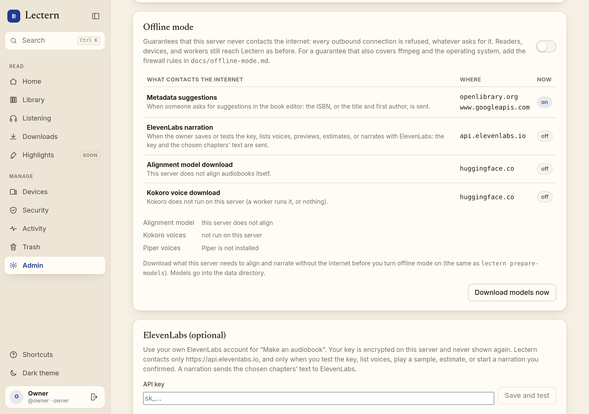

# Offline mode

One setting that guarantees Lectern makes no outbound internet connections. (Not to be confused
with the installed app keeping books on your phone, which is [offline.md](offline.md).)

Readers, e-readers, the web app, and workers still reach Lectern as before: offline mode is
about what the *server* starts, not what connects to it.

## What contacts the internet otherwise

Admin → Offline mode lists these with whether each is on right now.



| Feature | Contacts | When |
|---|---|---|
| Metadata suggestions (off by default) | `openlibrary.org`, `www.googleapis.com` | Someone asks for suggestions in the book editor: the ISBN, or title and first author |
| ElevenLabs narration (only with your key) | `api.elevenlabs.io` | Testing the key, voices, previews, estimates, and narrations you confirmed |
| Alignment model download (`align` image) | `huggingface.co` | Once, at the server's first alignment, unless the model is already downloaded |
| Kokoro download (`LECTERN_TTS_KOKORO_LOCAL=1`) | `huggingface.co` | Once, at the server's first Kokoro narration, unless already downloaded |

Nothing else in the server opens a connection outward. Not on that list, because they are not
the server: a Mac worker downloads its own models, and `/worker/install.sh` makes the Mac
fetch the worker from GitHub and PyPI. Restic backups write to a local folder.

## Turning it on

Either:

- **Admin → Offline mode**, the switch (owner only). It takes effect at once and survives
  restarts.
- **`LECTERN_OFFLINE=1`** in the server's environment (`.env` for the Tailscale setup). It is
  then on from the first moment the server runs, and Admin cannot turn it off.

While it is on:

- every outbound connection from the server is refused at one choke point, whatever asks
  for it, with the error *Lectern is in offline mode: refused to contact …*. Name lookups are
  refused too (DNS is outbound traffic); loopback (the reverse proxy, `tailscale serve`, the
  health check) keeps working;
- metadata suggestions and ElevenLabs show as unavailable, with that reason, and send
  nothing: a queued ElevenLabs narration fails at its next request instead of retrying;
- alignment loads its model from the data directory only (`HF_HUB_OFFLINE=1`, local files
  only). A missing model fails the job with a message that says to download it first.

## Download models first

Offline mode only blocks downloads; it cannot make up for them. Before turning it on, download
what the server needs to align and narrate:

- **Admin → Offline mode → Download models now**, or
- on the host:

  ```sh
  docker compose --env-file .env -f deploy/tailscale/compose.yaml exec lectern lectern prepare-models
  ```

By default that downloads the configured alignment model (`LECTERN_ALIGN_MODEL`) when the
image has the `align` extra, Kokoro's weights and voices when `LECTERN_TTS_KOKORO_LOCAL=1`,
and one Piper voice (`en_US-lessac-medium`) when Piper is installed without any voice. Choose
others with `--align-model base`, `--piper-voice de_DE-thorsten-high` (both repeatable), and
`--kokoro`. Models go into the data volume: alignment models into `<data>/models`, Kokoro into
the Hugging Face cache (`HF_HOME=/data/huggingface` in the image), Piper voices into
`<data>/tts/piper`. The download refuses to run while offline mode is on; when
`LECTERN_OFFLINE=1` set it, run that one command with `-e LECTERN_OFFLINE=0` after `exec`.

A job that asks for a different alignment model than the one downloaded fails while offline;
download that model too.

## A hard guarantee: firewall rules

Offline mode is enforced inside Lectern's Python processes: the server (on the standard
asyncio event loop, which the hook sees; uvloop would bypass it) and its alignment child, plus
`lectern align-transcribe`, `align-bench`, `backup`, and `restore` when `LECTERN_OFFLINE=1`.
Programs Lectern runs that are not Python (ffmpeg, restic, Tesseract), the Mac worker's tools
(`worker-doctor`), and anything else in the container are outside it. Firewall rules in the
container's network namespace close that gap: new outbound connections are rejected, while
answers to incoming connections and loopback still work.

A container's network namespace, and the rules in it, is rebuilt every time the container
starts: `docker compose up`, a restart, a crash restarted by Docker, a reboot. So the rules are
applied by [`deploy/offline-firewall.sh`](../deploy/offline-firewall.sh), which applies them
once and again after every start of the container. It needs `nft` on the host (`sudo apt
install nftables` if it is missing) and runs as a service:

```ini
# /etc/systemd/system/lectern-offline-firewall.service
[Unit]
Description=Lectern offline mode firewall rules
After=docker.service
Requires=docker.service

[Service]
ExecStart=/home/pi/lectern/deploy/offline-firewall.sh lectern-tailscale-tailscale-1 1000
Restart=always

[Install]
WantedBy=multi-user.target
```

Adjust the path to your checkout, then `sudo systemctl daemon-reload && sudo systemctl enable
--now lectern-offline-firewall`. `journalctl -u lectern-offline-firewall` shows each time the
rules were applied; *waiting for container …* means the name is wrong or the container is not
running yet. The arguments depend on the setup:

- **Tailscale setup** (`deploy/tailscale/compose.yaml`): `lectern-tailscale-tailscale-1 1000`.
  Lectern shares the Tailscale container's network, and Tailscale itself needs the internet
  to stay connected, so the rules match only Lectern's user; use your `LECTERN_UID` if you set
  another one in `.env`. The rules usually go in before Lectern starts, because Lectern waits
  for the sidecar's health check, but that order is not guaranteed; until they are in, only
  offline mode itself holds.
- **Plain `compose.yaml`** (a reverse proxy on the host reaches Lectern through the published
  port): `lectern`, with no user, so every new outbound connection from Lectern's own
  namespace is rejected. There is a moment at each start before the rules are in, during
  which only offline mode itself holds.

The rules it applies (the Tailscale variant; without a user the `meta skuid` matches go):

```nft
table inet lectern_offline {
  chain output {
    type filter hook output priority 0; policy accept;
    meta skuid 1000 oif "lo" accept
    meta skuid 1000 ct state established,related accept
    meta skuid 1000 reject
  }
}
```

Check that they hold, after setting it up and whenever in doubt (after a reboot, say). This
runs outside Lectern's own guard, so only the firewall can refuse it; *Connection refused* at
once is the expected answer, a timeout or a connection means the rules are not in place:

```sh
docker compose --env-file .env -f deploy/tailscale/compose.yaml exec lectern \
  python -c "import socket; socket.create_connection(('1.1.1.1', 443), timeout=5)"
```

(With the plain `compose.yaml`: `docker compose exec lectern python -c …`.)

To remove them, stop and disable the service and restart the container.

What was tested, in an orb rather than on a Pi: with the script running against containers of
the Lectern image, Lectern's user got *Connection refused* at once while root (as `tailscaled`
runs) still reached the internet; without a user every outbound connection was refused while
a request through the published port still got its answer; and the rules were back after
`docker restart` and after `docker stop` plus `docker start`. It was not run against a live
Tailscale deployment.
