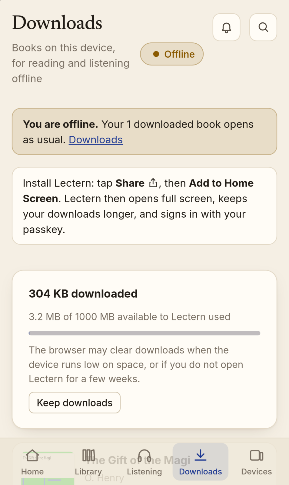
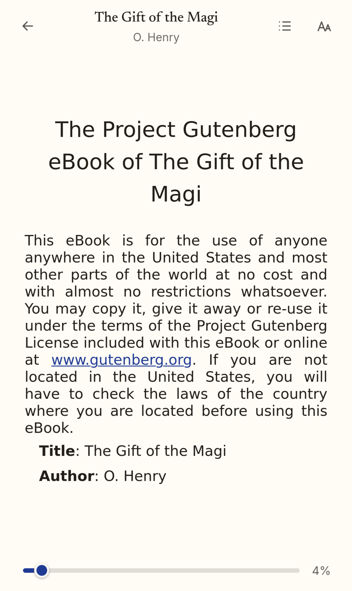
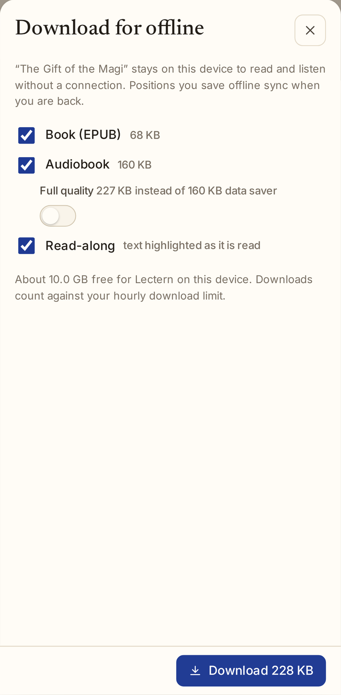
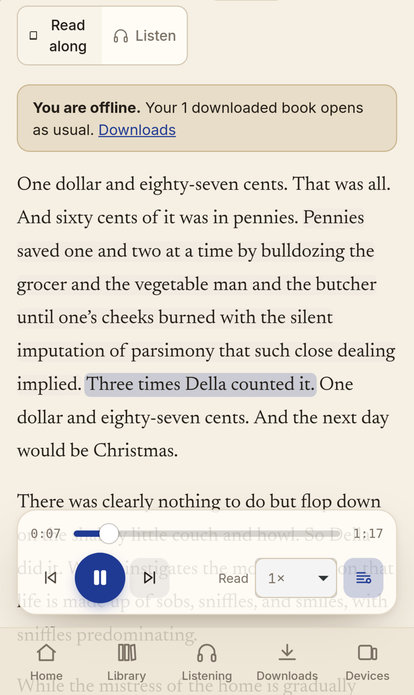
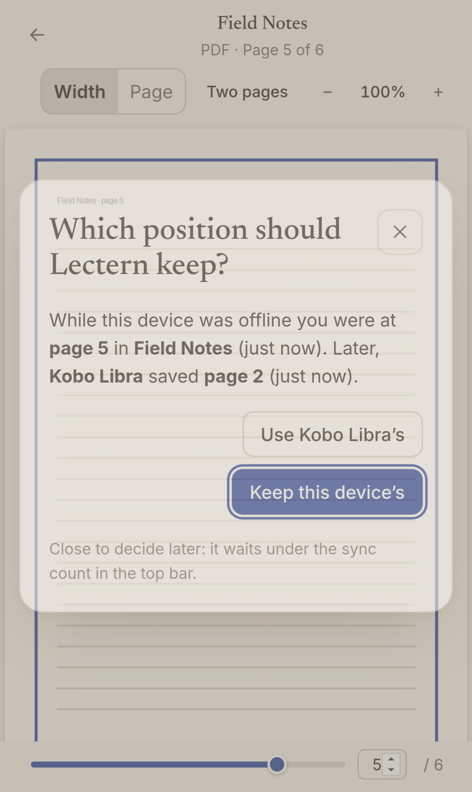
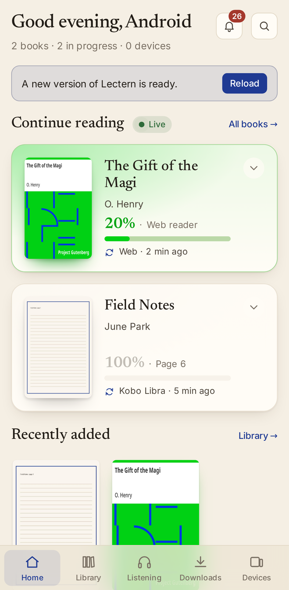

# Lectern on your phone: install it, download books, read and listen offline

Lectern is an installable web app (a PWA) for iPhone Safari and Android Chrome. Installed, it
opens full screen from its own icon, keeps books you download on the phone, and reads, plays,
and reads along with no connection. Positions you save offline sync when Lectern is reachable
again. Nothing is published anywhere: the app talks only to your own server, usually over
Tailscale.

| | iPhone (Safari) | Android (Chrome) |
| --- | --- | --- |
|  |  |  |
|  |  |  |

## 1. Reach Lectern from the phone

The phone needs an HTTPS address with a stable name: service workers, offline downloads, and
passkeys only work in a secure context. The [Tailscale setup](deploy-tailscale.md) gives you
one (`https://lectern.<tailnet>.ts.net`) without opening a port:

1. Install the Tailscale app (App Store or Play Store), sign in with the same account as the
   server, and turn it on.
2. Open `https://lectern.<tailnet>.ts.net` in **Safari** (iPhone) or **Chrome** (Android) and
   sign in.

With Tailscale off the server cannot be reached, which Lectern treats exactly like having no
signal: downloaded books keep working, the top bar says **Offline**, and positions wait to sync.
Turn Tailscale back on and the app notices by itself (it checks `/healthz` every 20 s while
offline, and whenever the app comes back to the foreground).

## 2. Install the app

- **iPhone or iPad:** in Safari tap **Share** (the square with an arrow), then **Add to Home
  Screen**, then **Add**. Other iPhone browsers can do the same from their share menu, but use
  Safari: it is what the home-screen app runs on.
- **Android:** Chrome offers **Install app** (or Lectern shows its own **Install app** button
  on Downloads); otherwise open Chrome's menu **⋮** and choose **Add to Home screen** or
  **Install app**.

Downloads shows the right hint for the phone you are on until the app is installed.

What you get: the app opens at `/app` in its own window (`display: standalone`), with Lectern's
icon (a maskable icon on Android, the apple-touch icon on iPhone), a launch screen (one per
iPhone screen size; Android builds its own from the manifest), the status bar in the page's
colour, and the layout padded around the notch, the Dynamic Island, and the home indicator
(`viewport-fit=cover` and `env(safe-area-inset-*)`).

**Sign in again inside the installed app.** iOS keeps a home-screen app's cookies and storage
separate from Safari's, so the app starts signed out and downloads made in a Safari tab are not
visible in the app (and the other way round). Download inside the app.

### Passkeys in the installed app

Passkeys work in the home-screen app on iPhone (Face ID / Touch ID, iCloud Keychain) and on
Android (Google Password Manager or another provider). Two details make that reliable:

- The manifest's scope is `/`, so `/login` belongs to the app. Signing in never leaves the
  app's window for a browser sheet with a different cookie jar.
- Safari shows the passkey sheet only when `navigator.credentials.get()` runs in direct response
  to the tap. The sign-in page therefore fetches its challenge when it loads (and refreshes it
  every 4 minutes, well inside the server's 5), so tapping **Sign in with a passkey** asks for
  the passkey immediately with no network wait first. Adding a passkey under Security works the
  same way.

Passkeys need the HTTPS address (`LECTERN_BASE_URL`); the passkey is bound to that hostname.

## 3. Download books

Open a book and tap **Download**. Choose what to keep:

- **Book (EPUB)** and/or **PDF**.
- **Audiobook**, as **data saver** (the ~64 kb/s copy the server makes with ffmpeg, see the
  README) or **full quality**. Data saver is the default when the book has one and it is
  smaller; the **Full quality** switch remembers your choice. If data saver is on for this
  device (its player switch, or your account's setting in Security when the device has not
  chosen), data saver stays the default. Without a data-saver copy, full quality is
  the only option (an owner or member can make one from the player).
- **Read-along**: the sentence list with audio times and the chapter text, when the book is
  aligned (needs the EPUB and the audiobook).

The sheet shows each part's size and how much space is left for Lectern. A download that would
not fit is refused before it starts. Lectern asks the browser to keep downloads (persistent
storage) on the first download; Downloads says whether that was granted and has a **Keep
downloads** button.

**Downloads** (`/app/downloads`, `G` `O`, in the tab bar on phones) lists every downloaded book
with its parts and size, storage used against the quota, and **Read**, **Listen**,
**Read along**, **Update** (when the server's copy changed), **Remove**, and **Remove all**.

Every file comes through the normal routes, so downloads follow the same rules as reading
online: the book must be visible to you (a reader sees only shelves shared with them), and each
file counts against the hourly download limits. A refused file stops the download and nothing
half-downloaded is kept. The audit log records `download.offline` when a download starts and a
`download` row per file (`detail` = `offline` for the EPUB, `offline pdf` for the PDF; audio is
metered per book like streaming).

## 4. Offline

- **Reader** (EPUB), **PDF viewer**, **player**, and **read-along** (with its sentence
  highlighting following the narration, tap-to-play, and sentence stepping) open downloaded
  books with no connection. The service worker answers their file requests from the copy on
  the phone, including the range requests audio seeking and pdf.js make.
- The top bar shows **Offline**, or **N positions to sync** / **Syncing…** after reconnecting.
  A banner under it says what still works.
- **Lock screen, headphones, car**: Media Session controls (play, pause, ±skip, previous and
  next chapter or sentence, seeking) with the cover as artwork, also offline.

### Positions saved offline

The reader, player, PDF viewer, and read-along save positions as usual. When the server cannot
be reached, the newest position per book waits in the phone's queue, in the same canonical form
it would have been sent (sentence and offset, audio seconds, or page). The player and
read-along's listen mode send the book's listening speed with each position, so a speed changed
offline waits in the queue with it, and is used on this device straight away. The queue is sent when the
connection comes back, when the app returns to the foreground, and at start-up.

Online, Lectern keeps whichever position arrived last. A queued position arrives late, so the
server judges it by when it was **recorded** instead (correcting the phone's clock by the
difference between the phone's and the server's time at sending):

- If no other device saved a position since this phone last saw one, the queued position wins.
- If another device saved one, but earlier than the queued position was recorded, the queued
  position wins: it is the latest.
- If another device saved one **after** the queued position was recorded, Lectern asks:
  *"While this device was offline you were at page 5 in Field Notes (12 min ago). Later, Kobo
  Libra saved page 2 (3 min ago)."* **Keep this device's** sends it again with `keep` and the
  server time of the position the prompt showed; **Use Kobo Libra's** drops it and moves the
  open reader or player there.
- **Keep this device's** replaces only the position the prompt showed (compare-and-set). If
  another device saved again while the prompt was open (or waiting under "decide later"), the
  server refuses with a fresh conflict and the prompt asks again with the newer position:
  nothing is overwritten unseen.
- A position saved online replaces anything queued for that book that was recorded before it.
  The queue applies each server answer only if the entry is still the one it sent, so a sync
  answering after an online save never brings an older position back as a conflict.

API: `PUT /api/works/{id}/progress` and `PUT /api/files/{id}/progress` accept
`"offline": {"recorded_at", "sent_at", "base", "keep", "expect"}` (ISO 8601 with a time zone;
`base` is the server time of the last position the phone had seen; `expect`, with `keep`, the
server time of the position being replaced). A losing replay is
`409 {"detail": "progress_conflict", "server": <the server's position>, "recorded_at": ...}`.

## 5. Updates, revocation, sign-out

- **Updates.** Every build of the web app is a new service worker (its version is a hash of the
  build). It installs in the background and waits; the app shows **A new version of Lectern
  is ready · Reload**. Nothing changes under you mid-chapter. The app checks for a new version
  whenever it comes back to the foreground.
- **Reconnect check.** On reconnect and on start-up the app sends its downloaded books and their
  revisions to `POST /api/offline/check`. A book that was deleted, trashed, or is no longer on a
  shelf shared with you is **removed from the phone** ("Removed from this device, no longer
  available to you: …"). A book whose files, audio, alignment, or details changed is marked
  **Changed on the server** with an **Update** button; the old copy keeps working meanwhile.
- <a id="signing-out"></a>**Sign-out** deletes everything the app keeps on the phone at once,
  online or not: downloaded files, read-along data, queued positions, and positions remembered
  per book. Then it asks the server to end the session; once the server answers, the app shell
  caches and the service worker go too. The server's sign-out response also sends
  `Clear-Site-Data: "cache", "storage"`. On phones, **Sign out** is at the top of Security and
  in the ⌘K palette.
- **Signing out offline.** The server session cannot end until the server hears about it. Until
  then the app shows only **Signed out** (it never uses the session again) and retries on every
  start, on reconnect, and every 20 s. It stops only when the server confirms the session is
  over (`200 {"signed_out": true}`). A 502 from `tailscale serve` while Lectern restarts, a 403,
  a 5xx, or a Wi-Fi sign-in page are not confirmations, and the app keeps retrying. Signing in on the phone, as anyone, also ends any session
  the browser still holds, so the next person never inherits the previous one's account.
- **Revoked or expired sessions.** A session that ends any other way (signed out from another
  device, revoked under Security, expired) deletes everything the next time the app reaches
  the server. A phone that stays offline cannot hear about a revoke, so downloads and the
  signed-in identity are kept offline only until a deadline the server sets on every
  successful check: the session's expiry, or `LECTERN_OFFLINE_MAX_AGE_SECONDS` (default
  14 days) after the last time the app reached the server, whichever is sooner. Past it the app
  deletes everything, even if it is left open. If someone else signs in on the phone, the
  previous person's downloads are deleted first.
  - The deadline is measured on the phone's clock. Setting the clock back extends it, so it
    bounds a lost or shared phone, not someone set on keeping books they lost access to.
  - The page enforces it, not the service worker: past the deadline the downloaded files stay
    in Cache Storage until the app next opens, which deletes them before showing anything.
- **Several tabs.** The position queue applies one change at a time within a tab. Two tabs (or
  the installed app and a browser tab on Android) can still interleave; the worst case is a
  conflict prompt that was not needed.

## Privacy: what is stored where

| What | Where | Contents |
| --- | --- | --- |
| App shell | Cache Storage `lectern-shell-<version>` | The public build (HTML, JS, CSS, fonts, icons); the same for everyone |
| Book files | Cache Storage `lectern-books` | Only files you downloaded on purpose: EPUB, PDF, audio tracks, the cover |
| Book details, read-along data, queued positions, who is signed in (and until when offline) | IndexedDB `lectern-offline` | Written by the app on download; deleted on sign-out, on a 401, and past the offline deadline |
| A sign-out still to reach the server | localStorage `lectern.signout` | That session's CSRF token, which `/logout` needs; deleted once the server answers |

The service worker never stores a response it was not told to store. It answers only app pages
(network first, the cached shell offline), public build files, and the book files the app
downloaded. Every `/api` request, `/login`, `/logout`, OPDS, `/mcp`, and every whole-file
download pass straight to the network and are never written to Cache Storage, so a cached API
response cannot leak to another session or person. The shell is fetched from
`/app/shell.html` without the session cookie; the manifest, icons, and `sw.js` are public too,
since the browser fetches them without a session. Everything else under `/app` still requires
sign-in.

## iPhone specifics and caveats

**Storage and eviction.** Since iOS 17 a site may use up to about 60% of the disk, and a
home-screen app gets the same quota as Safari. iOS can still delete website data:

- **Safari tabs:** Safari's tracking prevention deletes all script-writable storage (Cache
  Storage, IndexedDB, service workers) after 7 days of use without a visit to the site. Books
  downloaded in a Safari tab can vanish after a week away.
- **Home-screen app:** exempt from that 7-day rule. Its data is deleted only under storage
  pressure, when you delete the app from the Home Screen, or with Settings › Safari › Advanced
  › Website Data. Persistent storage (Downloads › **Keep downloads**) exempts it from
  eviction under pressure; iOS decides whether to grant it.
- So: **install the app and download inside it.** If a book is missing, download it again;
  positions live on the server and are not lost.

**Background audio.** Audiobooks keep playing with the screen locked or in another app, with
lock-screen controls, but iOS is stricter with web apps than with native ones:

- iOS suspends the page shortly after it leaves the screen. Audio keeps playing, but timers do
  not run reliably: the position is saved when you pause and when the app is hidden, not every
  15 s, and the sleep timer's fade-out happens when you return to the app if iOS paused its
  timer. Read-along highlighting, which follows the audio frame by frame, catches up when you
  come back.
- If iOS ends the app in the background (memory pressure, a long time away), playback stops
  and you start again from the last saved position; at most the last stretch since it was
  hidden is lost.
- Lock-screen buttons: iOS shows either ±seek or previous/next; Lectern provides both, and iOS
  picks.
- Audio from another app (a call, navigation) pauses Lectern; resume from the lock screen or
  the app.
- AirPlay and Bluetooth work as for any web audio. Android Chrome has none of these limits
  beyond the usual battery optimisation.

**Other iPhone notes.** Downloads run while Lectern is open on screen (iOS has no background
fetch for web apps); keep it open for a big audiobook. Comics (CBZ) are not part of offline
downloads yet; EPUB, PDF, audio, and read-along are.

## Tests

`frontend/e2e/` holds Playwright tests that run the installed-app flows on an emulated
**iPhone 15 (WebKit)** and **Pixel 7 (Chromium)** against a freshly seeded server
(`frontend/e2e/serve.py`: an owner, one reader per phone, *The Gift of the Magi* with audio,
a data-saver copy and alignment, and a PDF):

- install metadata (manifest, icons, launch screens, theme colours, safe areas, public files),
  the per-platform install hint, and "Update ready" → Reload into the new worker;
- download, then with the network off: the shell loads, the reader, player (ranged audio from
  the copy), Media Session, and read-along highlighting work; Cache Storage holds no API
  response;
- positions recorded offline sync on reconnect; a later save on another device brings up the
  conflict prompt, answered both ways;
- a book removed from the reader's shelf while offline is deleted on reconnect;
- sign-out deletes caches, IndexedDB, marks, and the worker; another person signing in never
  sees the previous person's downloads;
- passkeys: a full sign-in with a virtual authenticator on Chromium; on WebKit, that the passkey
  request happens in the tap with no network request before it.

```sh
npm --prefix frontend run build
npx --prefix frontend playwright install --with-deps chromium webkit
npm --prefix frontend run e2e
```

The tests write screenshots of each phone to `frontend/e2e-screenshots/`; the ones in
`docs/screenshots/pwa-*.png` come from there (downsized with
`magick mogrify -resize 1600x1600\>`). Server rules (manifest contents, the reconnect check,
visibility, download caps, the replay conflict rule, public files) are in
`tests/test_offline.py`; the service worker's routing, range handling, the queue, and platform
detection in `frontend/src/lib/__tests__/offline.test.ts`.

Icons and launch screens are drawn by `frontend/scripts/pwa_assets.py`
(`uv run python frontend/scripts/pwa_assets.py`) into `frontend/public/pwa/`.
