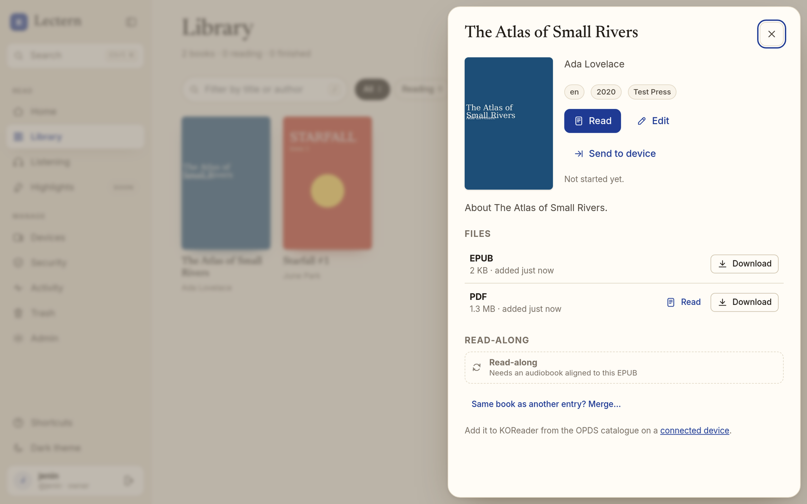
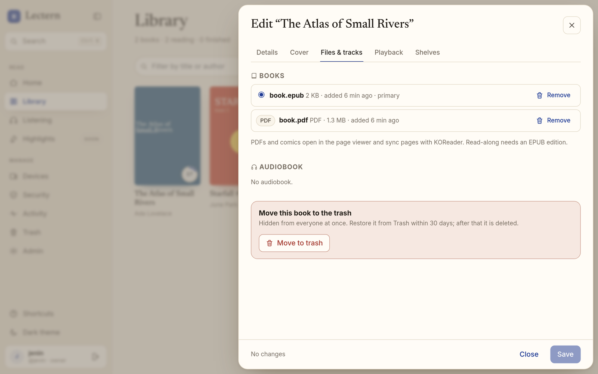
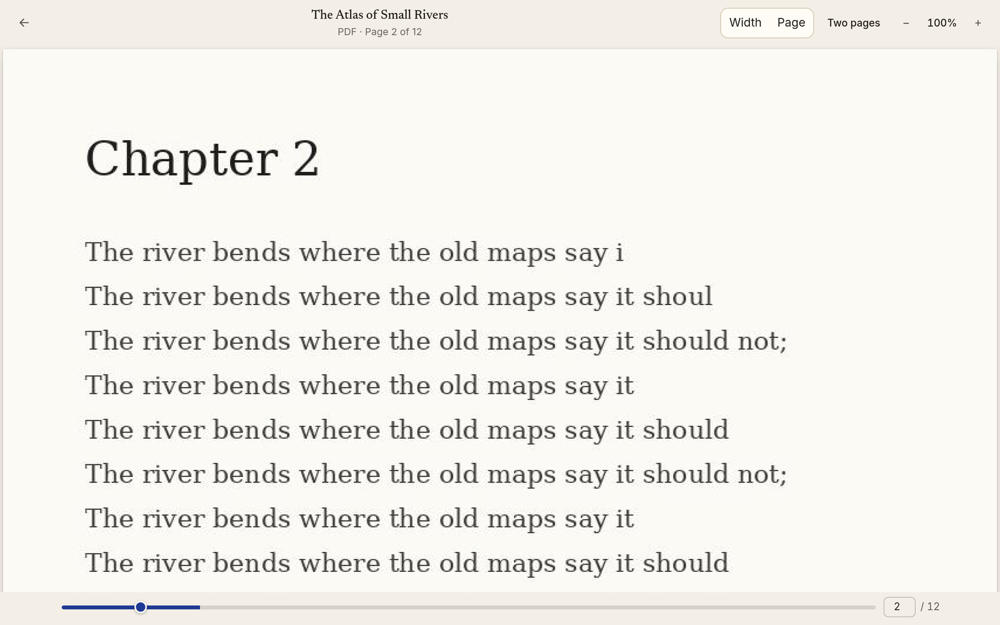
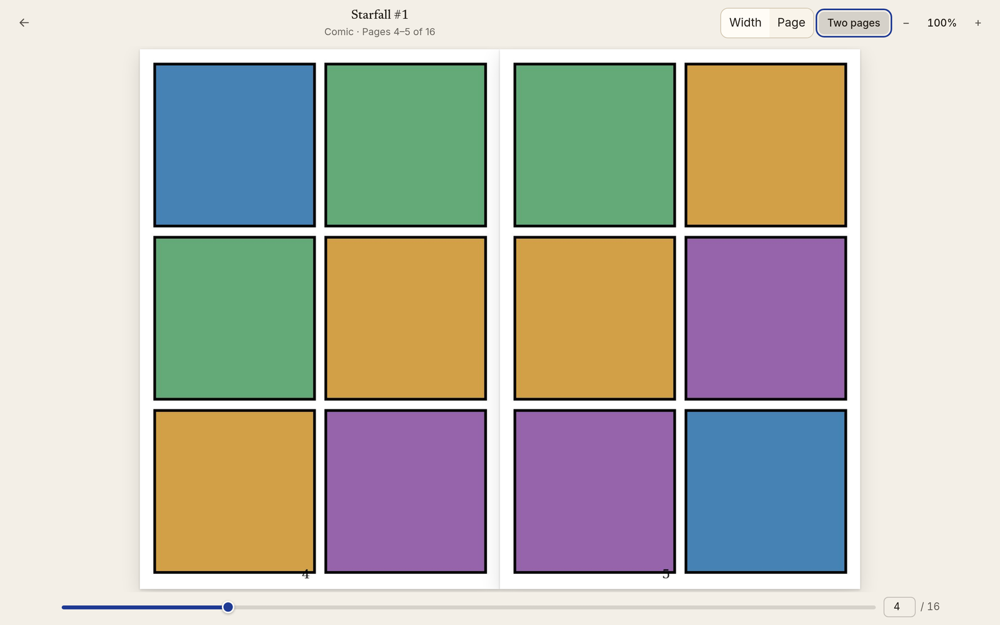
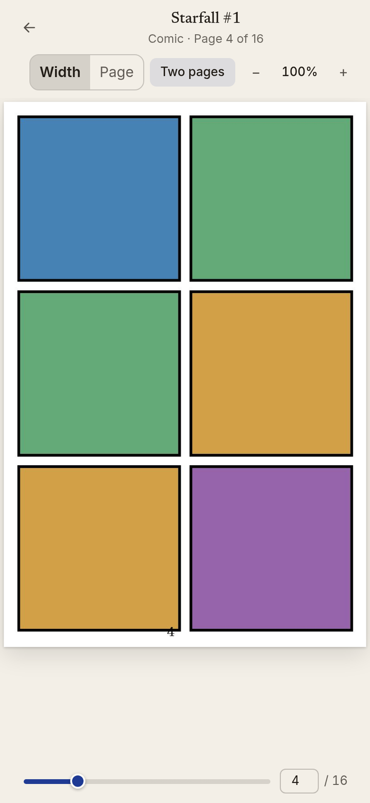
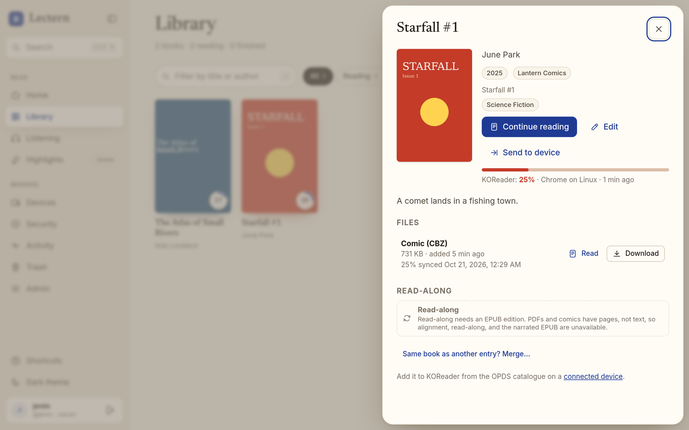

# PDFs and comics

Lectern files PDFs and CBZ comics next to EPUBs and audiobooks: through the inbox, the **Add
books** menu (and drag and drop), and the AI-tools upload (MCP), with the same review before
filing. A work can hold an EPUB and a PDF of the same book side by side.

| Format | Media type | Stored as | Recognised by |
| --- | --- | --- | --- |
| EPUB | `application/epub+zip` | `book.epub` | zip header `PK\x03\x04` |
| PDF | `application/pdf` | `book.pdf` | `%PDF-` at offset 0 |
| Comic | `application/vnd.comicbook+zip` | `book.cbz` | zip header `PK\x03\x04` |

A second file of the same format in one work is `book-<sha256 prefix>.<ext>`.

DRM-free MOBI and AZW3 are converted to EPUB at ingest and filed as EPUBs; DRM-protected ones
are refused ([kindle.md](kindle.md)).

**CBR is not supported.** Reading RAR safely needs a maintained RAR decoder, and the Python
options either run the non-free `unrar` program or go through libarchive's RAR code. Convert a
CBR to CBZ (unpack it and zip the images) before adding it. Uploads refuse `.cbr` with a
message saying so; the inbox leaves `.cbr` files where they are.

## Ingest

- **Magic bytes first.** The declared media type (or, in the inbox, the file extension) picks
  the parser, and the first bytes must agree before any parser runs. A zip renamed `.pdf` is
  refused as `not_pdf`, a PDF renamed `.cbz` as `not_comic`, in plain words.
- **PDF metadata** comes from the document Info dictionary (Title, Author, Subject, Keywords)
  and fills gaps from XMP (`dc:title`, `dc:creator`, `dc:language`, `dc:description`). Author
  strings like `A; B` or `A & B` become several authors; titles authoring tools leave behind
  (`Microsoft Word - draft.docx`, `untitled`) are cleaned or dropped.
- **Comic metadata** comes from `ComicInfo.xml` when present: Series, Number, Title, Writer,
  Publisher, Year/Month/Day, Genre and Tags, LanguageISO, Summary, GTIN (as ISBN), the
  `FrontCover` page, and `Manga=YesAndRightToLeft` (read right to left). Without it the comic
  is named after its file. Pages are the archive's images in natural order (`2` before `10`);
  `__MACOSX` and hidden files are skipped.
- **Covers** are the first page: a PDF's page 1 rendered to at most 1600 px, a comic's front
  cover image. Both go through the same bounded image decoder as every other cover.
- **Matching** works exactly as for EPUBs (same ISBN, or exact title and author, is certain;
  near matches wait for review), so a PDF of a book you have joins that work.
- **KOReader ids.** The partial MD5 KOReader computes for a file is stored at ingest, for PDFs
  and comics too, so progress sync works from the first open.

### Parser safety

| Limit | PDF | CBZ |
| --- | --- | --- |
| Where it runs | a child process (`python -I -m lectern.ingest.pdf`) with 1.5 GiB address space, 30 s CPU, 16 MiB output, no core dumps, `nice` +10, 45 s wall clock | in the server, without extracting anything to disk |
| Pages | at most 10 000 (`too_many_pages`) | at most 5 000 images, 10 000 entries |
| Size | the upload limit; a first page over 200 inches gets no cover | 64 MiB per entry, 2 GiB in total, and no entry over 1 MiB that expands more than 100× (`archive_too_large`) |
| Scripts | PDFium is built without V8 and the form environment (the only place it runs document JavaScript) is never started; pypdf only parses | no code in a CBZ |
| Encryption | password-protected PDFs are refused (`pdf_encrypted`) | encrypted entries are refused (`comic_encrypted`) |

Comic pages are read at most one byte past their declared size (a lying header is caught) and
served only if their first bytes are JPEG, PNG, GIF, or WebP, with `X-Content-Type-Options:
nosniff`.

## Library, editing, shelves, trash

PDF and comic works are ordinary works: full metadata editing with one-save undo, folder
renames that leave the bytes (and KOReader ids) alone, shelves, bulk edit, and the 30-day trash
for whole works or single files. In the editor's **Files & tracks** a PDF or comic is listed
with a badge; only an EPUB can be the *primary* edition, since the EPUB reader, sentences, and
alignment need text (`primary_not_an_epub_of_this_book`). The cover tab's **Use the book's own
cover** renders the first page again.

## OPDS, Send to device, KOReader

- OPDS acquisition links carry the file's own media type (`application/pdf`,
  `application/vnd.comicbook+zip`) and downloads are named `<Author> - <Title>.pdf` / `.cbz`.
- Works with only a PDF or comic can be queued to a device; the queue item is delivered when
  that device downloads the file in full (docs/device-queues.md).
- KOReader syncs PDF and CBZ positions as **page numbers**. Lectern stores them in KOReader's
  own record (`reading_progress`, keyed by the document's partial MD5), and the web viewer
  reads and writes that same record, so a page turned in the browser is where KOReader opens
  next and the other way round; the newer write wins, as between two KOReader devices. These
  positions are never projected onto sentences.

## Web viewer

**Read** on a PDF or comic opens the page viewer (`/app/reader/<work>?file=<file>`). A work
with an EPUB opens the EPUB reader from the main **Read** button; each PDF or comic file also
has its own **Read**.

- PDFs render with pdf.js on canvases, page by page; no annotation, form, or scripting layer is
  loaded, so nothing in a PDF runs. Character maps, standard fonts, and image decoders ship
  with the app (same origin).
- Comics show the page images the server serves after checking the archive.
- **Width** fits the page width (scroll down a tall page); **Page** fits the whole page;
  **Two pages** shows spreads the way a printed book opens (cover alone, then 2–3, 4–5, …).
  Right-to-left comics put the next page on the left and turn with ←.
- Zoom with − / + (or the keys `-`, `+`, `0` to reset); turn pages with ← →, Page Up/Down,
  Space, the page edges, the slider, or by typing a page number. Home and End jump to the ends.
- The page is saved a moment after you stop turning and when the tab hides. If another device
  saved a different page since you last read here, the viewer asks before jumping.
- Reading a comic counts as one download per browser per hour (on the first page); opening a
  PDF counts as one download, then reopening it is served from the browser cache.

## Text PDFs, scanned PDFs, and comics

A **text PDF** has a text layer Lectern reads: alignment, generated audiobooks, and read-along
on its pages work on it ([pdf-read-along.md](pdf-read-along.md)). A **scanned PDF** (page
images with no text) is marked *needs OCR* and only views and syncs pages until text
recognition ([issue #17](https://github.com/jeninh/lectern/issues/17)) gives it text.
**Comics** have pictures, not text: their card says read-along and narration need an EPUB or a
text PDF, the read-aloud status is `unavailable` with reason `needs_epub`, and no alignment is
queued. The **narrated EPUB** (EPUB 3 Media Overlay) export is made from an EPUB edition only. A
work with both an EPUB and a PDF aligns its EPUB as before, and read-along also works on the
PDF's pages.

## AI tools (MCP)

The MCP upload tool goes through the same resumable upload and review API, so it takes the
same formats. Its description should list them from `lectern.ingest.formats.FORMATS_SUMMARY`
("EPUB, PDF, or CBZ comics (CBR is not supported: convert it to CBZ), DRM-free MOBI or AZW3
(converted to EPUB), and M4B/M4A, MP3, OGG/Opus, or FLAC audiobooks") and the media types from `lectern.uploads.MEDIA_TYPES`.
