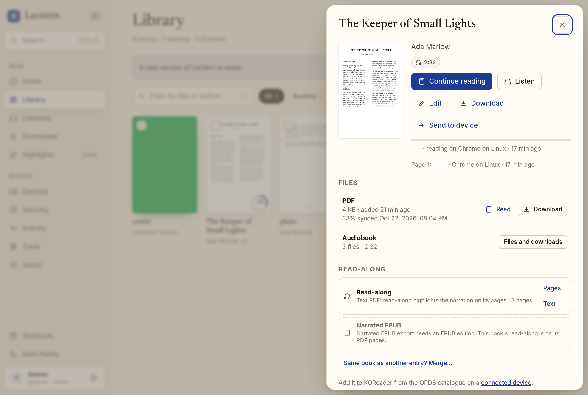
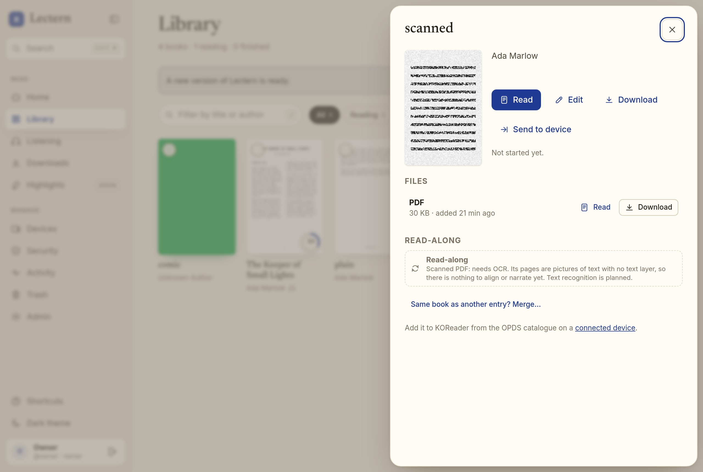
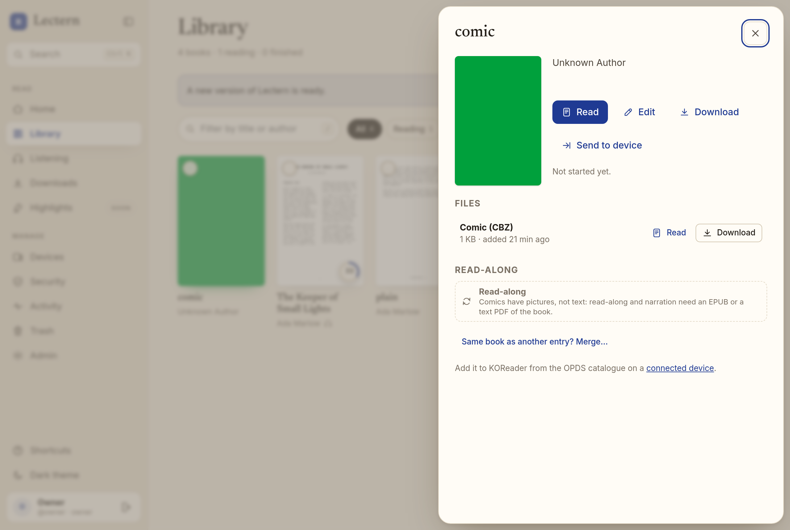
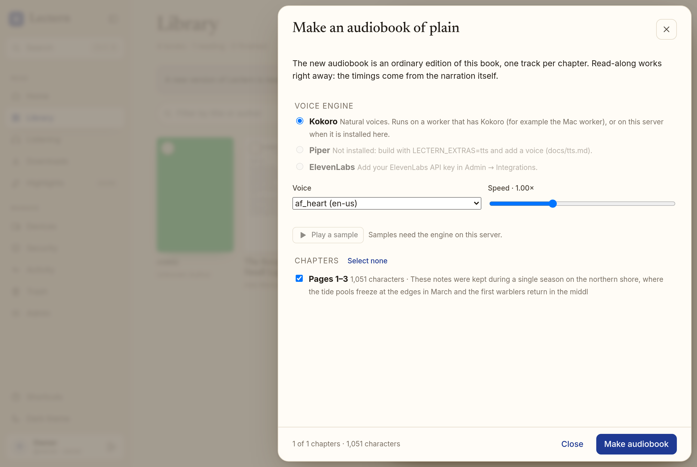
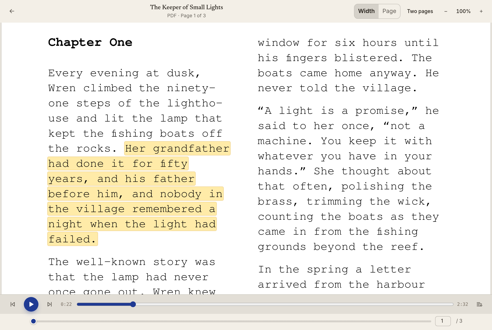
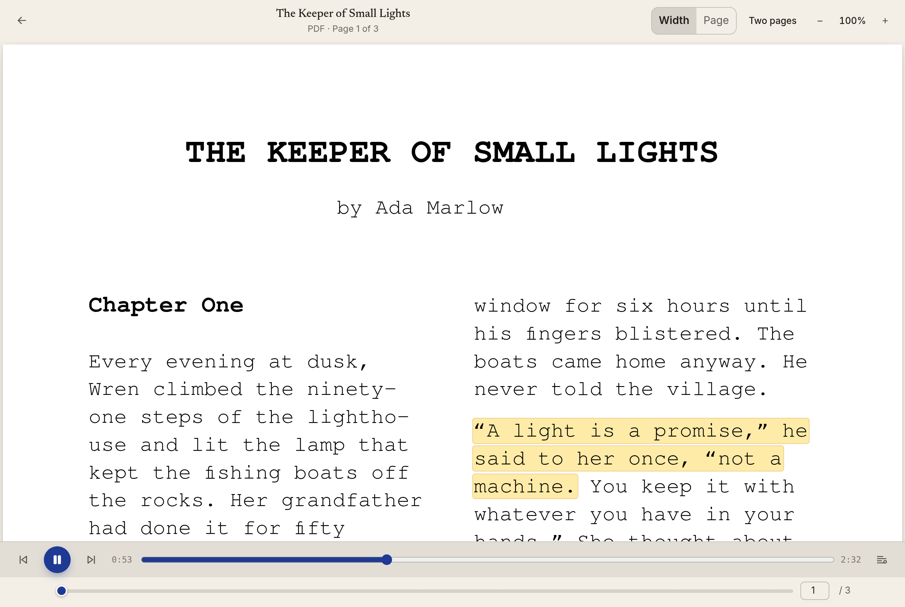
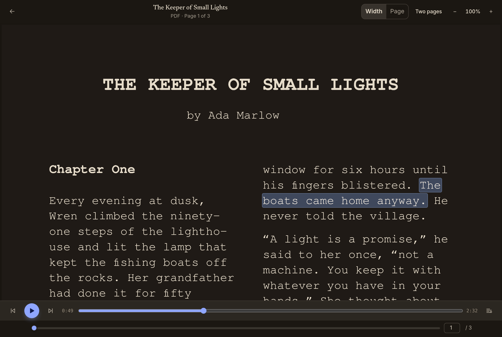
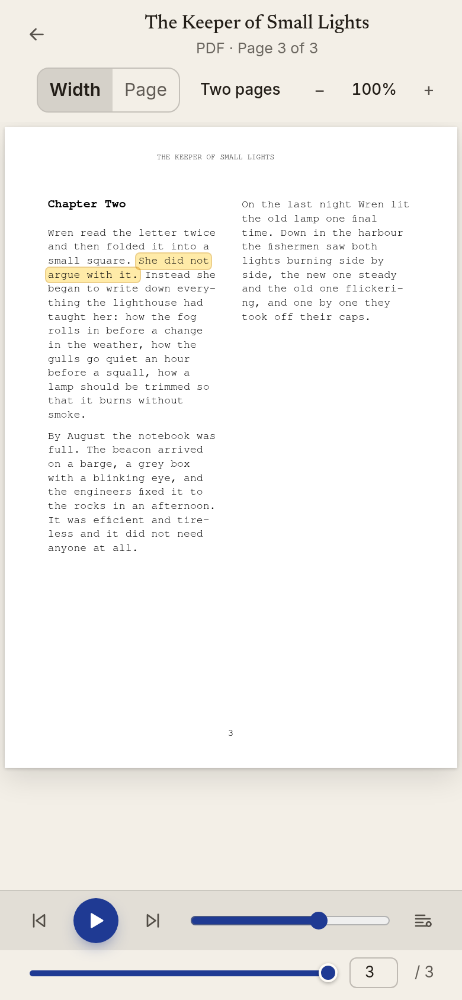

# Read-along and generated audiobooks for PDFs

A PDF with a text layer (a "text PDF": exported from a word processor, LaTeX, InDesign…) is a
book Lectern can read. Lectern extracts its text once and keeps it as a canonical text with
sentences and their boxes on the pages. Alignment, generated audiobooks, positions, KOReader
sync and read-along then work on the PDF the same way they work on an EPUB.

| The book is | What Lectern does |
|---|---|
| **Text PDF** | Reads the text layer. Read-along highlights the narration *on the PDF's pages*; **Make an audiobook** narrates it by outline chapter or page range; alignment runs on its text. |
| **Scanned PDF** (pictures of pages, no text layer) | Marks it **needs OCR** until text recognition ([ocr.md](ocr.md)) has run: viewing and page sync work, but nothing is aligned or narrated. Once it has, the recognised words become the same canonical text, so everything below works on the scan unchanged. |
| **Comic (CBZ)** | Pictures, not text: read-along and narration need an EPUB or a text PDF of the book. |
| **EPUB** | As before. When a work has an EPUB *and* a text PDF, the EPUB is the text, and the PDF's sentences are projected onto it, so read-along also works on the PDF's pages. |

The **narrated EPUB** export (EPUB 3 Media Overlays) is EPUB-only: it is made from an EPUB
edition, so a PDF-only work's card says *"Narrated EPUB export needs an EPUB edition"*.

## Reading the text layer

`lectern.pdftext` runs in the library sweep (Housekeeping, before the rescan; at startup and
every `LECTERN_TRACK_RESCAN_SECONDS`), one PDF at a time, for every PDF that is new, changed,
or was read by an older extractor.

- **Same safety caps as ingest.** The text is read by
  [PDFium](https://pdfium.googlesource.com/pdfium/) (pypdfium2, the maintained library the
  ingest check and cover renderer already use). Each batch of 48 pages runs in a child
  process (`python -I -m lectern.pdftext.extract`) under the ingest check's limits: the same
  CPU and memory rlimits, wall-clock timeout, page count and page size caps, and the same
  concurrency slots (`lectern.ingest.pdf`). On top of that: at most 30,000 characters per
  page, and 1.5 million words or 8 million characters per book (beyond that the rest
  is not read and the document says `truncated`). Encrypted PDFs are refused (`pdf_encrypted`). A PDF that
  fails three times is marked `failed` with the reason; owners and members can **Retry** it.
- **Words with boxes.** For every word it records its text, a loose box in PDF user space,
  font size, and whether it is bold, ends in a hyphen, or ends a line. It also records the
  outline (bookmarks) and page labels.
- **Layout** (`lectern.pdftext.layout`):
  - Unicode: NFC; ligatures and presentation forms (fi, fl, ff…) expanded (NFKC on those only);
    zero-width and private-use characters dropped; soft hyphens handled as hyphens.
  - Running heads, footers and page numbers: lines in the top and bottom 12% of the page
    that repeat on at least 40% of pages (by text with digits folded, and size) are removed,
    and so are bare page numbers ("12", "– 12 –", "Page 12", roman numerals).
  - Reading order: recursive XY-cut, so two- and three-column pages read column by column,
    with full-width headings and figures in place.
  - Paragraphs and headings: split on gaps and indents; a heading is a short line larger
    than the body or all bold. Paragraphs continue across columns and pages.
  - Dehyphenation: "lighth-" + "ouse" becomes "lighthouse" when the joined word is in the
    book's own vocabulary or the parts are not words; hyphens stay in compounds with kept
    prefixes ("self-", "well-", "half-", "ex-", "twenty-"…), before capitals and digits
  ("pre-War", "COVID-19"),
    and for em dashes.
- **Sections** are what a spine item is for an EPUB: from outline entries whose titles appear
  on their pages (leading "Chapter 3", "IV." enumerators are tolerated), else ranges of 10
  pages ("Pages 1–10").
- **Needs OCR**: fewer than half the pages have 40 or more characters of body text, and no
  text has been recognised yet. A recognised scan is read from its OCR words instead of its
  text layer (same layout step) and is ready whenever anything was recognised.

The result is one deterministic JSON document per PDF, written atomically to
`<work>/derived/pdf-text-<sha256 prefix>.json` (format in `lectern/pdftext/document.py`,
version 1): pages (size, rotation, label, has text), sections (title, page range, text,
blocks, and every word as `[start, end, page, x0, y0, x1, y1]`) and stats. Its SHA-256 is
what alignments record as their text, exactly like an EPUB's, so a new extractor version
makes an old alignment stale.

Sentences are split with the same segmenter as EPUBs and stored in `pdf_sentences` with
their first page and their boxes (one rectangle per line).

### What to expect

It is not a general PDF-to-text converter. Footnotes interleave with body text where they
sit; tables read row by row; text drawn as curves has no text layer. A PDF whose text layer
maps glyphs to the wrong characters (broken `ToUnicode`) is detected and treated like a scan.

## Positions: one sentence list per work

A work has one list of sentences (its *canonical* positions), from its text:

- **EPUB (and maybe PDFs)**: the EPUB's sentences, as before. Each PDF sentence gets the work
  sentence it is (`epub_n`), matched with the alignment anchors matcher over the text of both
  (`lectern.pdftext.project`); a PDF sentence with no counterpart in the EPUB has none, and
  is simply not highlighted.
- **PDF only**: the PDF's sentences are the work's sentences.

The list follows the text: an EPUB added to a PDF-only work replaces the PDF's list with the
EPUB's on the next sweep (positions move through the projection), and when the EPUB goes,
the PDF's list comes back. Once an alignment exists, its sentence map owns the list.

So a page in the PDF viewer, a sentence in the EPUB reader, an audio second and a KOReader
page all point at the same place. Saving a page projects to the first sentence on it; the
viewer offers *"Continue there?"* when the audiobook, the EPUB or KOReader got further. A
page turned offline and synced later never moves a work position that changed after it.

## Alignment

Alignment jobs, workers and leases are unchanged ([alignment.md](alignment.md)); only the
text input differs. A job whose text is a PDF has `text_source: "pdf"` in its payload and
needs the `align-pdf` capability, so a worker built before PDF text never claims one. The
built-in worker and the Pi/Mac worker (`lectern-align`) advertise it; a credential allowed
`align` may claim `align-pdf`. Its claim lists `inputs.text` (the canonical text document,
`GET /api/worker/jobs/{id}/inputs/text`) instead of `inputs.epub`.

## Generated audiobooks

**Make an audiobook** ([tts.md](tts.md)) works on a text PDF with Piper, Kokoro and
ElevenLabs. It narrates the PDF's sentences (the cleaned text: no running heads or page
numbers), one track per section, so chapters come from the outline, or are page ranges.
The sheet shows each chapter's pages. As with EPUBs, the timings come from the narration, so
read-along works as soon as it finishes. A scanned PDF says it needs OCR first
(`pdf_needs_ocr`); a PDF still being read says so (`pdf_text_pending`).

## Read-along on the pages

When a work has aligned (or generated) audio and a text PDF, the PDF viewer shows a player:

- the sentence being read is highlighted on the pdf.js page from its boxes (warm yellow on
  light pages, blue on dark);
- **following** turns to the narration's page, and scrolls a zoomed page to keep the
  highlight in view; **F** or the follow button toggles it (remembered on the device);
- **click a sentence** on the page to play from it; **Space** plays and pauses, **,** and
  **.** step a sentence;
- **dark mode** draws the page light on dark (pdf.js page colours; pictures keep theirs);
- the audio position is saved as the work's position (source `audio`).

The EPUB-style text read-along (`/app/read/{id}`) also works for a PDF-only work, from the
PDF's sections.

### Offline

Downloading a book with read-along ([offline.md](offline.md)) keeps the PDF, the audio, the
work's sentence timings and the PDF's boxes on the device, so read-along on the pages works
with the network off.

## API

- `GET /api/files/{id}/text`: `{status: "pending" | "ready" | "needs_ocr" | "failed", pages,
  pages_with_text, sections: [{title, page_start, page_end, from_outline, sentences,
  characters}], sentences, error, source: "text_layer" | "ocr" | null, ocr: {engine,
  language} | null, text_source: "epub" | "pdf" | null, map: "self" | "epub" | null,
  readalong}`.
- `GET /api/files/{id}/sentences?from=&to=` (pages of 2000): `{count, map, sentences: [{n,
  work_n, page, boxes: [[page, x0, y0, x1, y1]]}]}`. Only page numbers and rectangles, no text.
  `409 no_map` until the text is ready and current.
- `POST /api/files/{id}/text/retry` (owners, members): read a failed PDF again.
- `GET /api/files/{id}/pages` adds `text` (as above) and `position` (a newer work position,
  as a page).
- `GET /api/works/{id}/read-aloud` adds `text_source` and `pdfs`; a PDF-only work's reason is
  `export_needs_epub`.
- `GET /api/works/{id}/audiobook` chapters add `pages: [first, last]` (1-based) for PDF
  sections.

## OCR (issues #17, #62)

A recognised scan gets this same document, built from the OCR words file
(`derived/ocr-<prefix>.json`) by the same layout step: sections with text and words with
boxes, `status: "ready"`, plus `"ocr": {engine, language}`. Sentences, positions,
alignment, narration, the overlay and offline then work on scans with no other change.
Because the engine and language are part of the document, recognising again (another
language) is a new text: an alignment of the old one goes stale and is redone.
