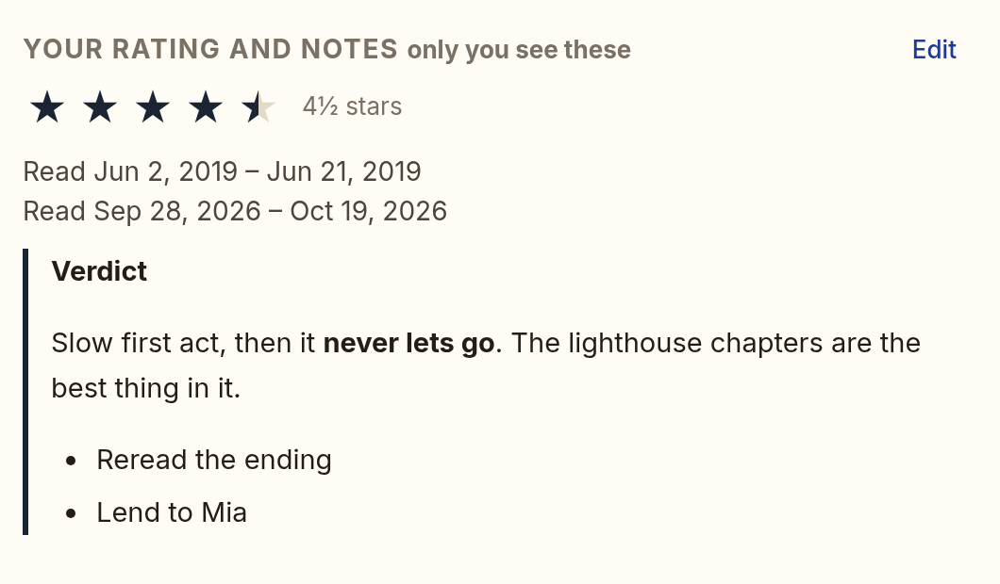

# Ratings, notes, and read dates

Every book's page has a **Your rating and notes** section: a rating from ½ to 5 stars, private
notes in Markdown, and the days you started and finished reading it. Only you see them. Other
people in the household, the owner included, never do.

## Rating

Click a star to rate. Each star has two halves: the left half of the fourth star is 3½ stars.
Click your rating again to clear it.

When you finish a book, Lectern asks **Rate it?**: on the book's page, and in the web reader
when you reach the end. **Not now** stops asking for that book.

## Notes

**Add notes or dates** (or **Edit**) opens the editor. Notes are Markdown: `**bold**`,
`*italic*`, lists, quotes, and links. HTML in your notes stays text; it never becomes part of
the page.

## Read dates and re-reads

Lectern already notices when you first start a book and when you reach the end, in KOReader,
the web reader, the page viewer, or the audio player. That is your read until you change it,
marked *from your reading progress*.

In the editor you can:

- **correct the dates**, such as a book you finished on paper a week before KOReader synced;
- **add a read** for a book you read before Lectern, with either date left blank if you do not
  remember it;
- **add a re-read**: each read has its own start and finish.

Once you save dates for a book, they replace the ones from your reading progress. Dates left
exactly as they were stay *from your reading progress*. Removing every read and saving brings
them back. A read with a start and no finish closes by itself on the day you reach the end of
the book again.

Lectern records only the days you give it. It never counts reading time for a read you added
by hand.

**Forget all** deletes your rating, notes, and saved dates for the book.

## In the Library

- `rating:` filters by your rating: `rating:5`, `rating:>=4`, `rating:3..4.5`. `-rating:>0`
  is every book you have not rated. **Your rating** is also a sort under **More**.
- `started:` and `finished:` use your corrected dates and every re-read: `finished:2025` finds
  a book you read in 2023 and again in 2025. Sorting by them uses your most recent read.
- A smart shelf such as `rating:>=4` shows each person the books *they* rated that highly.

See [filters.md](filters.md) for the whole syntax.

## Reading stats

`GET /api/reviews/finished?year=2025` lists the books you finished that year, by date, with
your corrected dates and ratings, a re-read counting each time, and your ten top-rated. Reading
stats and the year in review build on it.

## Privacy

- Your ratings, notes, and dates are stored per person and only ever read back for the person
  who wrote them. The API answers only for books you can see; a book unshared from you keeps
  your review, hidden, until it is shared again.
- They are not on the OPDS catalogue and not on the home Wi-Fi listener. A smart shelf you
  built on `rating:` still lists its books on your e-reader, never the ratings.
- An AI app sees them only with an AI key that has the **Your ratings and notes** (`reviews`)
  scope. That scope is never a default; see [mcp.md](mcp.md). Without it, `started:` and
  `finished:` (and sorting by them) use only the dates Lectern recorded from your reading,
  never ones you typed in.
- They are part of the database, so the owner's backups and restore include them. Deleting a person deletes theirs. Merging two copies of a book
  keeps everyone's: the kept book's rating and notes win, filled from the other's when empty, and
  both sets of dates are kept.

## API

- `GET /api/works/{id}/review`: `{rating, notes, read_throughs: [{id, started_on,
  finished_on, derived}], corrected, finished, dismissed, prompt}`. Dates are `YYYY-MM-DD`.
- `PUT /api/works/{id}/review` with any of `rating` (stars, or `null`), `notes`, and
  `read_throughs` (`[{started_on, finished_on}]`, replacing them all; `[]` goes back to the
  derived dates). A bad value is `422` with a reason: `bad_rating`, `bad_date`, `bad_order`,
  `empty_read`, `future_date`.
- `POST /api/works/{id}/review/dismiss`: **Not now** to **Rate it?**.
- `DELETE /api/works/{id}/review`: **Forget all**.

Stored in `book_reviews` and `read_throughs` (migration `0030_book_reviews`, `lectern.reviews`).
