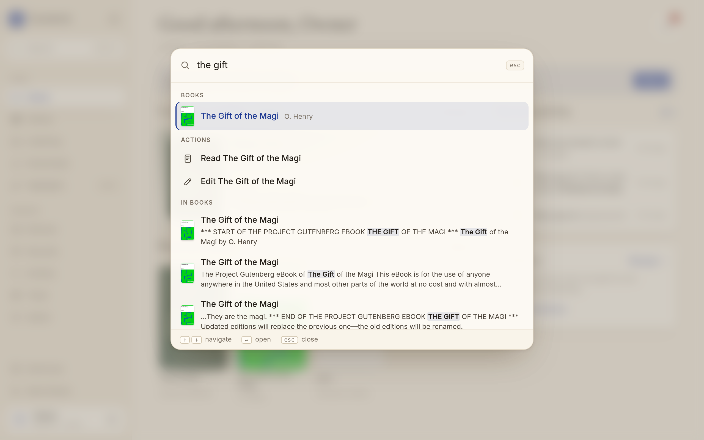
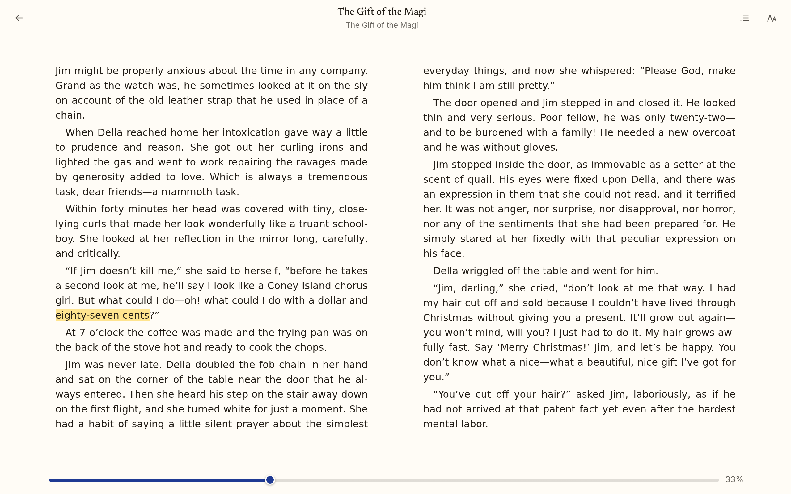

# Search inside books

Cmd/Ctrl+K finds books, shelves, authors, devices, and settings by name. Type three letters
or more and it also searches **inside** your books: the **In books** section, below the other
results, shows passages that match, each with a short snippet and the words that matched
marked. Choose one (arrow keys and Enter, or a click) and the book opens at that passage with
the match highlighted:

- an **EPUB** opens in the reader at the exact spot, the match marked in the text;
- a **PDF** opens at the page, with the match marked on the page.





## What you can search

- **Words and phrases.** The words you type are searched as a phrase first (in that order,
  together), then as words that all occur in the same passage. While you are still typing, the
  last word matches as a prefix once it has four letters (`call me ishm` finds *Call me
  Ishmael*). A trailing space means the word is complete.
- **Case and accents do not matter**: `cafe creme` finds *Café crème*.
- **Punctuation and search operators are ordinary characters**: quotes, `*`, `OR`, `NEAR`,
  and the like are not query syntax.
- At most 200 characters and 12 words per search, and 120 searches a minute per person
  (`LECTERN_SEARCH_REQUESTS_PER_MINUTE`). The palette waits for a pause in typing before it
  asks.

What is indexed: each book's EPUB (the one the reader opens, chosen in the editor) and the
text of each of its PDFs: the same reading-order text PDF read-along uses
([pdf-read-along.md](pdf-read-along.md)), once Lectern has read it, so a new PDF becomes
searchable a little after its text is ready. Search never opens a PDF itself. Comics,
audiobooks, and scanned PDFs without a text layer have no text to search. OCR
([ocr.md](ocr.md)) already makes a searchable copy of a scan, but its words do not feed the PDF
text document yet ("Still to do" there); once they do, the scan's text is indexed like any
other PDF's, with no change here.
Up to `LECTERN_SEARCH_MAX_CHARS_PER_WORK` characters (5 million, more than *War and Peace*)
per book.

## Who finds what

Search follows the same rule as the Library (`lectern.access.visible_works`):

- owners and members find passages in every book in the library;
- readers find passages only in books on shelves shared with them;
- books in the **Trash** are never found, by anyone, from the moment they are trashed.

A search answers with the visible passages only. It does not include counts or totals, and
a book you cannot see never shows up in a result, a snippet, or a "too broad" note.
Searching a word that only hidden books contain gives the same answer as searching a word
that no book contains.

One limit, stated plainly: the time a search takes depends on how often its words occur in
the whole index. A reader timing searches carefully could tell whether a word is very common
across the library (in thousands of passages). They cannot tell which book has it, or what it
says. The AI tools (`/mcp`) do not offer text search: they never return book content
([mcp.md](mcp.md)).

## Keeping the index up to date

The index is `<data>/search.db`, a separate SQLite file (FTS5). A background thread, the
indexer, keeps it in step with the library. Every `LECTERN_SEARCH_POLL_SECONDS` (10) it
compares what each book should have indexed (its files and their SHA-256) with what it did
index, and:

- **a book added** (upload, inbox, AI tools) is indexed;
- **a book edited** so its text changed (another primary EPUB, a PDF added, removed, or
  replaced, a PDF's text read again, a merge) is indexed again, the old passages replaced in one step;
- **a book trashed** is removed from the index (and is never found meanwhile);
- **a book restored** from the Trash is indexed again;
- **a book deleted for good** is removed.

Running it again changes nothing, so reindexing is idempotent. A newly filed book is
searchable within about ten seconds, and the first build of an existing library runs in the
background after an upgrade (see below). A file the indexer cannot read is skipped and noted;
a file that is briefly missing (a folder being renamed) is tried again later.

`search.db` is derived data: backups leave it out. After a restore, the indexer brings it back
in step with the restored library by itself. To rebuild it from scratch, stop Lectern, delete
`search.db`, and start Lectern again.

## Raspberry Pi

The indexer and the searches are built for a Raspberry Pi 4:

- **Memory.** A book is indexed one spine item (or PDF section) at a time, and PDFs are not
  parsed again: their text comes from the document PDF read-along already keeps. Searches
  stream through SQLite and hold no result set in memory; a PDF hit's page comes from the
  index, so no document is loaded to answer a search.
- **Disk.** Passages are stored compressed, so `search.db` is about the size of the books'
  plain text: roughly 1 GB for 3,000 novels. A plain FTS5 table would be more than twice that.
- **Indexing.** Indexing never takes the main database's write lock, so it does not slow down
  reading, syncing, or uploads. The first build of 3,000 novels (1.2 billion characters, the
  real indexer reading real EPUBs) took 5.3 minutes on the benchmark machine (3.8 million
  characters a second); on a Pi 4 expect roughly 20–30 minutes, in the background. Each look
  for changes costs about 40 ms on the benchmark machine for 3,000 books, every 10 seconds.
- **Latency target, Pi 4 with a few thousand books:** distinctive words and phrases (names,
  places, a line you remember) answer in **under 100 ms**. Words that occur in a large part of
  the library take longer. A search that runs past `LECTERN_SEARCH_TIME_BUDGET_MS` (2 s) stops
  and the palette says *Too many passages match. Add another word.*

Measured on the benchmark machine (2 vCPUs, x86-64) with `scripts/search_bench.py`: 3,000
EPUBs of 400,000 characters each, sentences of a Zipf-distributed vocabulary, indexed by the
real indexer; median of five runs:

| Search | Owner (sees all 3,000) | Reader (sees 40) |
| --- | --- | --- |
| A rare phrase (`lighthouse keeper`) | 2 ms | 0.9 ms |
| Common words and rare ones (`the lighthouse keeper`) | 59 ms | 58 ms |
| A moderately common word (rank ~2,000) | 66 ms | 27 ms |
| A rarer word (rank ~10,000) | 4 ms | 1.4 ms |
| Two moderately common words | 45 ms | 42 ms |
| Only very common words (`the of and`) | stopped, *too broad* | 0.9 s |
| `the` | stopped at 2 s, *too broad* | 0.5 s |

A Pi 4 is about 3–4 times slower than that machine, so distinctive words and phrases (rows
1, 4, and most of 2) stay under 100 ms there, and moderately common words land around
100–250 ms. These are estimates, not measurements on a Pi; run the script on one to check. The benchmark script is
`scripts/search_bench.py` (`uv run python scripts/search_bench.py 3000 400000 /tmp/bench`).

## Settings

| Variable | Default | |
| --- | --- | --- |
| `LECTERN_SEARCH_POLL_SECONDS` | `10` | How often the indexer looks for changed books |
| `LECTERN_SEARCH_MAX_CHARS_PER_WORK` | `5000000` | Text indexed per book |
| `LECTERN_SEARCH_REQUESTS_PER_MINUTE` | `120` | Searches per person per minute |
| `LECTERN_SEARCH_TIME_BUDGET_MS` | `2000` | A longer search stops and is answered *too broad* |

The indexer runs with the other background work (`LECTERN_BACKGROUND_JOBS`, on by default).

## API

`GET /api/search/text?q=<words>&limit=<1–20, default 8>&partial=<true|false>` (signed in).
`partial=true` (the default) lets the last word match as a prefix. Errors: `422`
`query_too_long` or `too_many_words`, `429` `too_many_searches` (with `Retry-After`).

```json
{
  "results": [
    {
      "work_id": 12, "title": "Moby-Dick", "author": "Herman Melville",
      "format": "epub", "file_id": 31,
      "spine_index": 3, "char": 1840, "length": 15,
      "match": "Call me Ishmael",
      "snippet": {"parts": [["Call me Ishmael", true], [". Some years ago…", false]],
                  "before": false, "after": true}
    },
    {"work_id": 40, "format": "pdf", "file_id": 77, "page": 112, "...": "…"}
  ],
  "too_broad": false
}
```

`spine_index` and `char` are positions on the text timeline every other position in Lectern
uses (`docs/contracts.md`), so `/app/reader/<work>?at=<spine_index>:<char>&len=<length>`
opens the reader there. A PDF hit opens `/app/reader/<work>?file=<file_id>&page=<page>&find=<match>`.
At most three passages per book are returned, best first.
